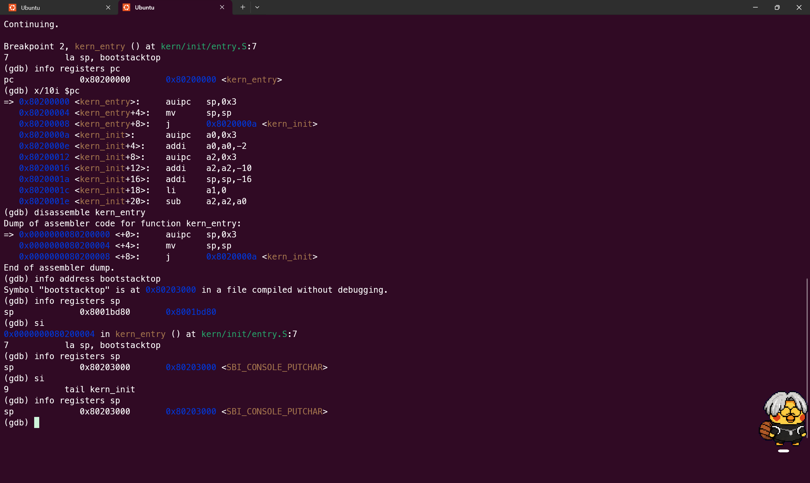
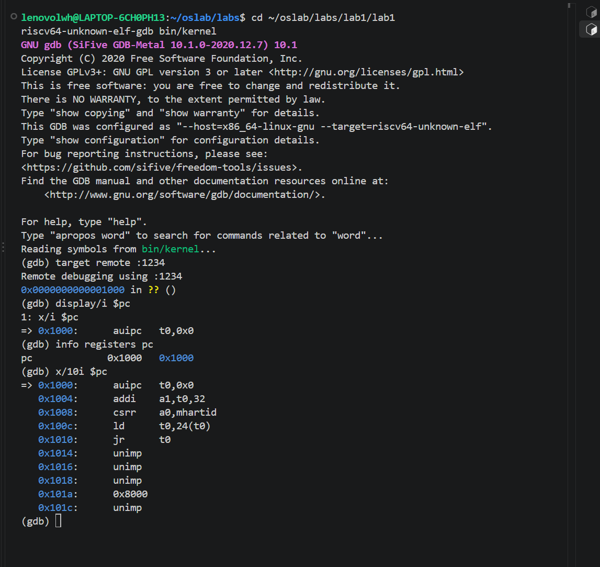
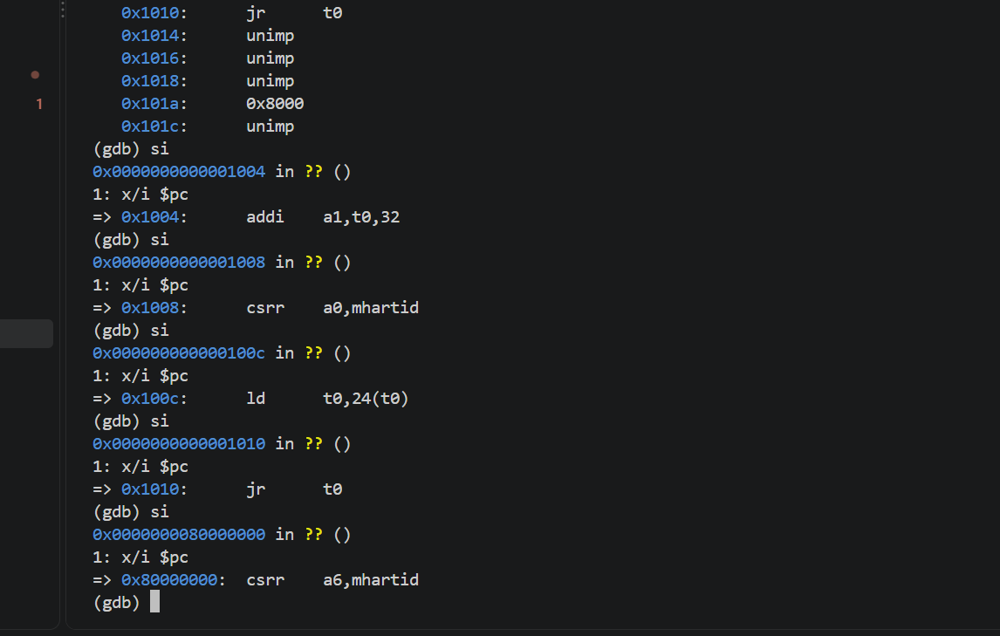
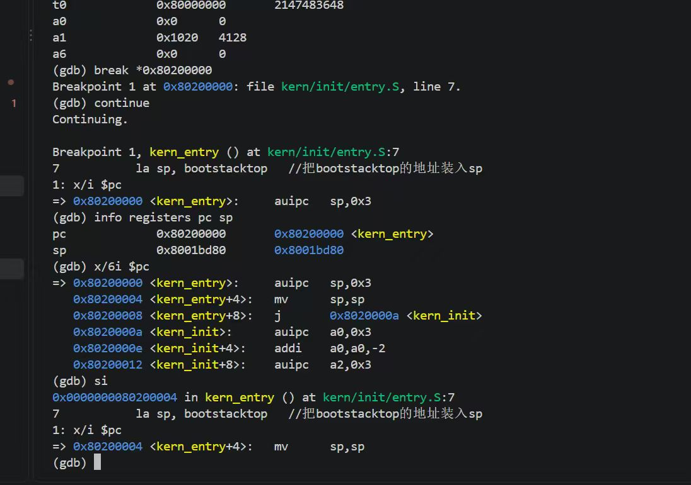
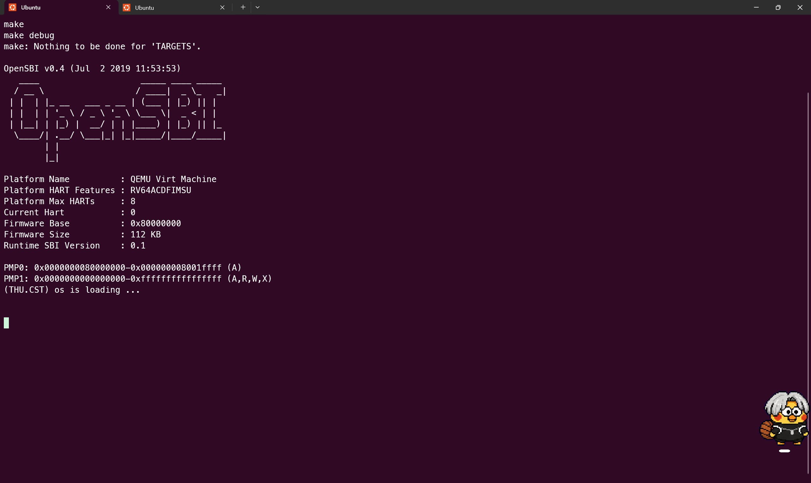
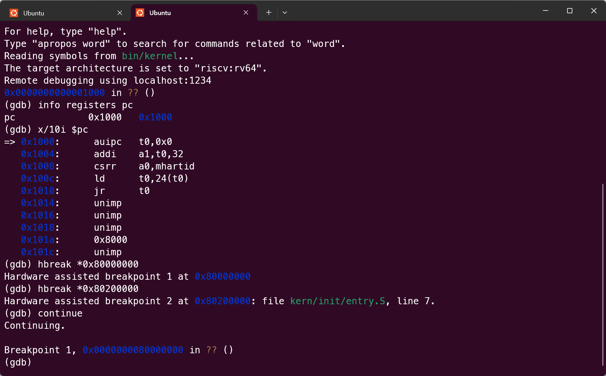
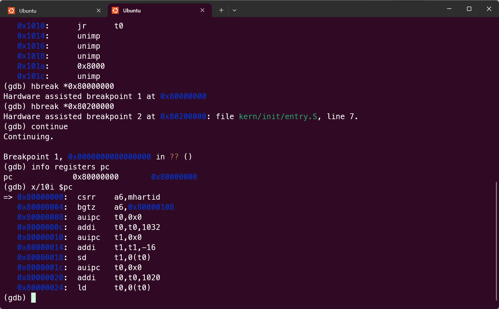
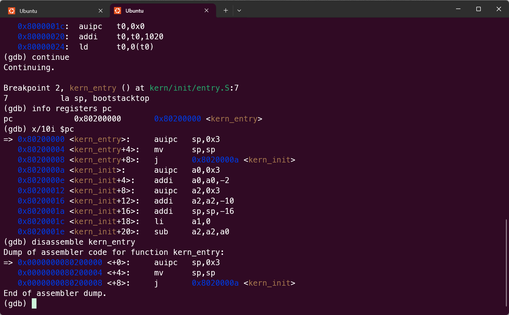
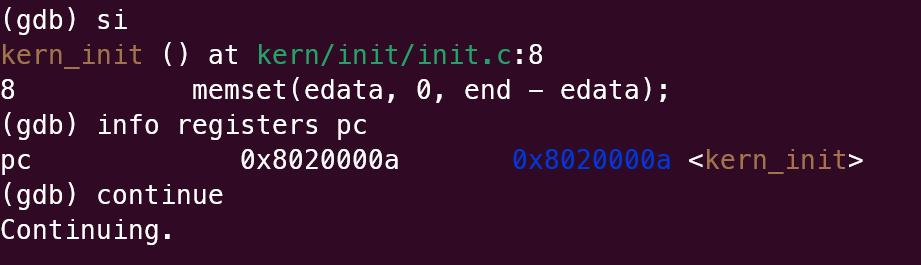

# 实验报告

## 实验基本信息

| 项目 | 内容 |
|------|------|
| **实验名称** | Lab 1：最小可执行内核与启动流程 |
| **小组成员** | 2514231李文浩 2510582田城昊 2511203严宗贺 |
| **完成日期** | 2026-10-09 |

### 小组分工

| 成员 | 负责的练习/模块 |
|------|----------------|
| 2510582田城昊 | 练习 1：理解内核启动中的程序入口操作 |
| 2514231李文浩 | 练习 2：使用 GDB 验证启动流程 |
| 2511203严宗贺 | 复核启动流程、整理测试证据与实验总结 |

---

## 一、实验目的

本实验的主要目的是：

1. 理解 QEMU 模拟的 RISC-V 计算机从加电复位到执行 uCore 内核的完整启动流程。
2. 理解链接脚本如何组织内核的内存布局，并将内核入口安排在 `0x80200000`。
3. 理解 `kern/init/entry.S` 如何建立内核栈并把控制权交给 C 语言入口 `kern_init()`。
4. 掌握使用 QEMU 和 GDB 远程调试 RISC-V 内核的基本方法。
5. 理解 OpenSBI 在硬件初始化、内核加载和 SBI 服务提供方面的作用。
6. 学习使用 AI 辅助开发操作系统核心功能

---

## 二、实验环境

| 成员 | AI 编程工具 | 底层模型 | 备注 |
|------|------------|---------|------|
| 2510582 田城昊 | Codex | GPT-5.6 Sol |  |
| 2511203 严宗贺 | DeepSeek | v4flash | |
| 2514231 李文浩 | ChatGPT | GPT-6.1 Sol | |


---

## 三、实验整体逻辑分析

### 3.1 本章节的逻辑主线

Lab 1 围绕“如何让一个最小的 uCore 内核在 QEMU 模拟的 RISC-V 计算机上运行”展开。实验从硬件复位地址出发，依次分析 QEMU 内置复位代码、OpenSBI 固件、内核镜像加载、汇编入口和 C 语言初始化函数之间的控制权交接，并通过 GDB 观察实际执行过程。

其完整执行链为：

```text
加电复位
  -> CPU 从 0x1000 执行 MROM 复位代码
  -> 跳转到 0x80000000 执行 OpenSBI
  -> OpenSBI 初始化运行环境并准备内核
  -> 跳转到 0x80200000 执行 kern/init/entry.S
  -> 设置内核栈
  -> 跳转到 kern_init()
  -> 通过 SBI 服务输出启动信息
```

### 3.2 功能的逐步实现

1. 首先通过链接脚本确定内核各段的布局和入口地址，使内核第一条指令位于 OpenSBI 约定的 `0x80200000`。
2. 随后由 `entry.S` 建立内核栈，为执行遵循 RISC-V 调用约定的 C 函数准备运行环境。
3. 汇编入口通过尾调用把控制权交给 `kern_init()`，进入主要的内核初始化逻辑。
4. `kern_init()` 使用封装后的 SBI 控制台服务输出信息，验证最小内核已经成功运行。
5. 最后使用 GDB 从复位地址开始跟踪，验证上述地址、指令和控制权交接过程与理论分析一致。

---

## 四、实验内容与分析

### 练习 1：理解内核启动中的程序入口操作

**负责人：** 2510582田城昊

#### `la sp, bootstacktop` 完成的操作和目的

`la sp, bootstacktop` 是一条加载地址的伪指令。汇编器会把它展开为能够将符号 `bootstacktop` 地址写入寄存器 `sp` 的实际指令序列。

`sp` 是 RISC-V ABI 规定的栈指针寄存器，而 `bootstacktop` 表示启动阶段预留的内核栈顶部。因此，这条指令完成的是内核初始栈指针的建立。其目的包括：

1. 为后续 C 函数调用提供有效的栈空间。
2. 支持保存返回地址、被调用者保存寄存器和局部变量。
3. 使后续代码能够按照 RISC-V ABI 的约定进入 `kern_init()`。

栈通常从高地址向低地址增长，因此应把 `sp` 初始化为预留栈区的顶部，而不是底部。此时还没有普通操作系统为内核自动准备运行栈，所以该初始化是从汇编入口进入 C 代码之前的必要步骤。

#### `tail kern_init` 完成的操作和目的

`tail kern_init` 是尾调用伪指令。它把程序计数器转移到 `kern_init()`，同时不为当前入口代码保留常规函数返回所需的返回地址。其效果可以理解为入口代码完成自身使命后，直接把后续执行交给 `kern_init()`。

使用尾调用的原因是 `entry.S` 只负责建立最基本的 C 语言运行环境，之后通常不需要返回到该入口。这样既符合启动流程的单向控制权交接，也避免建立没有实际用途的返回链。如果 `kern_init()` 意外返回，框架通常会进入停机或死循环逻辑，而不是继续执行不存在的调用者代码。

实际反汇编显示，`la sp, bootstacktop` 被展开为位于 `0x80200000` 和 `0x80200004` 的两条机器指令，而 `tail kern_init` 被展开为跳往 `0x8020000a <kern_init>` 的无返回跳转。单步执行前 `sp` 为 `0x8001bd80`，执行栈初始化指令后变为 `0x80203000`，与 GDB 查询到的 `bootstacktop` 地址一致。



### 练习 2：使用 GDB 验证启动流程

**负责人：** 2514231李文浩

#### 调试过程

1. 在第一个终端进入 Lab 1 工程目录，启动等待 GDB 连接的 QEMU：

   ```bash
   cd ~/oslab/labs/lab1/lab1
   make debug
   ```

   `make debug` 会让 QEMU 使用 `-S` 参数暂停 CPU，并使用 `-s` 参数在 `1234` 端口等待 GDB 连接。

2. 在第二个终端进入同一目录，使用实验工具链提供的 RISC-V GDB 加载内核符号并连接 QEMU：

   ```bash
   cd ~/oslab/labs/lab1/lab1
   riscv64-unknown-elf-gdb bin/kernel
   ```

   ```gdb
   target remote :1234
   ```

3. 连接后设置自动显示当前指令，并检查程序计数器和复位地址附近的指令：

   ```gdb
   display/i $pc
   info registers pc
   x/10i $pc
   ```

4. 连续执行五次单步指令，使 CPU 从复位代码跳转到 OpenSBI，并查看关键寄存器：

   ```gdb
   si
   si
   si
   si
   si
   info registers t0 a0 a1 a6
   ```

5. 在 uCore 内核入口 `0x80200000` 设置断点并继续运行：

   ```gdb
   break *0x80200000
   continue
   ```

6. 到达内核入口后检查 `pc`、`sp` 和入口附近的指令，再单步执行 uCore 的第一条指令：

   ```gdb
   info registers pc sp
   x/6i $pc
   si
   info registers pc
   ```

#### 观察结果

GDB 连接 QEMU 后，PC 位于复位地址 `0x1000`，附近的指令为：

```text
0x1000: auipc t0,0x0
0x1004: addi  a1,t0,32
0x1008: csrr  a0,mhartid
0x100c: ld    t0,24(t0)
0x1010: jr    t0
```

其中 `auipc` 和 `addi` 构造启动参数地址，`csrr` 读取当前 Hart 编号，`ld` 取出下一阶段入口地址，最后由 `jr t0` 完成跳转。



连续执行五次 `si` 后，PC 从 `0x1000` 移动到 `0x80000000`，当前指令变为 `csrr a6,mhartid`，说明复位代码已经把控制权交给 OpenSBI。



在 `0x80200000` 设置断点并继续运行后，GDB 停在 `kern/init/entry.S:7` 的 `kern_entry`，此时 `pc = 0x80200000`，说明 OpenSBI 已经把控制权交给 uCore。入口附近的实际指令为：

```text
0x80200000 <kern_entry>:   auipc sp,0x3
0x80200004 <kern_entry+4>: mv    sp,sp
0x80200008 <kern_entry+8>: j     0x8020000a <kern_init>
```

源代码中的 `la sp, bootstacktop` 是伪指令，被汇编器展开成 `auipc` 和 `addi`。这里第二条显示为 `mv sp,sp`，是因为对应的 `addi` 立即数为 `0`。执行一次 `si` 后，PC 从 `0x80200000` 变为 `0x80200004`，证明 uCore 内核的第一条指令已经执行。



#### 问题回答

RISC-V 虚拟机加电后，CPU 首先从复位地址 `0x1000` 取指。这里是 QEMU 提供的少量 MROM 复位代码，它读取 Hart ID 和下一阶段入口地址，然后跳转到 `0x80000000`。该地址是 OpenSBI 固件的入口，OpenSBI 运行在 M 模式，完成底层固件初始化并为内核提供 SBI 服务。

实验使用的 QEMU 启动参数已经把 uCore 内核镜像加载到 `0x80200000`。OpenSBI 完成初始化后跳转到这个地址，CPU 开始执行 `kern_entry`，随后设置内核栈并转入 `kern_init()`。本次调试依次观察到 `0x1000`、`0x80000000` 和 `0x80200000`，并单步执行了 `0x80200000` 处的第一条指令，因此验证了“复位代码 -> OpenSBI -> uCore 内核”的完整启动链。

---

## 五、测试与验证

Lab 1 主要验证内核能否正常启动，课程答疑说明以 `make qemu` 能够正常运行为主要验收依据。

### 5.1 `make qemu` 运行验证

```text
OpenSBI v0.4 (Jul  2 2019 11:53:53)
Platform Name          : QEMU Virt Machine
Platform HART Features : RV64ACDFIMSU
Current Hart           : 0
Firmware Base          : 0x80000000
Runtime SBI Version    : 0.1
(THU.CST) os is loading ...
```



### 5.2 GDB 启动流程验证










截图只需由一名成员提交，但各成员均应在自己的环境中完成并熟悉实验过程。

---

## 六、实验总结与收获

### 6.1 对操作系统的理解

1. 通过本次实验，我们了解了一个最小操作系统的启动过程。CPU 加电后先从 `0x1000` 开始执行，然后进入位于 `0x80000000` 的 OpenSBI，最后跳转到 `0x80200000` 执行 uCore 内核。我们也理解了链接脚本、内核入口和栈初始化在启动过程中的作用。

2. 本实验主要关注内核的启动，还没有涉及中断、虚拟内存、进程调度和文件系统等内容。这些也是操作系统的重要组成部分，需要在后续实验中继续学习。

### 6.2 AI 协作开发的经验

本次实验没有代码填空，AI 主要帮助我们理解启动流程、解释汇编指令和整理 GDB 调试步骤。不过 AI 给出的内容不能直接当作实验结果，寄存器地址、指令和运行输出仍然需要我们自己实际调试确认。通过这次实验，我们认识到使用 AI 时既要参考它的分析，也要结合源码和真实运行结果进行判断。
