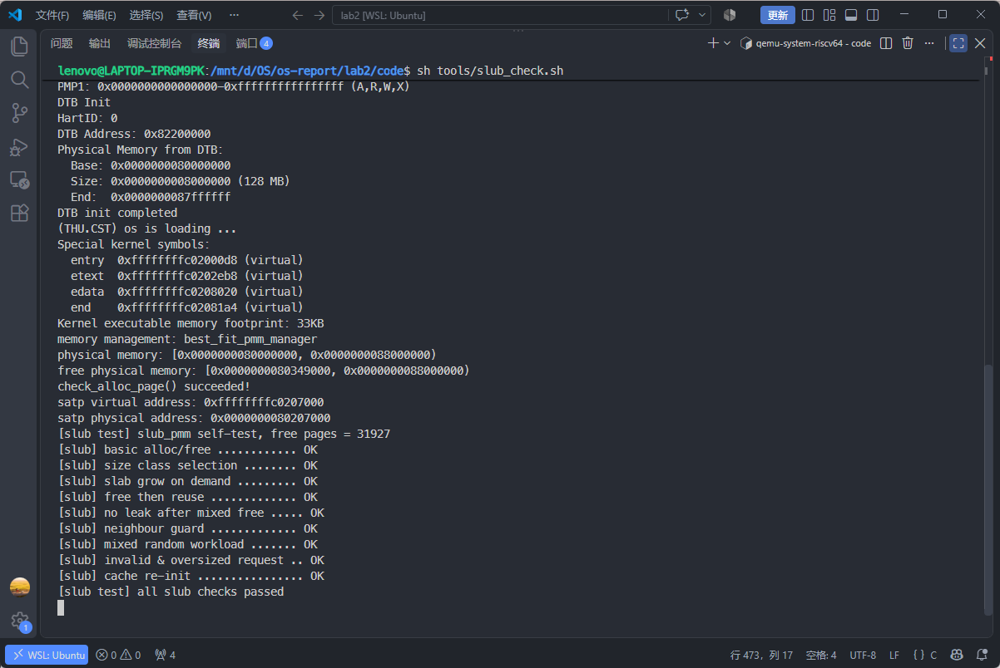
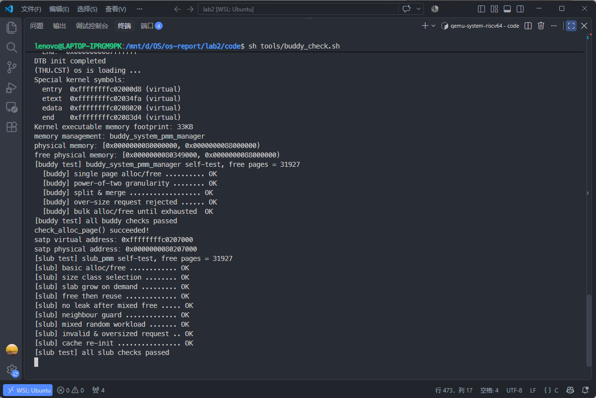
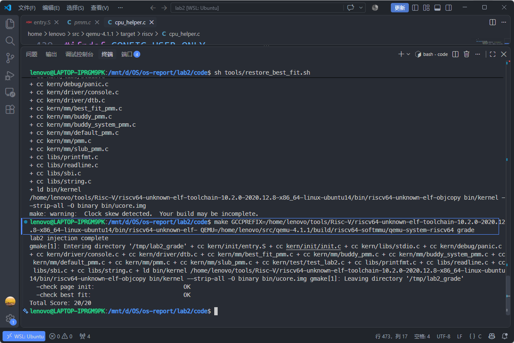

# Buddy 与 SLUB 测试说明

## 实现

Buddy 按阶维护空闲块链表，分配时向上取整到 2 的幂，释放时查找同阶伙伴并尝试合并。默认使用 Best-Fit，单独测试 Buddy 时通过 `LAB2_VERIFY_BUDDY_PMM` 切换。

SLUB 在页分配器之上设置九个对象档位，最大档位为 2048 字节；更大的请求直接申请连续页。页首预留 64 字节存放元数据，RV64 下 `struct slub_slab` 占 40 字节。大对象分配在计算头部和页对齐大小前检查整数溢出，无法表示的请求返回 `NULL`。

空闲对象链的摘取和插入为 O(1)。分配时需要查找有空闲对象的 slab，释放时需要扫描 cache/slab 确认归属，因此整个分配和释放过程并非 O(1)。

## 测试范围与限制

- Buddy 的五个用例覆盖单页分配回收、非 2 的幂请求、分裂后伙伴回收、超量请求与单块上限判定、固定大块分配失败。每轮检查空闲页数及链表中各块的页数之和。
- `buddy_split_merge_check` 借走现成的 0 阶块，记录各阶空闲块数，分配 1 页后检查伙伴块所在链表及大小，释放后检查计数恢复。该用例检查分裂后的伙伴块及释放后的各阶块数恢复，但没有保证分裂起始阶至少为 2，不能据此证明连续多级合并。4096 页分配失败只表示该尺寸无法继续分配，不表示全部单页已用尽。
- 单块上限分支在本机无法由公共接口触发（可用页数约 3.2 万 < 2^19 页，超上限请求一定同时超 `nr_free`）。实现把"阶换算 + 是否超上限"抽成 `buddy_order_for_request()`，测试直接断言它：2^19 页合法、(2^19)+1 页判为超限；公共接口对超上限请求返回 `NULL` 且状态不变。
- Buddy 释放接口要求合法块头和原请求长度，不支持任意指针、重复释放或任意错误长度。
- SLUB 的九个用例覆盖基本分配回收、档位选择、slab 扩容、空闲对象复用、混合回收、相邻对象检查、伪随机负载、非法尺寸和空 cache 重建。边界测试包含 2048/2049 字节切换、`SIZE_MAX` 附近请求和 `free(NULL)`。
- `slub_guard_check` 写满合法对象范围后，检查相邻对象的一个机器字和元数据 canary。它不是主动越界写测试，也不提供通用的越界检测。
- SLUB 混合测试分两段。第一段固定覆盖：八个槽位各放一个对象、六种尺寸（8/100/600/2049/5000/12）轮流使用，并用 `size_hit[]`、`slot_hit[]` 断言每个尺寸与每个槽位都被用到，覆盖不再依赖随机数的运气。第二段 200 步随机负载：每步只取一次随机数，槽位与尺寸取自它的不同位段，避免早期"连续两次取模"造成的低位关联。两段在分配与释放之后都检查 `slub_structure_ok()` 与"已用对象数 == 现场 slab 对象数"。
- SLUB 不支持非法指针和重复释放。对不属于 slab 的指针，代码会读取大对象头部；非法指针可能先触发访问异常，不能保证被 magic 断言拦截。
- `slub_init()` 只能在没有存活对象时重新调用。当前实现没有并发、抢占或 SMP 支持。

## 新版在 QEMU 4.1.1 下的测试结果

使用课程裸机 GCC 10.2.0，在 VS Code 的 WSL 终端运行：

| 配置 | 结果 | 初始空闲页数 |
| --- | --- | --- |
| Best-Fit + SLUB | SLUB 九项通过 | 31927 |
| Buddy + SLUB | Buddy 五项、SLUB 九项通过 | 31927 |

执行 `tools/restore_best_fit.sh` 恢复默认 Best-Fit 后，课程 `make grade` 的 Page Init 和 Best-Fit 均为 OK，总分 20/20。

