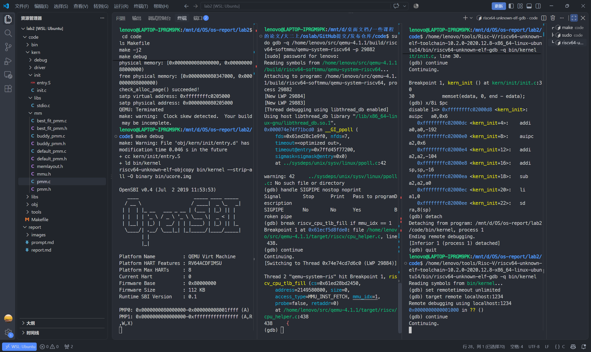
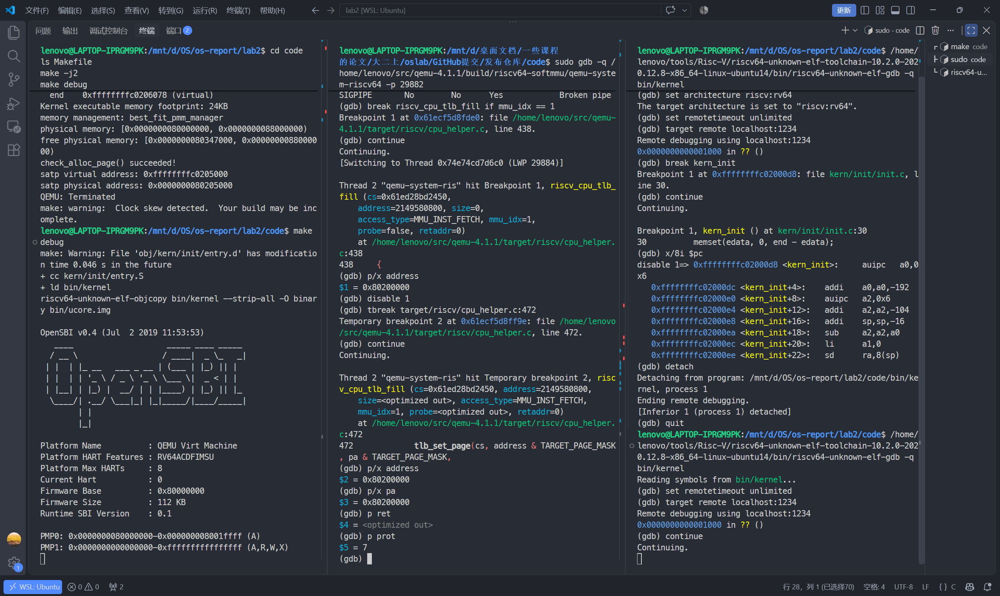
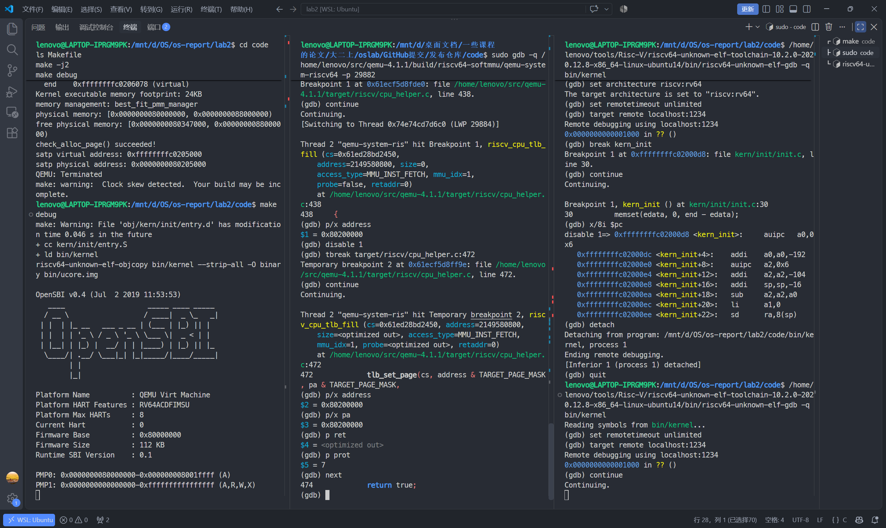
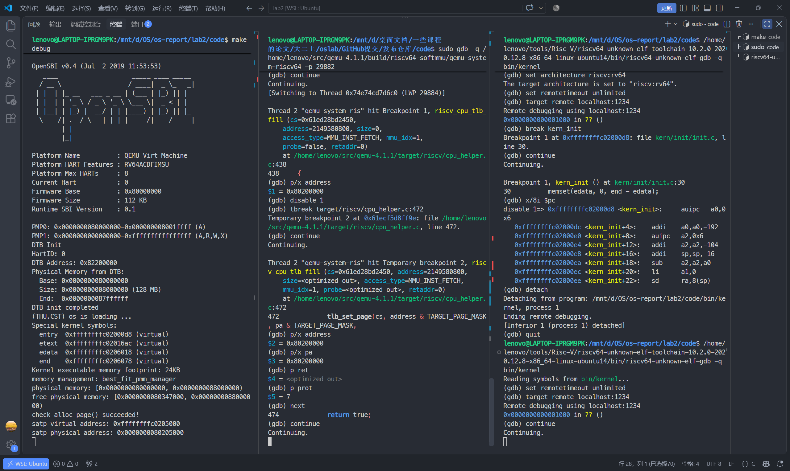
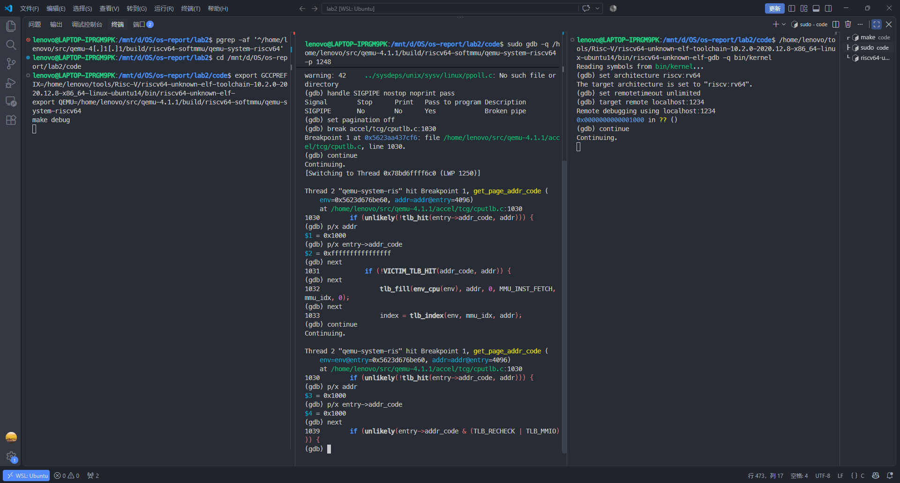

# Lab2 分支任务：TLB 填入与命中的逐步说明

实验记录：2510582 田城昊。环境：WSL Ubuntu、QEMU 4.1.1、宿主机 GDB、RISC-V 工具链 GDB。

## 1. 实验目的

通过双 GDB 调试 QEMU，观察 CPU 取指时 TLB 的填入和命中过程。

地址翻译完成后，QEMU 调用 `tlb_set_page()`，将地址映射和访问权限填入软件 TLB。后续取指时，通过 `tlb_hit()` 检查是否已有对应映射；命中后可跳过缺失处理分支，继续访问内存。

实验分为两部分：

1. 在 `riscv_cpu_tlb_fill()` 中设置断点，查看翻译结果，并单步执行 `tlb_set_page()`，观察映射的填入过程。
2. 在 `get_page_addr_code()` 中设置断点，观察 `tlb_hit()` 的判断结果和后续执行路径。

这里的“写回”指地址映射的回填（refill），不涉及缓存数据写回内存。

## 2. 调试终端分工

| 位置 | 运行内容 | 调试／观察对象 | 作用 |
| --- | --- | --- | --- |
| 左边 | `make debug` | QEMU 中运行的 uCore | 启动模拟机并显示 OpenSBI、内核输出 |
| 中间 | 宿主机 `sudo gdb` | Linux 上的 QEMU 进程 | 查看 QEMU 如何翻译地址、查询和填入软件 TLB |
| 右边 | `riscv64-unknown-elf-gdb` | QEMU 中的 RISC-V 内核 | 控制内核断点、继续运行和逐条执行指令 |

右边让模拟 CPU 执行指令，中间观察 QEMU 为执行这些指令所做的工作。两边的 `continue` 继续的是不同调试对象，通常需要配合使用。

中间暂停 QEMU 进程时，右边可能仍显示 `Continuing.` 或等待远程响应。这时先处理中间的 `(gdb)`，让 QEMU 继续运行；不要往没有提示符的终端连续粘贴命令。

## 3. 地址和术语

| 名称 | 含义 | 本次记录 |
| --- | --- | --- |
| 客体访问地址 `address`／`addr` | 模拟的 RISC-V CPU 要访问的地址；分页开启时按虚拟地址翻译 | 填入截图中为 `0x80200000` |
| 客体物理地址 `pa` | 翻译得到的模拟机物理内存地址 | 填入截图中为 `0x80200000` |
| 宿主地址 | QEMU 进程在 Linux 中使用的地址 | 中间 GDB 的 QEMU 函数地址属于这一类 |
| `entry->addr_code` | 软件 TLB 中供取指查询使用的标记字段，可能含状态位 | 不能直接当作物理地址解释 |
| `MMU_INST_FETCH` | 本次访问是读取指令 | 截图中已显示 |
| `mmu_idx = 1` | 本次访问使用的 MMU 上下文索引；该 RISC-V 路径对应 S 模式上下文 | 不能仅凭它判断分页已经开启 |
| `prot = 7` | QEMU 的读、写、执行权限位之和：`1 + 2 + 4` | 不是 RISC-V 页表项原始数值 |

此次启动早期捕获的是低地址 `0x80200000 → 0x80200000`。地址相同也可以进行 TLB 填入；仅凭相同地址不能断言执行了 Sv39 页表遍历。

此前另一次调试观察到高地址 `0xffffffffc0200000 → 0x80200000`，但调用来自 GDB stub 的调试内存读取。它可以说明地址翻译结果，不能代替本次 CPU TLB 填入／命中证据。

## 4. 启动调试环境

以下命令按终端分开执行。GDB 中每执行一条命令，等待提示符或断点输出后再进行下一步。

### 4.1 左边：在代码目录启动 QEMU

代码目录为 `/mnt/d/OS/os-report/lab2/code`。左边运行的内核与右边加载的 `bin/kernel` 必须来自同一次构建；中间 GDB 的当前目录不决定 QEMU 使用哪份内核。

```bash
# 进入含 Makefile 的代码目录；lab2 外层只有 code/report，不能直接 make debug。
cd /mnt/d/OS/os-report/lab2/code

# 使用课程的裸机 RISC-V 编译工具链。
# 注意：Makefile 内部对 GCCPREFIX 有赋值，所以必须用命令行变量传入，
# 只 export 而不在命令行给出会被 Makefile 的赋值覆盖掉。
export GCCPREFIX=/home/lenovo/tools/Risc-V/riscv64-unknown-elf-toolchain-10.2.0-2020.12.8-x86_64-linux-ubuntu14/bin/riscv64-unknown-elf-

# 使用带调试符号、与下面源码行号对应的 QEMU 4.1.1。
export QEMU=/home/lenovo/src/qemu-4.1.1/build/riscv64-softmmu/qemu-system-riscv64

# 构建内核（GCCPREFIX/QEMU 都以命令行变量形式传入，避免被 Makefile 覆盖）。
make GCCPREFIX="$GCCPREFIX" QEMU="$QEMU" -j2

# 启动 QEMU；Makefile 中 -s 提供默认 1234 调试端口，-S 暂停客体 CPU。
make GCCPREFIX="$GCCPREFIX" QEMU="$QEMU" debug
```

左边不返回 shell 提示符是正常的，因为 QEMU 正在前台运行。

### 4.2 中间：附加 QEMU 进程

```bash
# 列出 QEMU 的 PID 和命令行。每次启动 PID 都会变化。
pgrep -af '^/home/lenovo/src/qemu-4[.]1[.]1/build/riscv64-softmmu/qemu-system-riscv64'
```

确认该命令行包含本次运行的 `bin/ucore.img`、`-s -S`，再附加。多个 QEMU 同时存在时，应先确认目标，不任取一个 PID。

```bash
# 29882 只是历史截图中的 PID，复现时替换为刚查到的 QEMU PID。
sudo gdb -q /home/lenovo/src/qemu-4.1.1/build/riscv64-softmmu/qemu-system-riscv64 -p 29882
```

附加后，中间出现 `(gdb)`。不要附加 QEMU 的父进程 `make`；之前误附加父进程会看到 `/usr/bin/make` 与可执行文件不匹配。

下面每个代码块都只在指定的 GDB 中输入：

```gdb
# 中间：SIGPIPE 不作为本次观察的停点，仍把信号传给程序。
handle SIGPIPE nostop noprint pass

# 中间：关闭长输出分页，方便查看调用栈。
set pagination off

# 中间：捕获 S 模式上下文中的 CPU TLB 填入。
break riscv_cpu_tlb_fill if mmu_idx == 1

# 中间：恢复 QEMU 宿主进程，等待右边启动客体 CPU。
continue
```

### 4.3 右边：连接模拟的 RISC-V CPU

```bash
# 与左边使用同一代码目录。
cd /mnt/d/OS/os-report/lab2/code

# 读取本次构建的内核符号；这里使用 RISC-V GDB，而非宿主 GDB。
/home/lenovo/tools/Risc-V/riscv64-unknown-elf-toolchain-10.2.0-2020.12.8-x86_64-linux-ubuntu14/bin/riscv64-unknown-elf-gdb -q bin/kernel
```

```gdb
# 右边：指定模拟 CPU 的架构。
set architecture riscv:rv64

# 右边：中间的 Host GDB 可能长时间暂停 QEMU，取消远程等待超时。
set remotetimeout unlimited

# 右边：连接 QEMU 的客体调试端口。
target remote localhost:1234

# 右边：让客体 CPU 执行；中间设置的 TLB 断点可能先停住 QEMU。
continue
```

## 5. TLB 填入过程

### 5.1 CPU 进入填入函数

中间命中 `riscv_cpu_tlb_fill()`。历史截图显示：

```text
access_type = MMU_INST_FETCH
mmu_idx = 1
address = 2149580800
```

在中间输入：

```gdb
# 用十六进制查看本次 CPU 访问地址，便于和内存布局对照。
p/x address
```

结果为 `0x80200000`，即内核镜像的加载地址。`MMU_INST_FETCH` 说明这是 CPU 取指路径，而不是 GDB 为显示反汇编而读取内存的路径。



### 5.2 运行到填入调用之前

```gdb
# 中间：禁用刚才的入口断点，避免每次填入都停在函数开头。
# 1 是本次截图中的断点编号；有其他断点时先 info breakpoints 核对。
disable 1

# 中间：设置一次性断点，停在 tlb_set_page 调用处。
tbreak target/riscv/cpu_helper.c:472

# 中间：让 QEMU 先完成地址翻译和权限检查。
continue
```

在对应源码版本中，472 行是：

```c
/* QEMU riscv_cpu_tlb_fill() 中的填入分支。 */
if (ret == TRANSLATE_SUCCESS) {
    /* 将客体访问地址和物理地址分别按页对齐，缓存映射与访问权限。
     * mmu_idx 指定缓存所属 MMU 上下文；TARGET_PAGE_SIZE 是缓存页粒度。
     * QEMU 会更新内部 TLB 字段，并处理地址空间等细节。
     */
    tlb_set_page(cs, address & TARGET_PAGE_MASK, pa & TARGET_PAGE_MASK,
                 prot, mmu_idx, TARGET_PAGE_SIZE);
    return true; /* 填入成功，允许本次访问继续。 */
}
```

停在 472 行意味着这一行**还没有执行**。此时输入：

```gdb
# 客体访问地址。
p/x address

# 已经翻译得到的客体物理地址。
p/x pa

# 本次映射的访问权限。
p prot
```

截图结果是 `address = 0x80200000`、`pa = 0x80200000`、`prot = 7`。截图中的 `p ret` 显示 `<optimized out>`，表示优化后的程序无法在当前停点直接提供该变量，并不表示翻译失败。程序已经进入成功分支，是这里可用的控制流依据。



### 5.3 执行填入操作

```gdb
# 中间：执行当前 C 源码语句，跨过 tlb_set_page 函数调用。
next
```

执行后，程序从 472 行停到 474 行的 `return true;`，说明 `tlb_set_page()` 已执行并返回。



```gdb
# 中间：恢复 QEMU，让内核继续运行。
continue
```

左边随后输出内存信息和 `check_alloc_page() succeeded!`，内核初始化继续完成。TLB 是否命中，还需要观察下一节的查询分支。



## 6. TLB 命中过程

### 6.1 先停住客体，再设置宿主断点

本次从头启动 QEMU：左边执行 `make debug`，中间附加 QEMU 并在 1030 行设置断点，右边连接 `localhost:1234` 后继续运行，捕获到启动早期对 `0x1000` 的查询。若在内核运行后继续检查，可按下面的顺序暂停并设置断点。

1. 在右边点击终端并按 `Ctrl+C`，等待右边出现 `(gdb)`，暂停客体 CPU。若中间已经停住，应先让中间继续，才能处理右边的远程暂停请求。
2. 在中间按 `Ctrl+C`，等待中间出现 `(gdb)`，暂停 QEMU 进程以设置断点。
3. 在中间输入：

```gdb
# 捕获 QEMU 对取指地址的软件 TLB 查询。
break accel/tcg/cputlb.c:1030

# 恢复 QEMU；客体 CPU 此时仍由右边 GDB 暂停着。
continue
```

4. 在右边输入：

```gdb
# 查看客体下一条指令的地址，供解释访问地址时参考。
p/x $pc

# 让模拟的 RISC-V CPU 执行一条机器指令。
si
```

右边触发执行，中间才有机会观察相关取指处理。若已有翻译块被复用，一次 `si` 不保证经过 `get_page_addr_code()`；只有右边返回提示符后才能再次单步。没有命中此断点本身不能用来判断 TLB 命中或缺失。

### 6.2 查询代码逐句注释

文件：QEMU 4.1.1 的 `accel/tcg/cputlb.c`，函数 `get_page_addr_code()`。

```c
/* 选择当前取指访问使用的 MMU 上下文。 */
uintptr_t mmu_idx = cpu_mmu_index(env, true);

/* 根据客体地址找到软件 TLB 槽位。 */
uintptr_t index = tlb_index(env, mmu_idx, addr);
CPUTLBEntry *entry = tlb_entry(env, mmu_idx, addr);

/* 1030：tlb_hit 为真表示主 TLB 命中；前面的 ! 把结果取反。
 * 因此只有主 TLB 未命中才进入这个 if。
 * unlikely 只是编译器分支概率提示，不改变判断结果。
 */
if (unlikely(!tlb_hit(entry->addr_code, addr))) {
    /* 1031：主 TLB 未命中后，先尝试 victim TLB。 */
    if (!VICTIM_TLB_HIT(addr_code, addr)) {
        /* 1032：两处均未命中，才调用填入处理。 */
        tlb_fill(env_cpu(env), addr, 0, MMU_INST_FETCH, mmu_idx, 0);
        index = tlb_index(env, mmu_idx, addr);
        entry = tlb_entry(env, mmu_idx, addr);
    }
    /* 验证缺失处理后已有可用映射。 */
    assert(tlb_hit(entry->addr_code, addr));
}

/* 1039：检查是否需要重新校验或属于 MMIO 等特殊情况。
 * 主 TLB 命中后可以直接到达这里；缺失处理完成后也会到达这里。
 */
if (unlikely(entry->addr_code & (TLB_RECHECK | TLB_MMIO))) {
    return -1;
}
```

### 6.3 单步检查命中分支

中间停在 1030 行时，逐条输入：

```gdb
# 记录这一次查询的客体地址，不沿用前一张图的地址。
p/x addr

# 查看取指 TLB 标记；其中可能包含状态位，不是物理地址。
p/x entry->addr_code

# 显示当前判断附近的源码。
list

# 执行当前判断并观察接下来进入哪一条源码路径。
next
```

| 观察结果 | 判断 |
| --- | --- |
| 从 1030 行直接到 1039 行，跳过 1031—1036 | `!tlb_hit(...)` 为假，主软件 TLB 命中 |
| 从 1030 行进入 1031 行 | 主 TLB 未命中，正在尝试 victim TLB |
| 继续进入 1032 行的 `tlb_fill()` | 主 TLB 和 victim TLB 均未命中，需要填入 |

判断命中时，需要观察程序是否从 1030 行直接跳过缺失分支。单独停在 1039 行不能说明命中，因为缺失处理完成后也会到达这里。若源码单步受编译优化影响，可结合 `list` 和 `step` 检查执行路径。

### 6.4 实际记录：首次缺失，随后命中

重新启动后，第一次在 1030 行停下时的输出为：

```text
(gdb) p/x addr
$1 = 0x1000
(gdb) p/x entry->addr_code
$2 = 0xffffffffffffffff
(gdb) next
1031    if (!VICTIM_TLB_HIT(addr_code, addr)) {
(gdb) next
1032        tlb_fill(env_cpu(env), addr, 0, MMU_INST_FETCH, mmu_idx, 0);
(gdb) next
1033        index = tlb_index(env, mmu_idx, addr);
```

此时 TLB 标记为全 1，未命中主 TLB；程序继续进入 1032 行，说明 victim TLB 也没有提供该映射。再次执行 `next` 后停在 1033 行，`tlb_fill()` 已执行并返回。

在中间执行 `continue`，再次命中 1030 行断点后，逐条输入 `p/x addr`、`p/x entry->addr_code`、`next`，得到：

```text
1030    if (unlikely(!tlb_hit(entry->addr_code, addr))) {
(gdb) p/x addr
$3 = 0x1000
(gdb) p/x entry->addr_code
$4 = 0x1000
(gdb) next
1039    if (unlikely(entry->addr_code & (TLB_RECHECK | TLB_MMIO))) {
```

第二次查询的地址仍为 `0x1000`，取指 TLB 标记也变为 `0x1000`。单步后直接到达 1039 行，跳过 1031—1036 行，因此这一次主软件 TLB 命中。



图 5 对应启动早期的 `0x1000` 取指访问。第 5 节的 `0x80200000` 填入来自另一次运行；两段记录分别展示填入调用和查询分支。`0x1000` 不是 uCore 的高半虚拟地址，此处也没有记录 Sv39 页表遍历。

## 7. 关键断点位置

填入和查询位于不同的源文件中，各断点的作用如下：

| 文件和位置 | 在做什么 |
| --- | --- |
| `target/riscv/cpu_helper.c:472` | 通过 `tlb_set_page()` 填入地址映射 |
| `target/riscv/cpu_helper.c:474` | 填入完成后返回成功 |
| `accel/tcg/cputlb.c:1030` | 查询取指地址是否命中主软件 TLB |
| `accel/tcg/cputlb.c:1039` | 查询／缺失处理后检查特殊标志 |

本实验分别观察填入与查询过程。要进一步确认命中的是前面填入的同一映射，还需核对两次访问的地址、MMU 上下文，以及中间是否发生 TLB 失效。

## 8. 常用指令速查

| 指令 | 含义 | 在哪里用 |
| --- | --- | --- |
| `p/x address` | 打印变量值，按十六进制显示；`p` 为 print，`x` 为 hexadecimal | 中间填入函数 |
| `p/x addr` | 打印查询地址，按十六进制显示 | 中间查询函数 |
| `p prot` | 按默认格式打印权限值 | 中间 |
| `p/x $pc` | 打印当前被调试 CPU 的程序计数器 | 右边观察 RISC-V CPU |
| `x/8i $pc` | 从 PC 开始反汇编 8 条指令；这里 `x` 是 examine，与 `p/x` 的格式修饰不同 | 右边 |
| `si` | 执行一条机器指令 | 右边控制客体 CPU |
| `next`／`n` | 按 C 源码单步，通常跨过函数调用 | 中间观察 QEMU |
| `step`／`s` | 源码单步，通常进入函数调用 | 中间 |
| `finish` | 运行至当前函数返回 | 中间 |
| `continue`／`c` | 继续当前被调试程序，直到断点或中断 | 两边作用对象不同 |
| `bt` | 查看调用栈，确认从哪条路径进入函数 | 中间 |
| `info breakpoints` | 查看断点编号、位置、是否启用 | 两边各自维护断点 |
| `disable 编号` | 禁用本 GDB 中指定断点 | 两边各自生效 |

`$1`、`$2` 等是 GDB 的打印结果历史编号，不是程序变量名。

## 9. 退出调试

为避免客体远程调试等待被暂停的 QEMU，应按顺序退出：

1. 中间若停在断点，先 `disable breakpoints` 禁用断点，再 `continue`，让 QEMU 能处理右边请求。
2. 右边按 `Ctrl+C` 等待提示符，执行 `detach`，再执行 `quit`，退出客体 GDB。
3. 中间按 `Ctrl+C` 等待提示符，执行 `detach`，再执行 `quit`，退出宿主 GDB。
4. 在左边 QEMU 串口终端按 `Ctrl+A`，松开后再按 `X`，退出 `-nographic` QEMU。

不要继续使用历史 PID 去杀进程。若必须从其他终端结束 QEMU，应重新核对 PID 和命令行。

## 10. 调试结果

在 CPU 取指触发的填入过程中，观察到访问地址和物理地址均为 `0x80200000`，访问权限 `prot` 为 7。执行 `next` 后，程序从 `tlb_set_page()` 调用处运行到 `return true;`，完成本次 TLB 填入。恢复 QEMU 后，内核继续完成初始化。

命中检查位于 `get_page_addr_code()`。补充调试记录中，首次查询 `0x1000` 时进入缺失处理并执行 `tlb_fill()`；再次查询 `0x1000` 时，`entry->addr_code` 为 `0x1000`，程序从 1030 行直接运行到 1039 行，跳过缺失处理分支，观察到主软件 TLB 命中。

## 11. 截图目录

| 图片 | 内容 |
| --- | --- |
| 图1 | CPU 取指进入 `riscv_cpu_tlb_fill()` |
| 图2 | 到达填入调用前，`address = pa = 0x80200000`，`prot = 7` |
| 图3 | `next` 跨过填入调用，到达 `return true` |
| 图4 | 恢复 QEMU 后内核继续完成初始化 |
| 图5 | `0x1000` 首次访问缺失并填入，随后查询从 1030 行直接到 1039 行，主软件 TLB 命中 |

以上截图保存在 `images/TLB/`。文中的源码摘录来自 QEMU 4.1.1，注释用于说明调试过程。
