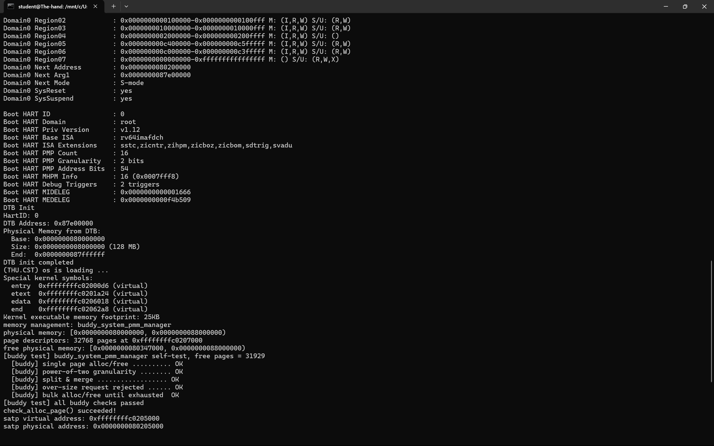

# 实验报告

## 实验基本信息

| 项目         | 内容                                                  |
| ------------ | ----------------------------------------------------- |
| **实验名称** | Lab 2：物理内存和页表                                 |
| **小组成员** | 2514231 李文浩、2511203 严宗贺、2510582 田城昊              |
| **完成日期** | 2026-10-25                                            |

### 小组分工

| 成员               | 负责的练习/模块                                                                                |
| ------------------ | ---------------------------------------------------------------------------------------------- |
| `[2510582 田城昊]` | 功能模块一任务一：物理内存探测与页描述符初始化；扩展 Challenge：硬件可用物理内存范围的获取方法 |
| `[2514231 李文浩]` | 功能模块二：物理内存分配功能 任务一：理解first-fit 连续物理内存分配算法  任务二：实现 Best-Fit 连续物理内存分配算法        |
| `[2511203 严宗贺]` | 功能模块二任务三：buddy system（伙伴系统）分配算法；三、实验整体逻辑分析（模块二与观察视角） |

---

## 一、实验目的

本实验的主要目的是：

1. 理解 RISC-V 内核从设备树获得物理内存布局的方法，掌握物理地址、内核虚拟地址、物理页号和 `struct Page *` 之间的关系。
2. 掌握以页为单位管理物理内存的方法，正确排除 OpenSBI、内核镜像、页表和页描述符数组占用的空间。
3. 理解 `page_init()` 如何把安全的完整空闲页注册给统一的物理内存管理器接口。
4. 理解页面分配算法的实现方式：在 First-Fit 的基础上实现 Best-Fit，并独立设计 Buddy System 的块组织方式、分裂与伙伴合并过程。
5. 按照 Lab0.5 的 `[PROMPT] / [RELY] / [GUARANTEE] / [SPECIFICATION]` 结构设计提示词，使用 AI 辅助实现、审查和验证内核功能。

---

## 二、实验环境

| 项目        | 配置                                          |
| ----------- | --------------------------------------------- |
| 宿主系统    | Windows + WSL Ubuntu                          |
| 源码编辑    | VS Code / Codex 桌面应用                      |
| AI 编程工具 | Codex                                         |
| 底层模型    | OpenAI GPT-5 系列（以客户端实际显示版本为准） |
| 交叉编译器  | `riscv64-unknown-elf-gcc 10.2.0`              |
| 模拟器      | QEMU 4.1.1，RISC-V `virt` 平台                |
| 固件        | OpenSBI                                       |
| 构建工具    | GNU Make                                      |

AI 工具使用情况：

| 成员               | AI 编程工具    | 底层模型          | 备注                                             |
| ------------------ | -------------- | ----------------- | ------------------------------------------------ |
| `[2510582-田城昊]` | Codex 桌面应用 | OpenAI GPT-5 系列 | 用于阅读实验文档、设计提示词、实现审查和环境排错 |
| `[2514231-李文浩]` | opencode | DeepSeek v4.1flash   |  用于代码讲解、提示词设计与实现复核以及代码功能补全                                      |
| `[2511203-严宗贺]` | DeepSeek Harness | DeepSeek-V4-Flash | 用于整体逻辑梳理、提示词编写、Buddy 模块实现与自测设计 |

本实验实际使用的关键路径如下：

```bash
export LAB2_DIR='/mnt/d/桌面文档/一些课程的论文/大二上/oslab/lab2_new'
export RISCV_PREFIX='/home/lenovo/tools/Risc-V/riscv64-unknown-elf-toolchain-10.2.0-2020.12.8-x86_64-linux-ubuntu14/bin/riscv64-unknown-elf-'
export QEMU_411='/home/lenovo/.local/qemu-4.1.1/bin/qemu-system-riscv64'
export QEMU_411_DEBUG='/home/lenovo/src/qemu-4.1.1/build/riscv64-softmmu/qemu-system-riscv64'
```

---

## 三、实验整体逻辑分析

### 3.1 本章节的逻辑主线

本报告覆盖 Lab2 的两个功能模块，它们回答的是同一个问题的前后两半。

模块一回答"内存从哪里来、哪些能用"：内核启动后怎样知道物理内存在哪里，怎样为每个物理页建立软件描述，以及怎样保证固件、内核和元数据占用的页面不会被当成空闲页。处理完成后，剩余完整页面通过统一接口交给当前物理内存管理器。

模块二回答"能用的页怎样按请求切分和回收"：既然管理器只拿到"从某个物理页开始、连续若干个完整页"这一种原料，它就必须自己维护空闲块的集合，并决定分配时挑哪一块、释放时怎样把碎块重新拼回大块。First-Fit、Best-Fit、Buddy System 三种实现的差别，全部落在这两个决策上——选块策略与合并策略，而不是页描述符本身。

整体调用链为：

```text
pmm_init()
  -> init_pmm_manager()                     选择并初始化分配策略（default / best_fit / buddy）
  -> page_init()
       -> get_memory_base()/get_memory_size() 从 DTB 取得 RAM 范围
       -> 初始化 pages[]                    建立并保留全部页描述符
       -> 计算 free_start/free_end          排除已占用和非完整页面
       -> init_memmap()                     把安全的完整空闲页登记给管理器
            -> pmm_manager->init_memmap()   按各算法自己的结构组织空闲块
  -> check_alloc_page()
       -> pmm_manager->check()              各分配器自带的正确性测试
运行期
  -> alloc_pages(n)  -> pmm_manager->alloc_pages(n)   按策略挑块、必要时切分
  -> free_pages(p,n) -> pmm_manager->free_pages(p,n)  按策略插回、必要时合并
```

### 3.2 功能的逐步实现

1. 首先通过 `get_memory_base()` 和 `get_memory_size()` 读取 DTB 解析结果，并检查范围是否有效。
2. 接着设置 `va_pa_offset`、`npage` 和 `pages`，为 `[nbase, npage)` 中的每个物理页建立描述符。
3. 然后把所有页面先标记为 Reserved，计算描述符数组结束后的页对齐物理地址，避免 OpenSBI、内核和描述符数组进入空闲区。
4. 最后仅在区间非空时调用 `init_memmap()`，注册可用完整页，并通过 QEMU 和课程注入测试验证结果。
5. 在 First-Fit 的完整实现上只改动分配时的选择策略——把"第一个装得下的块"换成"装得下且最小的块"，得到 Best-Fit；因为两者共用同一套"按地址有序 + 释放即合并"的骨架，这个改动可以做到只换一个函数体。
6. 由于 `pmm_manager` 一次只能指向一个实现，而课程评测的 `[Test 2]` 只认 `best_fit_pmm_manager`，所以 Best-Fit 完成后要把 `init_pmm_manager()` 切过去；Buddy 只能通过一个默认关闭的宏临时启用，验证完必须切回，否则会丢掉这 10 分。
7. 单独实现 Buddy System：块大小被限制为 2 的幂，空闲块按阶分链表组织，分配时二分、释放时按"页号异或块大小"找伙伴合并；它不参与课程评分，因此测试必须自己设计与实现，并挂在 `pmm_manager->check` 上随内核启动执行。
8. 最后统一验证：`make qemu` 观察初始化输出与各分配器自测结论，`make grade` 确认注入测试的两项检查点为 PASS。

---

## 四、实验内容与实现

### 功能模块一：物理内存初始化功能

**负责人：** `[2510582 田城昊]`

#### 模块功能描述

**需要实现/修改的函数：**

```c
static void page_init(void);    // kern/mm/pmm.c
```

`page_init()` 根据设备树提供的物理内存基址和大小，设置虚实地址偏移、物理内存末端页号以及页描述符数组。它先将全部受管页面标记为保留，然后计算描述符数组结束后的第一个完整物理页，只把该位置到物理内存末端之间的完整页注册给当前 `pmm_manager`。

本次默认 128 MiB QEMU 配置的实测内存布局如下；空闲区起点由内核和描述符数组大小计算得到，重新链接后可能变化：

```text
0x80000000  +-------------------------------+
            | OpenSBI                       |
0x80200000  +-------------------------------+
            | uCore 内核、栈和启动页表       |
kernel end  +-------------------------------+
            | 对齐空隙                      |
pages       +-------------------------------+
            | struct Page 描述符数组        |
0x80347000  +-------------------------------+
            | 可供 PMM 分配的完整物理页     |
0x88000000  +-------------------------------+
```

关键全局状态的含义如下：

| 变量            | 含义                                     |
| --------------- | ---------------------------------------- |
| `va_pa_offset`  | 内核高半虚拟地址和物理地址之间的固定偏移 |
| `npage`         | 设备树报告的物理内存末端对应的物理页号   |
| `nbase`         | DRAM 起始地址对应的物理页号              |
| `pages`         | `struct Page` 描述符数组的内核虚拟地址   |
| `npage - nbase` | 本实验真正需要建立描述符的物理页数量     |

#### 实现步骤与边界

1. 读取 DTB 解析结果，检查基址、长度、加法溢出及本平台的 `DRAM_BASE` 约定。
2. 设置 `va_pa_offset = PHYSICAL_MEMORY_OFFSET`，以 `PPN(mem_base + mem_size)` 得到末端页号 `npage`。实际描述符数量为 `npage - nbase`，不是直接分配 `npage` 个描述符。
3. 将链接符号 `end` 向上按 `PGSIZE` 对齐，得到描述符数组 `pages` 的内核虚拟地址；逐项清零状态并设置 Reserved。
4. 对 `pages + (npage - nbase)` 先用 `PADDR` 转为物理地址，再向上对齐得到 `free_start`；对物理内存末端向下对齐得到 `free_end`。
5. 仅在 `free_start < free_end` 时调用 `init_memmap(pa2page(free_start), (free_end - free_start) / PGSIZE)`，由管理器登记空闲页。

默认布局中 `npage = 0x88000`、`nbase = 0x80000`，所以共描述 `0x8000 = 32768` 个物理页。`0x80347000` 是本次构建的计算结果，代码没有硬编码该起点。

**实现范围：** 当前代码通过了本次默认 128 MiB 配置的测试；它固定要求 RAM 起点为 `DRAM_BASE`，尚未把 DTB 本体及设备树保留区从空闲集合中单独扣除，也未实现多段 RAM 管理。对超过框架映射上限的内存以及描述符数组本身容纳不下的极端小内存，还应补充映射上界和元数据容量检查。因此这里不宣称任意内存配置都已验证通过。

#### 最终提示词

以下提示词按照 Lab0.5 规定的四段式结构整理。本功能在建立实验记录前已完成，因此这是基于最终正确实现复盘得到的提示词；未将其伪装成最初输入。

```markdown
[PROMPT]
任务：修改 kern/mm/pmm.c，实现 page_init() 的物理内存探测、Page 描述符初始化和空闲物理页注册。
操作要求：必须修改项目中的真实文件；保留现有 pmm_init()、测试逻辑和 lab2 标记；不要修改公开接口，也不要硬编码某次运行得到的 free_start。
输出要求：仅完成该功能所需的代码；以工程内真实宏、数据结构和函数为准，不引入无关功能。

[RELY]

- DTB 接口：uint64_t get_memory_base(void)、uint64_t get_memory_size(void)。
- 页面大小与换算：PGSIZE、PPN、ROUNDUP、ROUNDDOWN。
- 地址关系：DRAM_BASE、PHYSICAL_MEMORY_OFFSET、PADDR。
- 全局状态：struct Page *pages、size_t npage、const size_t nbase、uint64_t va_pa_offset。
- struct Page 字段及操作：flags、property、page_link、set_page_ref、SetPageReserved。
- 可用接口：panic、cprintf、list_init、pa2page、init_memmap。
- 链接符号 end 是内核镜像末尾的虚拟地址。

[GUARANTEE]
必须实现：static void page_init(void)。
允许在 kern/mm/pmm.c 内增加局部变量；不得修改 get_memory_base()、get_memory_size()、pa2page() 或 PMM manager 的公开接口。

[SPECIFICATION]
Pre-Condition:

- DTB 已完成解析，PMM manager 已完成 init。
- 内核高半映射可用，end、PADDR 和 PHYSICAL_MEMORY_OFFSET 的含义有效。

Post-Condition:

- 正确设置 va_pa_offset、npage 和 pages。
- [nbase, npage) 的每个物理页都有对应描述符，初始均不可分配。
- 只将描述符数组之后到物理内存末端之间的完整页面注册为空闲区。

Case 1（有效范围且存在空闲完整页）：

- 检查地址范围不为空且加法不溢出。
- 将 pages 放在 end 之后的页对齐地址。
- 将全部 Page 描述符初始化为 Reserved、引用计数为 0、property 为 0。
- 计算描述符数组后的页对齐物理地址，调用 init_memmap() 注册空闲页。

Case 2（DTB 信息无效）：

- 对基址或大小为 0、范围溢出、DRAM 基址与平台约定冲突等情况调用 panic。

Case 3（没有可用完整页）：

- 保持所有描述符为 Reserved，不得用 0 页或无效范围调用 init_memmap()。

Requirements:

- 严格区分虚拟地址、物理地址、物理页号和 Page *。
- 起始地址向上对齐，物理内存末端向下对齐。
- 内核镜像与 Page 描述符数组占用的页面必须保持 Reserved。
```

#### 实现迭代过程

本模块的功能逻辑一次实现后通过了课程注入测试；环境验证经历了两轮。

##### 第一次迭代

**遇到的问题：**

- 临时使用 `riscv64-linux-gnu-gcc` 构建时，OpenSBI 能正常启动，但内核没有任何输出。
- 反汇编发现 `entry.S` 中的 `la` 通过 GOT/PIC 形式获取高半虚拟地址，而此时分页尚未完成，导致入口阶段异常。

**问题解决策略：**

- 对比 Lab0/0.5 环境和课程文档，确认本实验需要裸机 `riscv64-unknown-elf` 工具链。
- 改用已安装的 `riscv64-unknown-elf-gcc 10.2.0`，保持 QEMU 4.1.1 不变，重新清理并构建。

##### 第二次迭代

**最终结果：**

- ✅ 使用 QEMU 4.1.1 正常启动。
- ✅ 正确输出设备树物理内存范围和最终空闲区间。
- ✅ `page_init()` 的 8 项注入检查全部通过。
- ✅ `make grade` 总分为 `20/20`。

**关键点总结：**

1. `pages` 本身也占用物理内存，因此必须把描述符数组之后的位置作为空闲区起点。
2. 所有页面先 Reserved，再仅释放确认安全的完整页面，可以避免内核占用页被错误分配。
3. `mem_base == DRAM_BASE` 是本实验 QEMU `virt` 平台约束，不应推广为所有真实硬件的通用假设。

---

### Challenge：硬件的可用物理内存范围的获取方法

**负责人：** `[2510582 田城昊]`

操作系统通常不会通过盲目读写未知地址来试探内存，而是在启动阶段接收固件或 Bootloader 已经枚举好的内存描述。

在本实验的 RISC-V 启动流程中，QEMU 构造设备树，OpenSBI 启动内核时将 Hart ID 放入 `a0`，将 DTB 的物理地址放入 `a1`。`kern_entry` 保存 `a1` 后，`dtb_init()` 将 DTB 物理地址转换为内核虚拟地址，解析 `memory` 节点的 `reg` 属性，得到物理内存基址和大小，最后由 `page_init()` 查询并处理。

```text
QEMU 生成 DTB
  -> OpenSBI 在 a1 中传入 DTB 物理地址
  -> kern_entry 保存为 boot_dtb
  -> dtb_init() 解析 memory/reg
  -> get_memory_base()/get_memory_size()
  -> page_init() 排除已占用区域
  -> init_memmap() 注册可用完整页
```

真实系统需要在固件给出的 RAM 描述基础上继续排除下列区域：

- 固件和 Bootloader 占用的区域；
- 内核镜像、内核栈和启动页表；
- DTB 本体、FDT memory reservation block 和 `/reserved-memory`；
- `struct Page` 等内核元数据；
- 设备 MMIO 窗口、坏内存和平台规定不可使用的区域。

经过集合扣除、地址合法性检查和页边界对齐后，剩余区间才是真正可交给物理内存管理器的空闲页。若内存由多个不连续 RAM bank 组成，内核还应分别注册多个可用区间，而不能只保存一个 `[base, end)`。

其他平台也采用类似思想：传统 x86 可通过 BIOS E820 获得内存映射，UEFI 系统可在退出 Boot Services 前调用 `GetMemoryMap()`。如果固件完全不提供内存描述，则只能读取平台内存控制器寄存器或采用平台专用探测方法；直接对未知地址读写可能误触 MMIO，具有安全风险，不应作为首选方案。

本实验的 `dtb.c` 是教学简化版，只提取第一个 `memory` 节点中的一组 `reg`。因此它足以支持固定的 QEMU `virt` 环境，但尚未覆盖多段 RAM 和全部保留区，这正是实验模型与真实操作系统之间的主要差异。

---

### 功能模块二：物理内存分配功能
**负责人：** `[2514231-李文浩]`

#### 任务一：理解first-fit 连续物理内存分配算法（思考题）
初始化空闲页：是default_init，default_init_memmap两个函数实现的，第一个函数保证置空链表和nr_free计数为零，第二个函数负责登记内存为空闲块，每页的标记也会被改变，property从1变0，首页property变为n，每一块只有一个节点，并且nr_free计数更新

分配连续物理页：default_alloc_pages(n)负责这个功能，这是first的体现，也是与bestfit功能的主要区别。当n > nr_free时，可用页总数都不够就不需要再寻找了。总数够时，就从表头往下扫（无论增删节点都保证链表按内存块首物理地址升序排列），依赖这个有序性，找到第一个满足property >= n的块，然后记住这个块的前驱，将他截取下来，同时如果如果块比 n 大，就在page + n的位置切出块剩余部分，作为新的块首页插回原来的位置，保证链表仍然有序。此外更新nr_free。

回收页面并合并相邻空闲块：default_free_pages(base, n)负责此功能。运行时先检查这些页不是保留页、也不在空闲链表上，避免释放内核页或重复释放；然后把标志和引用计数清零，首页写property = n，更新nr_free，再按地址插回链表。

每页都有一个记录该页的性质的小内存，包括ref引用计数；flags状态位图，它的值代表着该页的状态；property；链表节点，节点有next和prev两个指针。

改进方法：
1.因为每次查找块都是从低地址开始，会导致低地址的块越来越碎，高地址的空闲块利用率不大。可以试试随机从低地址或高地址开始查找，或者使用bestfit分配方法。
2.我觉得操作系统忙来忙去有一个统一的目标，就是提高资源利用率。这个单链表的话不适用于并发，不适配多核cpu。（猜测）
3.可以加点其他的观测值，如最大property等，方便我们确定内存分配失败的原因。

#### 任务二：实现 Best-Fit 连续物理内存分配算法（设计提示词借助 AI 完成）
firstfit分配方法与bestfit分配方法的唯一区别在分配时的选择策略：前者取链表中第一个足够大的块，依赖地址有序，命中即停，而后者遍历整条链表，取满足需求的最小块，因此能保留大块，但每次分配都要扫完链表。

提示词：
[PROMPT]

给lab2补充一个bestfit物理内存分配器，写在新文件 kern/mm/best_fit_pmm.c 里。

模仿kern/mm/default_pmm.c ，其中初始化、登记空闲页、分配、释放、查询剩余页数的五个函数都保留，函数名加 best_fit_前缀。文件里原有的两个测试函数不要动，也不要复制。
只改分配：first-fit 是找到第一个够大的就 break，best-fit 要把整条链表扫完，选够大的里面最小的，大小一样就选地址低的。不要留 break。
注意default_pmm.c 里“插到链表最后”的分支少了一个 break，会把前驱指针指到自己，复制过来的时候补上。
文件末尾加管理器 best_fit_pmm_manager，检查函数用文件里现成的那个。
改 kern/mm/pmm.c 里初始化管理器那一行，换成新的。
其他文件不要动，page_init不用管。

[RELY]

参考实现：default_pmm.c 里五个函数就是现成的模板，结构、状态、合并方式都能照搬。
数据结构：页描述符（引用计数、标志位、块大小、链表节点）、空闲区（链表头 + 剩余页数）、管理器（名字 + 六个函数指针）。
链表：带哨兵的环形双向链表，有初始化、插入（分插到某节点之后/之前）、删除、判空、取前后节点这些操作。
页面操作：页大小与页号换算、保留位和空闲块标记的置/清/判、链表节点转页描述符、单页分配与释放、断言，工程里都有。
状态约定（测试函数依赖）：链表按地址升序、只挂空闲块首页；首页记录块大小并带标记；剩余页数等于各块大小之和；分配从块首切；释放立即合并左右。
[GUARANTEE]

必须交的有：
五个静态函数，名字加 best_fit_ 前缀（初始化、登记、分配、释放、查询）；
一个管理器常量 best_fit_pmm_manager，名字不能改，六个成员分别指向这五个函数和文件里现成的检查函数；
kern/mm/pmm.c 里初始化管理器那一行改成新管理器。
不要改两个测试函数，也不要改 default_pmm.c、pmm.h、memlayout.h、list.h。

[SPECIFICATION]

初始化
Pre：无。 
Post：链表为空，剩余页数为 0。 
Req：不碰页描述符。

登记空闲页
Pre：页数大于 0，起始页对齐，每一页都是保留页。 
Post：每页标志和引用计数清零；首页记录页数并打标记；剩余页数累加；按地址插入链表。 
Case 1：空表则插表头。 
Case 2：落在中间则插到第一个更大的块之前。 
Case 3：比所有块都大则插表尾，插完就结束循环。 
Req：保持有序；不合并。

分配
Pre：请求页数大于 0。 
Post：成功返回首页并摘下、清标记；块比请求大时，剩余部分以新首页插回原位；剩余页数减掉请求页数。失败返回空。
Case 1：请求页数超过剩余总数则直接返回空。 
Case 2：有够大的块则扫完整条链表，选够大的里面最小的（一样大取地址低的），从块首切。 
Case 3：都太小则返回空。 
Req：不要找到第一个就停，测试里的 assert(p0 + 4 == p1) 会挂；只减请求页数。

释放
Pre：页数大于 0；每页都不是保留页，且不在空闲链表上。 
Post：标志和引用计数清零；首页记录页数并打标记；剩余页数累加；按地址插回；与左右相邻块合并。 
Case 1：空表则插表头，不合并。 
Case 2：左邻接得上则并进左邻，代表块前移，再看右边。 
Case 3：右邻接得上则并进自己。 
Case 4：左右都接得上则一次并成一块。 
Req：先插回再合并；左右各看一个邻居；相邻要用“正好接上”判断；被吞并的块清标记并摘掉；合并不改剩余页数。

查询
Post：直接返回剩余页数，不要重新遍历。


best-fit方法问题与改进：
1.很明显，用时会比firstfit方法长。可以根据块大小对链表进行分档，如1，2，4，8......,每档一个链表。
2.实际应用时1页的需求多么？如果不多的话那为了避免剩下大量零碎的1页空闲页，当property-n=1时就全给了吧。
3.切分时从尾页向前切割，也就是首页不动，可以减少节点的改变，更能保证节点的有序性。

#### 任务三：buddy system（伙伴系统）分配算法（设计提示词借助 AI 完成）

**负责人：** `[2511203-严宗贺]`

##### 模块功能描述

**新增与修改的文件：**

```c
// 新增 kern/mm/buddy_system_pmm.c、kern/mm/buddy_system_pmm.h
static void          buddy_init(void);
static void          buddy_init_memmap(struct Page *base, size_t n);
static struct Page  *buddy_alloc_pages(size_t n);
static void          buddy_free_pages(struct Page *base, size_t n);
static size_t        buddy_nr_free_pages(void);
static void          buddy_check(void);          // 本任务第二份 prompt 生成的测试
const struct pmm_manager buddy_system_pmm_manager;

// 修改 kern/mm/pmm.c
#define LAB2_VERIFY_BUDDY_PMM 0                  // 仅供单独验证 Buddy 的开关，提交状态必须为 0
static void init_pmm_manager(void);              // 按开关选择 best_fit 或 buddy
```

任务一、任务二的两个分配器有一个共同点：空闲块的**大小可以是任意页数**，块与块的边界完全靠块头页的 `property` 记录。Buddy System 把这一点改掉了——**每个空闲块的大小都必须是 2 的幂**。这个限制换来了一个很强的性质：块的首地址必然按自身大小对齐，于是"伙伴"可以直接用地址异或算出来，不需要额外记录谁和谁相邻；代价是内部碎片，申请 3 页只能得到 4 页的块。

内部状态设计如下：

```c
#define BUDDY_MAX_ORDER 19          /* 单块最大 2^19 页 = 2 GiB，覆盖本实验的 128 MiB */

typedef struct {
    list_entry_t free_list[BUDDY_MAX_ORDER + 1];   /* 每一阶一条空闲块链表 */
    unsigned int nr_free;                          /* 空闲页总数 */
} buddy_free_area_t;
```

| 信息 | 存放位置 | 含义 |
| ---- | -------- | ---- |
| 块大小 | 块头页的 `property` | 该块共 `2^order` 页，恒为 2 的幂 |
| 是否空闲块头 | 块头页的 `PageProperty` 位 | 置位表示"挂在某阶链表上的空闲块首页"；分配出去后清除 |
| 属于哪一阶 | 由块大小取对数得到 | 决定挂在 `free_list[order]` 上 |
| 成员关系 | `page_link` | 挂到对应阶的链表 |

为什么 `BUDDY_MAX_ORDER` 取 19：受管区间从 `DRAM_BASE` 起算，`nbase = DRAM_BASE / PGSIZE = 0x80000 = 2^19` 页。只要块不超过 `2^19` 页，"描述符下标 `page - pages`"和"物理页号 `page2ppn(page)`"就同时按块大小对齐，伙伴计算可以直接用下标异或；超过这个阶，两种视角的对齐关系就不再一致。QEMU `virt` 默认 128 MiB，扣除内核镜像和描述符数组后空闲区约 3.2 万页，实际最大块只到 14 阶。

**分配（分裂）**：把请求页数向上取整到 `2^k`，从第 k 阶开始向上找第一个非空链表，取出其中的块，再逐级二分：一次分裂把块拆成两个低一阶的块，低的那半继续切，高的那半挂到对应阶的空闲链表上，直到剩下的大小正好是 `2^k`，把它作为结果返回。因为始终保留低位那一半，返回的块首地址与最初取出的块首地址相同，天然满足对齐要求。

**释放（合并）**：块头页页号异或其块大小就是伙伴页号。若伙伴块同阶、正挂在空闲链表上且未被保留，就把两块合并、阶数加一，然后继续尝试与更高阶的伙伴合并，直到伙伴不在空闲状态为止，最后把合并结果挂回对应阶的链表。

**记账约定（本任务最容易出错的点）**：框架给 `free_pages(base, n)` 的 `n` 是**调用者当初请求的页数**，而 Buddy 实际给出的块可能更大（请求 3 页得到 4 页的块）。如果释放时按 `n` 反推阶数，就会得出 2 页的块，与真实块边界错位，后续合并会算到错误的伙伴页上。因此分配时在块头页保留 `property = 2^k`（同时清除 `PageProperty`，用这个位区分"空闲块头"和"已分配块头"），释放时以块头记录的真实块大小为准，规则是 `size = max(块头 property, 向上取整到 2 的幂的 n)`。

##### 设计提示词

按课程要求，本任务提交两份提示词：第一份从零生成 Buddy 模块并接入内核，第二份针对这份实现设计测试函数。

**第一份提示词（生成模块并接入内核）：**

```markdown
[PROMPT]
任务：在 lab2 工程里从零新增一个 Buddy System 连续物理内存分配器，写入新文件 kern/mm/buddy_system_pmm.c 与 kern/mm/buddy_system_pmm.h，并接入内核。
操作要求：必须修改项目中的真实文件；不要改动 default_pmm.c、best_fit_pmm.c 及这两个文件里已有的测试函数；不要改动 tools/ 下的评测脚本；新增代码保留 lab2 注释标记，并在标记处写明学号。
输出要求：给出完整、可直接编译的 .c 与 .h；不引入无关功能；除管理器常量外不新增全局导出符号。

[RELY]

- 管理器接口：kern/mm/pmm.h 中 struct pmm_manager 的六个函数指针（init、init_memmap、alloc_pages、free_pages、nr_free_pages、check），以及 alloc_page()/free_page() 宏。
- 页描述符：kern/mm/memlayout.h 中 struct Page { int ref; uint64_t flags; unsigned int property; list_entry_t page_link; }，以及 SetPageProperty/ClearPageProperty/PageProperty、SetPageReserved/ClearPageReserved/PageReserved、le2page。
- 链表：libs/list.h 的 list_init、list_add、list_add_before、list_del、list_empty、list_next。
- 地址与页号：PGSIZE、PGSHIFT、PPN、page2pa/pa2page/page2ppn，全局 pages、npage、nbase。
- 对齐与断言：ROUNDUP、ROUNDDOWN、assert、panic、cprintf。
- 工程约定：kern/mm/*.c 会被 Makefile 自动编译；init_pmm_manager() 当前挂 best_fit_pmm_manager；课程评测的 [Test 2] 只认 best_fit_pmm_manager。

[GUARANTEE]
必须实现：上面六个静态函数，以及常量 const struct pmm_manager buddy_system_pmm_manager（名字不可改），六个成员分别指向这六个函数；头文件中声明该常量。
允许：在 kern/mm/buddy_system_pmm.c 内自行设计内部状态（按阶组织的空闲链表、计数器）与静态辅助函数。
不得修改：default_pmm.c、best_fit_pmm.c、pmm.h、memlayout.h、list.h、tools/*。
必须保证：提交状态下 init_pmm_manager() 仍然选择 best_fit_pmm_manager；Buddy 只能通过一个默认关闭的宏开关临时启用，并在注释中写明"验证时改 1、提交前改回 0"。

[SPECIFICATION]
Pre-Condition:
- init_memmap 由 page_init() 调用，传入的 [base, base + n) 每一页都已被置为 Reserved，且 n >= 1。
- npage、nbase、pages 已经由 page_init() 设置完成。

Post-Condition:
- init：所有阶链表为空，nr_free = 0。
- init_memmap：把区间拆成若干"起点按自身大小对齐、大小为 2^order"的块登记；被登记的页清除 Reserved、ref 与 property 清零；nr_free 增加 n。
- alloc_pages(n)：成功返回块头页——块按自身大小对齐、PageProperty 已清、块头 property 记录真实块大小 2^k，nr_free 减少 2^k；失败返回 NULL 且不改变任何状态。
- free_pages(base, n)：回收 size = max(块头 property, 向上取整到 2 的幂的 n) 个页，与同阶伙伴反复合并后挂回对应阶链表，nr_free 增加 size。
- nr_free_pages：直接返回计数器，不重新遍历链表。
- check：执行自带测试，任一断言失败即 panic。

Case 1（请求恰好是一整块）：直接摘下返回，不做分裂。
Case 2（请求小于最大可用块）：从最近的高阶块逐级二分，多出来的高半部分挂到低一阶链表。
Case 3（请求超过 nr_free 或超过单块上限）：直接返回 NULL。
Case 4（释放时伙伴块同阶、空闲且未被保留）：合并，阶数加一，继续向上判断。
Case 5（伙伴块被保留、阶数不同、或根本不在链表上）：停止合并，直接把当前块挂回链表。
Case 6（合并后块首前移到伙伴位置）：必须保证返回给上层的仍是合并后的块首，且块头记录的大小同步更新。

Requirements:
- 块大小恒为 2 的幂，块首必须按自身大小对齐（页号 % 2^k == 0）。
- 伙伴页号 = 本块页号 ^ 块大小；合并前必须同时确认伙伴块的 PageProperty 置位、property 等于该阶大小。
- 只有块头页挂链表并带 PageProperty；被合并掉的伙伴页要清标记并从链表摘除。
- nr_free 只按真实块大小增减，任何路径都不得让"各阶空闲块页数之和"与 nr_free 不一致。
- 分配出去后清除 PageProperty，但保留块头 property，作为释放时的真实块大小依据。
```

**第二份提示词（针对该实现设计测试）：**

```markdown
[PROMPT]
任务：为刚完成的 Buddy System 分配器设计并实现自带测试函数 buddy_check()，挂到 buddy_system_pmm_manager 的 check 成员上，随内核启动的 check_alloc_page() 执行。
操作要求：测试只能写在 kern/mm/buddy_system_pmm.c 内，不得修改 pmm.h、框架代码或其他分配器；不得依赖某一次运行得到的具体地址；每个用例结束时必须把分配器恢复到用例开始前的状态。
输出要求：测试函数 + 每个用例一行 cprintf 结论；断言失败立即 panic，不允许静默通过。

[RELY]

- 可用操作：alloc_pages/alloc_page、free_pages/free_page、nr_free_pages、page_ref、page2pa、page2ppn、PageProperty、PageReserved、assert、cprintf。
- 被测状态：buddy_area.free_list[order] 与 buddy_area.nr_free。
- 上文约定必须成立的不变量：块大小为 2^order、块首按自身大小对齐、块头 property 等于块大小、伙伴页号 = 页号 ^ 块大小。
- 已知布局：npage = 0x88000，nbase = 0x80000，空闲区约 3.2 万页，最大块阶约 14。

[GUARANTEE]
必须实现：static void buddy_check(void)，内部覆盖至少五类行为；允许增加静态辅助函数（例如遍历所有阶求空闲页数总和的"对账"函数）。
不得修改：default_pmm.c、best_fit_pmm.c 及其中已有的测试、tools/*。
不得改变内核启动后的内存状态：测试前后的空闲页总数必须一致。

[SPECIFICATION]
Pre-Condition：pmm_manager 已指向 buddy_system_pmm_manager，init 与 init_memmap 已完成，链表与计数器自洽。
Post-Condition：全部断言通过，状态与进入测试前一致，并输出各用例结论。

必须覆盖的用例：
Case 1（基本分配回收）：连续分配 3 个单页，三页互不相同、ref 为 0、nr_free 恰好减少 3；释放后 nr_free 与用例前完全相等。
Case 2（分配粒度）：请求 3 页，返回块必须 4 页对齐、块头 property 为 4、PageProperty 已清、nr_free 减少 4；按 3 页释放后计数还原。
Case 3（分裂与合并）：先从最小的空闲块整块分配再释放（验证不分裂路径）；再把最大的空闲块切成两半分别分配、然后分别释放，验证两半能重新合并成整块（合并后再请求整块必须成功）。
Case 4（越界请求）：请求页数大于全部受管物理页、以及大于 nr_free 时都必须返回 NULL，且 nr_free 与链表结构不变。
Case 5（耗尽路径）：以 4096 页为单位反复分配直到返回 NULL，记录成功次数，校验 nr_free 的减少量恰好等于已分配页数；再逆序全部释放，校验 nr_free 回到用例前的值。

Requirements:
- 每个用例前后都要用"遍历所有阶链表求页数和"的辅助函数与 nr_free 对账，并对每个链表成员校验：PageProperty 置位、块大小与所在阶一致、块首按自身大小对齐。
- 不得硬编码任何地址，所有判断只能依赖相对关系与不变量，保证内核体积变化时测试仍然成立。
```

##### 实现迭代过程

本模块的实现经历了两次迭代，两次都不是"写不出来"，而是"能跑但账不对"。

###### 第一次迭代

**遇到的问题：**

- 最初照搬 Best-Fit 的骨架，用一条按地址排序的空闲链表，分配时把块切成"请求的 n 页 + 剩余部分"两块。
- 这样得到的空闲块大小不再是 2 的幂，"伙伴"失去了定义，释放时只能退化成按地址找左右邻块合并，本质上变成了 First-Fit 的变体；更严重的是计数对不上：申请 3 页实际占用 4 页，但 `free_pages(base, 3)` 只回收 3 页，第 4 页永久泄漏，自测里"用例前后 nr_free 相等"这一条直接失败。
- 另外，`basic_check` 风格的自测只检查分配出的页面互不相同、ref 为 0，这类检查完全抓不到上面的泄漏。

**问题解决策略：**

- 明确 Buddy 的硬约束：块大小只能是 2 的幂，块首必须按自身大小对齐。
- 把内部状态从"一条链表"改成"每一阶一条链表"（`free_list[order]`），块大小记录在块头页的 `property` 中。
- 在提示词的 `[GUARANTEE]` 里补上"必须保证各阶空闲块页数之和等于 nr_free"，并让测试函数在每个用例前后做对账，而不是只看返回指针。

###### 第二次迭代

**遇到的问题：**

- 改成多阶链表后，分裂与合并的结构正确了，但释放仍然出错：只按调用者传入的 `n` 反推阶数，于是"申请 3 页、释放 3 页"被当成 2 页的块处理，块边界错位，下一次合并时算到了别人的伙伴页上，表现为链表里出现大小与阶不符的块，甚至 panic。
- 另一个隐蔽问题是合并时只判断了"伙伴页是否在链表上"，没有校验伙伴块的 `property` 是否等于当前阶，导致把不同阶的块当成伙伴。

**问题解决策略：**

- 在 `[SPECIFICATION]` 里把记账规则写死：分配出去的块头保留 `property = 2^k`、清除 `PageProperty`；释放时以块头记录的真实块大小为准，规则是 `size = max(块头 property, 向上取整到 2 的幂的 n)`。
- 合并条件补全为三个：伙伴块 `PageProperty` 置位、`property` 等于当前阶大小、且页号未越过受管区间；合并后用 `buddy_push_free_block()` 统一"设 property + 置位 + 挂链表"的动作，避免三处重复代码各自漏一步。
- 让 `buddy_sum_free_pages()` 在遍历时同时校验"块大小与所在阶一致""块首按自身大小对齐"，把结构性错误变成断言，而不是留到后面变成随机 panic。

**最终结果：**

- ✅ 编译通过，五个接口与管理器常量注册正确。
- ✅ 自带 5 项测试全部通过，输出 `[buddy test] all buddy checks passed`。
- ✅ 用宏开关切到 Buddy 后 `make qemu` 正常启动；切回 Best-Fit 后 `make grade` 仍为 `20/20`。

**关键点总结：**

1. Buddy 的"伙伴"只有在块大小为 2 的幂、且块首按自身大小对齐时才有意义；一旦允许任意大小的块，算法就退化。
2. `alloc_pages(n)` 的返回值可能比请求更大，因此"真实块大小"必须由分配方记录、由释放方读取，不能各自用 `n` 推算。
3. `PageProperty` 位在这里承担了第二个语义：区分"空闲块头"与"已分配块头"，而 `property` 字段在两种状态下都保存块大小。
4. 自带测试如果没有"对账"步骤，只能验证"能分配出去"，验证不了"没有泄漏"。

##### 测试覆盖与有效性说明

测试挂在 `pmm_manager->check` 上，随内核启动执行，共 5 个用例；每个用例前后都对账。

| 用例 | 覆盖的核心行为 / 边界 | 为什么能有效检验实现 |
| ---- | --------------------- | -------------------- |
| 基本分配回收 | 单页分配与释放、页面不重复、ref 归零、精确计数 | 任何页数泄漏都会让 `nr_free` 与用例前不等，这是最基础的回归 |
| 分配粒度 | 分配粒度必须是 2 的幂、块首按自身大小对齐、块头记录真实大小 | 申请 3 页只能给 4 页块；能暴露"按 n 而不是按 2^k 记账"这一类错误 |
| 分裂与合并 | 不分裂路径；把最大块切成两半再分别释放后应重新合并成整块 | 只有分裂与合并都正确，两个半块才能拼回原块并再次整块分配；这是对伙伴算法最直接的验证 |
| 越界请求 | 请求大于空闲总量、大于单块上限时必须返回 NULL 且状态不变 | 检验边界判断，防止越界返回非法页或误改计数 |
| 耗尽路径 | 以 16 MiB 为单位分配直到没有合适块，再逆序全部释放 | 检验"找不到块"的分支与批量回收后的状态恢复，能暴露分裂过程中丢失的空闲块 |

对账函数 `buddy_sum_free_pages()` 遍历所有阶的空闲链表，逐个检查 `PageProperty` 置位、块大小与所在阶一致、块首按自身大小对齐，并累加页数，用来与 `nr_free` 比较。它把"结构不变量"变成了断言：一旦某次分裂或合并写错了标记或漏改了计数，测试会立刻 panic 并指出是哪条约束被破坏，而不是等到后续随机分配时出现难以定位的越界。

##### 问题回答：你的 Buddy 算法是否有进一步的改进空间？

1. 每次分配都要从请求阶向上扫描找第一个非空链表，最坏要扫 `BUDDY_MAX_ORDER` 条链表。可以用位图记录"哪些阶非空"，把查找降为常数级；也可以把阶的上界按实际内存裁剪，避免为不可能出现的阶浪费判断。
2. 块大小只能是 2 的幂，申请 3 页占 4 页，内部碎片在最坏情况下接近 50%。缓解办法是两层结构：底层用 Buddy 管理页块，上层再用 slab 一类的对象分配器管理小块，避免每次都按整块分配。
3. 伙伴判定用"描述符下标异或块大小"，依赖 `nbase` 是 2 的幂。真实硬件的 DRAM 起点不一定对齐到大页，此时要改用物理页号做对齐修正，否则伙伴会算到受管区间之外。
4. 合并只在释放时发生，频繁的分配/释放会产生大量链表操作。可以保留少量"每阶缓冲块"或采用延迟合并，把多次小操作合并成一次。
5. 目前 `init_memmap()` 只登记一段连续区间，没有处理多段 RAM、NUMA 节点或保留区；真实系统需要按区间分别登记，并在合并时保证不跨越区间边界。

##### 验证结果

先把 `kern/mm/pmm.c` 中的开关改为 `1`，重新编译并运行：

```c
#define LAB2_VERIFY_BUDDY_PMM 1
```

`make qemu` 的关键输出（空闲页数 = `(0x88000000 − 空闲区起点) / 4096`，会随内核镜像体积变化；下例为 31929 页，实际运行时请以本机输出为准）：

```text
memory management: buddy_system_pmm_manager
[buddy test] buddy_system_pmm_manager self-test, free pages = 31929
  [buddy] single page alloc/free .......... OK
  [buddy] power-of-two granularity ........ OK
  [buddy] split & merge .................. OK
  [buddy] over-size request rejected ...... OK
  [buddy] bulk alloc/free until exhausted  OK
[buddy test] all buddy checks passed
check_alloc_page() succeeded!
```

验证完必须把开关改回 `0` 再提交，否则评测的 `[Test 2]` 会因为 `pmm_manager` 不是 `best_fit_pmm_manager` 而失败。



---

### 分支任务：QEMU 双 GDB 调试地址转换过程

**实际复现与记录：** `[2510582 田城昊]`。本项是 Lab2 的独立分支任务；组内最终答辩分工由小组确认。

本任务同时从 QEMU 宿主侧和 uCore 客体侧观察一次地址翻译。三个 VS Code WSL 终端的职责如下：

| 终端 | 工具 | 调试对象 |
| --- | --- | --- |
| 终端 1 | QEMU 4.1.1（带调试符号） | 运行 uCore，并开放 1234 端口的 GDB stub |
| 终端 2 | Ubuntu `/usr/bin/gdb` | 附加 x86-64 QEMU 进程，在 QEMU 源码中断点 |
| 终端 3 | `riscv64-unknown-elf-gdb` | 通过远程协议调试 QEMU 中运行的 RISC-V uCore |

关键操作顺序为：

```text
QEMU: make debug（-s -S）
  -> Host GDB: attach QEMU PID
  -> handle SIGPIPE nostop noprint
  -> break get_physical_address
  -> RISC-V GDB: set remotetimeout unlimited
  -> target remote localhost:1234
  -> break kern_init
  -> continue
  -> Host GDB 命中 QEMU 地址翻译函数并检查参数、调用栈和返回值
```

本次在连接远程目标前执行 `set remotetimeout unlimited`，以便建立连接时就使用该设置。宿主 GDB 暂停 QEMU 时，QEMU 的 GDB stub 也会暂停；若 RISC-V GDB 此时等待回复，有限超时可能产生 `Ignoring packet error`。这属于双层调试的时序问题，不是 uCore 代码错误。

本次实测中，RISC-V GDB 的内存读取包经 QEMU gdbstub 进入如下调用链：

```text
handle_read_mem()
  -> target_memory_rw_debug()
  -> cpu_memory_rw_debug()
  -> cpu_get_phys_page_attrs_debug()
  -> riscv_cpu_get_phys_page_debug()
  -> get_physical_address()
```

Host GDB 观察到：

```text
addr        = 0xffffffffc0200000
access_type = 0
mmu_idx     = 1
return      = 0
phys_addr   = 0x80200000
```

返回值 `0` 表示翻译成功，且：

```text
0xffffffffc0200000 - 0x80200000 = 0xffffffff40000000
```

该差值与内核使用的 `va_pa_offset` 一致，说明高半虚拟地址 `0xffffffffc0200000` 被正确映射到内核加载物理地址 `0x80200000`。CPU 执行路径上的地址翻译可能命中 QEMU 软件 TLB，因此一次单步不保证进入该函数。本次截图中的调用栈明确属于 gdbstub 调试内存读取路径，该路径调用 `riscv_cpu_get_phys_page_debug()` 进行翻译，不能据此宣称已观察到 CPU 的 TLB miss 或回填过程。

`entry.S` 中启动页表最后一个根级页表项为有效叶子项，覆盖 1 GiB。Sv39 最多使用三级页表，但本次高半地址映射会在根级叶子项结束查询；报告不把本次结果描述成遍历了三级页表。

调试过程中还需区分 `ps -ef` 的 PID 和 PPID。本次 QEMU 行中的第一个数字才是 QEMU PID，第二个数字是父进程 `make` 的 PID；误附加父进程会出现自动识别执行文件为 `/usr/bin/make` 的提示。

关键截图：


---

## 五、测试与验证

### 5.1 模块一与模块二（提交状态：Best-Fit）的验证

在 WSL 中使用课程裸机工具链和 QEMU 4.1.1 执行：

```bash
cd "$LAB2_DIR"
make GCCPREFIX="$RISCV_PREFIX" clean
make GCCPREFIX="$RISCV_PREFIX" -j2
make GCCPREFIX="$RISCV_PREFIX" QEMU="$QEMU_411" qemu
make GCCPREFIX="$RISCV_PREFIX" QEMU="$QEMU_411" grade
```

关键运行结果：

```text
Physical Memory from DTB:
  Base: 0x0000000080000000
  Size: 0x0000000008000000 (128 MB)

physical memory: [0x0000000080000000, 0x0000000088000000)
free physical memory: [0x0000000080347000, 0x0000000088000000)
check_alloc_page() succeeded!

check page init: OK
Total Score: 20/20
```

测试含义：

1. 设备树成功报告 128 MiB 物理内存。
2. `page_init()` 正确设置全局状态，内核末尾页和描述符数组保持 Reserved。
3. `page2pa()` 与 `pa2page()` 能正确往返转换。
4. 空闲区成功注册给当前 `pmm_manager`，`check_alloc_page()` 能从该区域完成测试分配。

**测试截图：**


此图证明本次内核初始化和页面分配自测通过。上面的 `20/20` 是此前评分记录，本次文档合并没有重新评分，最终评分截图仍待补充；该成绩也不单独证明 Buddy 自测通过。

### 5.2 任务三（Buddy System）的单独验证

Buddy 不参与课程自动评分（`make grade` 只检查 `[Test 1]` 与 `[Test 2]`，后者仅判断 `pmm_manager` 是否为 `best_fit_pmm_manager`），因此它的正确性靠分配器自带的 5 项测试链来证明。验证步骤：

```bash
# 1. 把 kern/mm/pmm.c 中的 LAB2_VERIFY_BUDDY_PMM 改为 1
make GCCPREFIX="$RISCV_PREFIX" clean
make GCCPREFIX="$RISCV_PREFIX" -j2
make GCCPREFIX="$RISCV_PREFIX" QEMU="$QEMU_411" qemu    # 观察 buddy 自测输出并截图

# 2. 改回 0，确认提交状态仍然是 Best-Fit
make GCCPREFIX="$RISCV_PREFIX" clean
make GCCPREFIX="$RISCV_PREFIX" -j2
make GCCPREFIX="$RISCV_PREFIX" QEMU="$QEMU_411" grade   # 期望仍为 20/20
```

关键输出见「四、实验内容与实现 · 任务三 · 验证结果」一节。测试的设计思路是"每个用例前后对账"：基本分配回收、分配粒度、分裂与合并、越界请求、耗尽路径五个用例各覆盖一类路径，任何一个用例漏还页面或写错标记，都会在 `nr_free` 与链表结构的对比中立即暴露。

若本机暂时没有可用的交叉工具链，也可以用纯逻辑方式先行自检：把两个分配器的算法逐行等价复现后在多种"内核结束地址"下重跑同一批断言，确认算法不依赖某一次运行的具体地址，再上机验证。这种方式不能替代真实编译与运行，但能在没有环境时先排除逻辑错误。

---

## 六、实验总结与收获

### 对操作系统的理解

1. 物理内存管理不是单纯实现一个分配算法。系统必须先从平台信息中发现 RAM，再扣除固件、内核和元数据占用区，最后才能建立分配器状态。
2. `struct Page` 是物理页的软件描述，而不是物理页本身。`pages[i]` 与某个物理页一一对应，但描述符数组也需要占用实际内存。
3. 虚拟地址、物理地址、物理页号和描述符指针是四种不同表示。`PADDR`、`PPN`、`pa2page` 和 `page2pa` 分别承担不同转换职责，混用会产生越界或错误映射。
4. 页面起点需要向上对齐，内存末端需要向下对齐，这样注册给分配器的每一页才完全落在安全范围内。
5. `pmm_manager` 将内存布局初始化与具体分配策略解耦；功能模块一只负责提供安全的初始空闲页。
6. 同一批空闲页可以用完全不同的结构组织：First-Fit 与 Best-Fit 用一条按地址排序的链表、靠 `property` 记录块长度；Buddy 用每一阶一条链表，靠"块大小是 2 的幂"这一约束让块首自动对齐，从而能用异或直接算出伙伴。数据结构的选择决定了能做哪种合并，也决定了碎片的形态——前两者产生外部碎片，Buddy 产生内部碎片。
7. 分配接口的语义并不总是"给我 n 页"：Buddy 只能按 2 的幂给出，于是"真实块大小"必须由分配方记录、由释放方读取。这类记账错误在测试里往往表现为难以定位的越界或链表结构错乱，而不是直接的崩溃。
8. "外部评测"与"自测"是两种不同性质的东西：课程注入测试只验证规定行为（`page_init` 的八项断言、管理器选择是否正确），像 Buddy 这种没有自动评分的实现必须自己补测试，而且测试里要有对账步骤，才能验证"没有泄漏"而不只是"能分配"。

OS 原理中重要、但本模块尚未完整覆盖的内容包括：NUMA 拓扑、内存热插拔、坏页隔离、DMA 区域约束、多段 RAM 和页回收。本实验使用单核、固定 QEMU 内存布局和简化 DTB 解析器，重点是建立物理内存初始化的基础概念和接口。

### AI 协作开发的经验

1. 提示词必须写清可依赖接口、前置条件、后置条件和异常分支，仅描述“实现 page_init”不足以约束地址单位和保留区边界。
2. AI 生成或修改内核代码后仍需人工阅读反汇编、地址转换和数据结构不变量；能编译不代表能在分页前的启动环境中执行。
3. 环境问题和代码问题要分开定位。本次无输出不是 QEMU 4.1.1 故障，而是错误工具链产生 GOT/PIC 寻址；对比反汇编后才能确定根因。
4. 课程测试可验证规定行为，但不能替代边界分析。实验实现固定 `DRAM_BASE`、只解析一个 RAM 区间，报告中必须明确这些限制。
5. 让 AI 从零写一个算法时，把"不变量"写进 `[SPECIFICATION]` 比写实现步骤更有效：例如"各阶空闲块页数之和必须等于 nr_free"，它会把记账补齐；而我只需要在测试里核对这一条。
6. 只让 AI 生成实现是不够的，还要让它生成测试，但提示词里必须写明"每个用例前后必须恢复状态"，否则生成的测试很容易把分配器改到半损坏状态，后面的用例全都在用坏掉的堆。
7. 提示词里明确"不得改动某几个文件"很有价值：任务三只需要新增文件，但 AI 很容易顺手去改 `init_pmm_manager()`，那样会把已经通过的 `[Test 2]` 弄掉。

---

## 提交前检查清单

- [ ] 填写所有成员的学号、姓名和真实分工。
- [ ] 将代码中 `lab2 ... YOUR CODE` 的 `YOUR CODE` 按课程要求替换为本人学号，同时保留 `lab2` 注释。
- [ ] 补充 `make qemu` 和唯一一次最终 `make grade` 的完整截图。
- [ ] 确认 `kern/mm/pmm.c` 中 `LAB2_VERIFY_BUDDY_PMM` 已改回 `0`，并附上 Buddy 自测（`[buddy test] all buddy checks passed`）的截图。
- [ ] 检查新增文件 `kern/mm/buddy_system_pmm.c`、`buddy_system_pmm.h` 中的 `lab2 function2-3` 注释已写明本人学号。
- [ ] 复核模块一、模块二、任务三三部分报告内容与仓库最终代码一致后提交。
