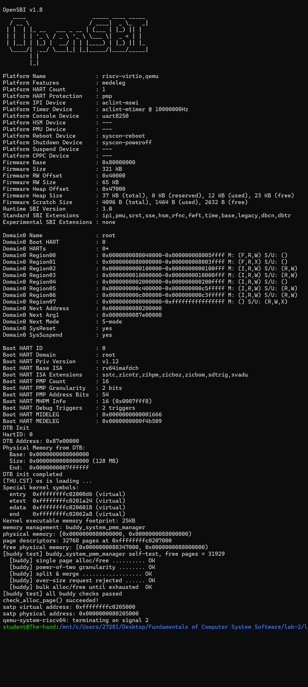
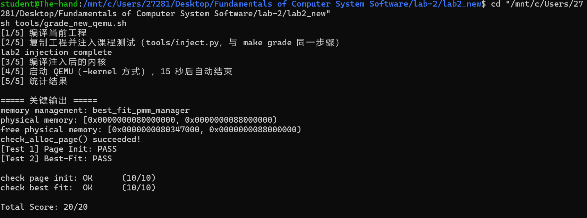
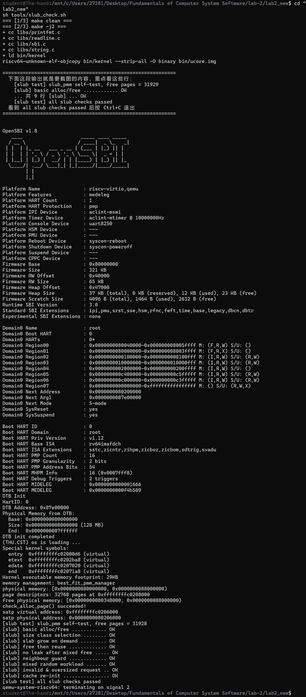
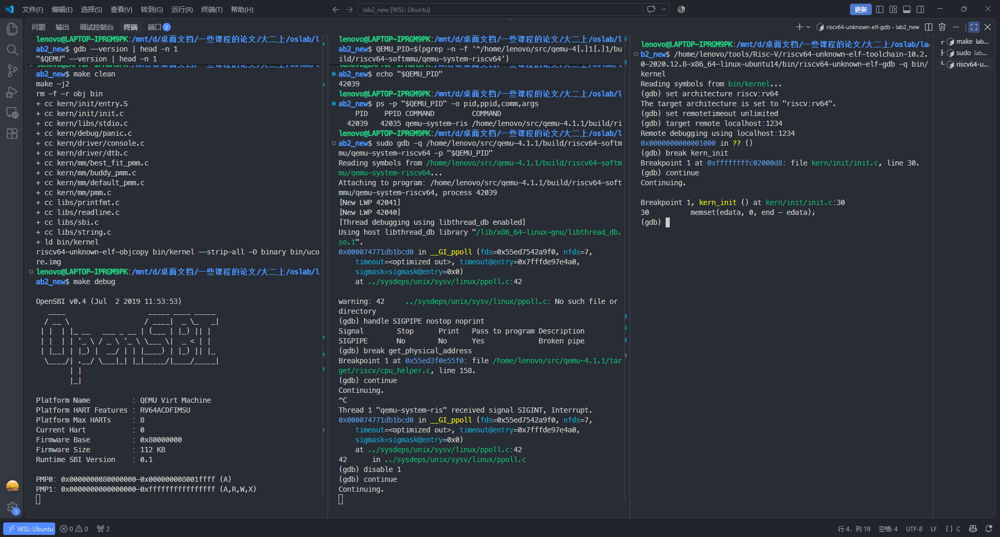
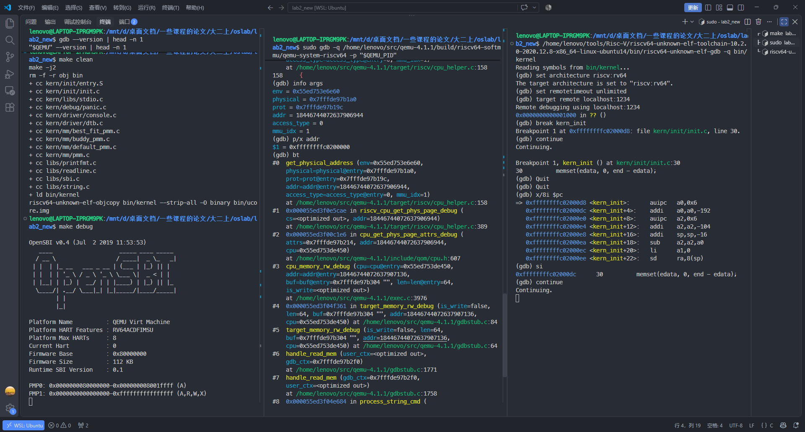
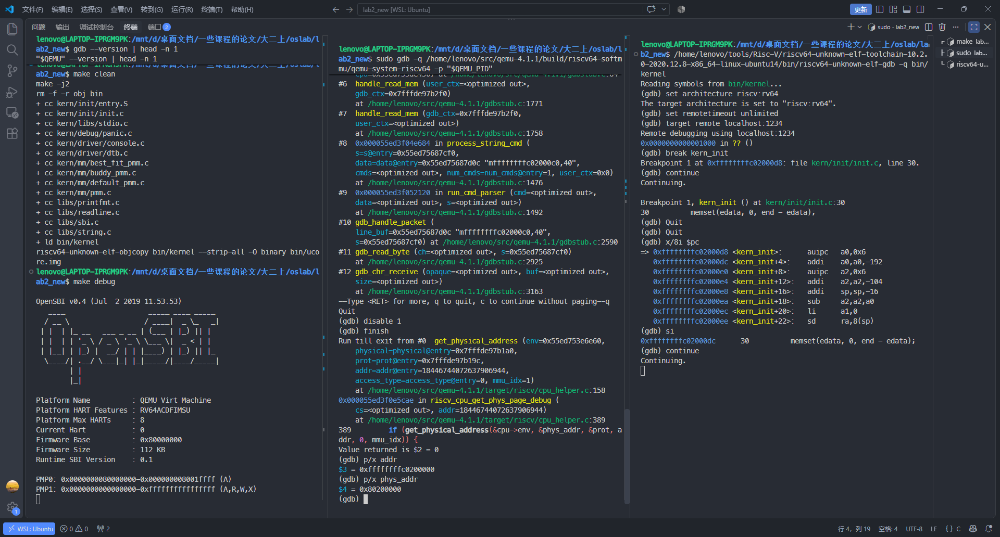
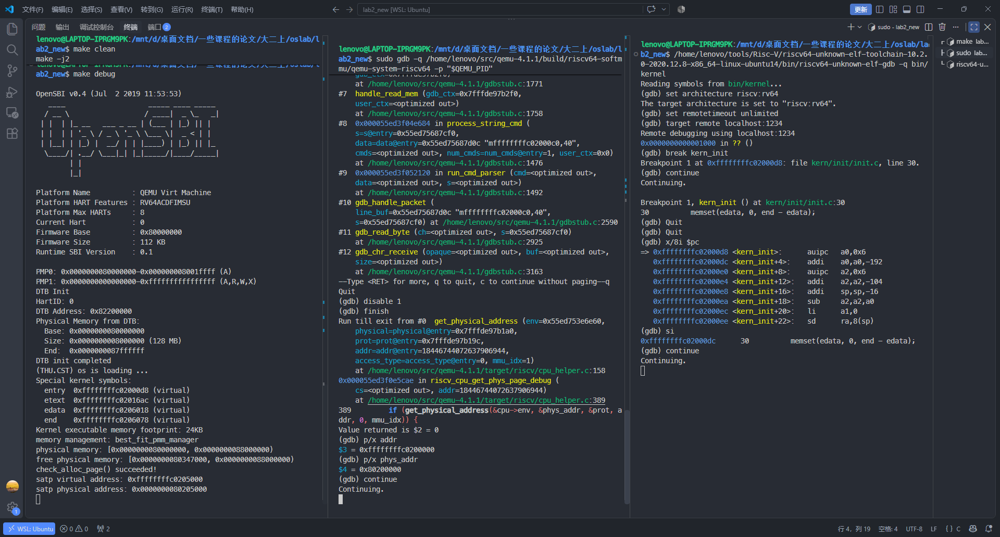
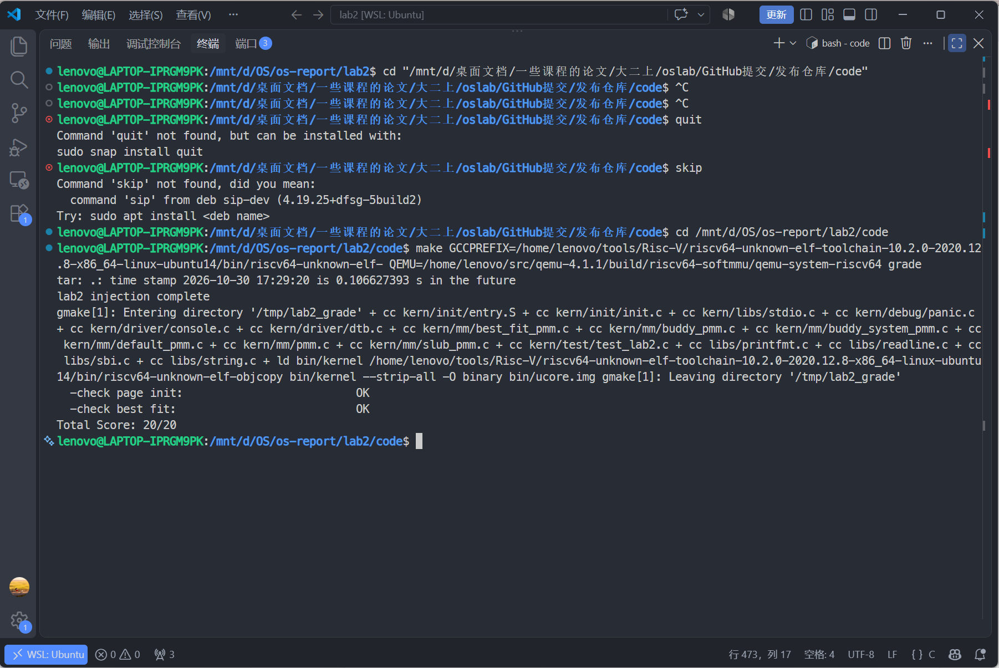

# 实验报告

## 实验基本信息

| 项目         | 内容                                           |
| ------------ | ---------------------------------------------- |
| **实验名称** | Lab 2：物理内存和页表                          |
| **小组成员** | 2514231 李文浩、2511203 严宗贺、2510582 田城昊 |
| **完成日期** | 2026-10-30                                     |

### 小组分工

| 成员               | 负责的练习/模块                                                                                                    |
| ------------------ | ------------------------------------------------------------------------------------------------------------------ |
| `[2510582 田城昊]` | 功能模块一任务一：物理内存探测与页描述符初始化；扩展 Challenge：硬件可用物理内存范围的获取方法                     |
| `[2514231 李文浩]` | 功能模块二：物理内存分配功能 任务一：理解first-fit 连续物理内存分配算法 任务二：实现 Best-Fit 连续物理内存分配算法 |
| `[2511203 严宗贺]` | 功能模块二任务三：Buddy System；扩展 Challenge：SLUB；Buddy/SLUB 测试用例与实现边界；三、实验整体逻辑分析（模块二与观察视角）                       |

---

## 一、实验目的

本实验的主要目的是：

1. 理解 RISC-V 内核从设备树获得物理内存布局的方法，掌握物理地址、内核虚拟地址、物理页号和 `struct Page *` 之间的关系。
2. 掌握以页为单位管理物理内存的方法，正确排除 OpenSBI、内核镜像、页表和页描述符数组占用的空间。
3. 理解 `page_init()` 如何把安全的完整空闲页注册给统一的物理内存管理器接口。
4. 理解页面分配算法的实现方式：在 First-Fit 的基础上实现 Best-Fit，并独立设计 Buddy System 的块组织方式、分裂与伙伴合并过程。
5. 按照 Lab0.5 的 `[PROMPT] / [RELY] / [GUARANTEE] / [SPECIFICATION]` 结构设计提示词，使用 AI 辅助实现、审查和验证内核功能。

---

## 二、实验环境

| 项目        | 配置                                          |
| ----------- | --------------------------------------------- |
| 宿主系统    | Windows + WSL Ubuntu                          |
| 源码编辑    | VS Code / Codex 桌面应用                      |
| AI 编程工具 | Codex                                         |
| 底层模型    | Codex，具体模型版本未单独记录 |
| 交叉编译器  | `riscv64-unknown-elf-gcc 10.2.0`              |
| 模拟器      | QEMU 4.1.1，RISC-V `virt` 平台                |
| 固件        | OpenSBI                                       |
| 构建工具    | GNU Make                                      |

AI 工具使用情况：

| 成员               | AI 编程工具      | 底层模型           | 备注                                                   |
| ------------------ | ---------------- | ------------------ | ------------------------------------------------------ |
| `[2510582-田城昊]` | Codex 桌面应用   | 具体版本未单独记录 | 用于阅读实验文档、设计提示词、实现审查和环境排错       |
| `[2514231-李文浩]` | opencode         | DeepSeek v4.1flash | 用于代码讲解、提示词设计与实现复核以及代码功能补全     |
| `[2511203-严宗贺]` | DeepSeek Harness | DeepSeek-V4-Flash  | 用于整体逻辑梳理、提示词编写、Buddy 模块实现与自测设计 |

本实验实际使用的关键路径如下：

```bash
export LAB2_DIR='/mnt/d/OS/os-report/lab2/code'
export RISCV_PREFIX='/home/lenovo/tools/Risc-V/riscv64-unknown-elf-toolchain-10.2.0-2020.12.8-x86_64-linux-ubuntu14/bin/riscv64-unknown-elf-'
export QEMU_411='/home/lenovo/.local/qemu-4.1.1/bin/qemu-system-riscv64'
export QEMU_411_DEBUG='/home/lenovo/src/qemu-4.1.1/build/riscv64-softmmu/qemu-system-riscv64'
```

---

## 三、实验整体逻辑分析

### 3.1 初始化与分配流程

Lab2 的物理内存管理分为初始化和分配回收两个部分。

模块一从设备树读取 RAM 范围，为物理页建立描述符，排除固件、内核和页描述符数组占用的页面，再把剩余完整页登记给物理内存管理器。

模块二维护空闲块，处理连续页的分配与回收。First-Fit 选择第一个足够大的块，Best-Fit 选择满足请求的最小块；Buddy 则按 2 的幂组织块，使用分裂和伙伴合并管理空闲区。

整体调用链为：

```text
pmm_init()
  -> init_pmm_manager()                     选择并初始化分配策略（default / best_fit / buddy）
  -> page_init()
       -> get_memory_base()/get_memory_size() 从 DTB 取得 RAM 范围
       -> 初始化 pages[]                    建立并保留全部页描述符
       -> 计算 free_start/free_end          排除已占用和非完整页面
       -> init_memmap()                     把安全的完整空闲页登记给管理器
            -> pmm_manager->init_memmap()   按各算法自己的结构组织空闲块
  -> check_alloc_page()
       -> pmm_manager->check()              各分配器自带的正确性测试
运行期
  -> alloc_pages(n)  -> pmm_manager->alloc_pages(n)   按策略挑块、必要时切分
  -> free_pages(p,n) -> pmm_manager->free_pages(p,n)  按策略插回、必要时合并
```

### 3.2 功能的逐步实现

1. 首先通过 `get_memory_base()` 和 `get_memory_size()` 读取 DTB 解析结果，并检查范围是否有效。
2. 接着设置 `va_pa_offset`、`npage` 和 `pages`，为 `[nbase, npage)` 中的每个物理页建立描述符。
3. 然后把所有页面先标记为 Reserved，计算描述符数组结束后的页对齐物理地址，避免 OpenSBI、内核和描述符数组进入空闲区。
4. 最后仅在区间非空时调用 `init_memmap()`，注册可用完整页，并通过 QEMU 和课程注入测试验证结果。
5. 在 First-Fit 的完整实现上只改动分配时的选择策略——把"第一个装得下的块"换成"装得下且最小的块"，得到 Best-Fit；因为两者共用同一套"按地址有序 + 释放即合并"的骨架，这个改动可以做到只换一个函数体。
6. 由于 `pmm_manager` 一次只能指向一个实现，而课程评测的 `[Test 2]` 只认 `best_fit_pmm_manager`，所以 Best-Fit 完成后要把 `init_pmm_manager()` 切过去；Buddy 只能通过一个默认关闭的宏临时启用，验证后恢复 Best-Fit，以满足课程第二项评分要求。
7. 单独实现 Buddy System：块大小被限制为 2 的幂，空闲块按阶分链表组织，分配时二分、释放时按"页号异或块大小"找伙伴合并；它不参与课程评分，因此测试必须自己设计与实现，并挂在 `pmm_manager->check` 上随内核启动执行。
8. 最后统一验证：`make qemu` 观察初始化输出与各分配器自测结论，`make grade` 确认注入测试的两项检查点为 PASS。

---

## 四、实验内容与实现

### 功能模块一：物理内存初始化功能

**负责人：** `[2510582 田城昊]`

#### 模块功能描述

**需要实现/修改的函数：**

```c
static void page_init(void);    // kern/mm/pmm.c
```

`page_init()` 根据设备树提供的物理内存基址和大小，设置虚实地址偏移、物理内存末端页号以及页描述符数组。它先将全部受管页面标记为保留，然后计算描述符数组结束后的第一个完整物理页，只把该位置到物理内存末端之间的完整页注册给当前 `pmm_manager`。

本次默认 128 MiB QEMU 配置的实测内存布局如下；空闲区起点由内核和描述符数组大小计算得到，重新链接后可能变化：

```text
0x80000000  +-------------------------------+
            | OpenSBI                       |
0x80200000  +-------------------------------+
            | uCore 内核、栈和启动页表       |
kernel end  +-------------------------------+
            | 对齐空隙                      |
pages       +-------------------------------+
            | struct Page 描述符数组        |
0x80347000  +-------------------------------+
            | 可供 PMM 分配的完整物理页     |
0x88000000  +-------------------------------+
```

关键全局状态的含义如下：

| 变量            | 含义                                     |
| --------------- | ---------------------------------------- |
| `va_pa_offset`  | 内核高半虚拟地址和物理地址之间的固定偏移 |
| `npage`         | 设备树报告的物理内存末端对应的物理页号   |
| `nbase`         | DRAM 起始地址对应的物理页号              |
| `pages`         | `struct Page` 描述符数组的内核虚拟地址   |
| `npage - nbase` | 本实验真正需要建立描述符的物理页数量     |

#### 实现步骤与边界

1. 读取 DTB 解析结果，检查基址、长度、加法溢出及本平台的 `DRAM_BASE` 约定。
2. 设置 `va_pa_offset = PHYSICAL_MEMORY_OFFSET`，以 `PPN(mem_base + mem_size)` 得到末端页号 `npage`。实际描述符数量为 `npage - nbase`，不是直接分配 `npage` 个描述符。
3. 将链接符号 `end` 向上按 `PGSIZE` 对齐，得到描述符数组 `pages` 的内核虚拟地址；逐项清零状态并设置 Reserved。
4. 对 `pages + (npage - nbase)` 先用 `PADDR` 转为物理地址，再向上对齐得到 `free_start`；对物理内存末端向下对齐得到 `free_end`。
5. 仅在 `free_start < free_end` 时调用 `init_memmap(pa2page(free_start), (free_end - free_start) / PGSIZE)`，由管理器登记空闲页。

默认布局中 `npage = 0x88000`、`nbase = 0x80000`，所以共描述 `0x8000 = 32768` 个物理页。`0x80347000` 是本次构建的计算结果，代码没有硬编码该起点。

**实现范围：** 已测试默认 128 MiB 的 QEMU 配置，RAM 基址固定为 `DRAM_BASE`。当前只解析一段 RAM，未单独扣除 DTB 及设备树保留区，也未处理多段内存。超出已有映射范围或内存不足以容纳描述符数组的配置未测试。

#### 最终提示词

下面按 Lab0.5 的格式，列出根据最终实现复盘整理的 `page_init()` 提示词。

```markdown
[PROMPT]
任务：修改 kern/mm/pmm.c，实现 page_init() 的物理内存探测、Page 描述符初始化和空闲物理页注册。
操作要求：必须修改项目中的真实文件；保留现有 pmm_init()、测试逻辑和 lab2 标记；不要修改公开接口，也不要硬编码某次运行得到的 free_start。
输出要求：仅完成该功能所需的代码；以工程内真实宏、数据结构和函数为准，不引入无关功能。

[RELY]

- DTB 接口：uint64_t get_memory_base(void)、uint64_t get_memory_size(void)。
- 页面大小与换算：PGSIZE、PPN、ROUNDUP、ROUNDDOWN。
- 地址关系：DRAM_BASE、PHYSICAL_MEMORY_OFFSET、PADDR。
- 全局状态：struct Page \*pages、size_t npage、const size_t nbase、uint64_t va_pa_offset。
- struct Page 字段及操作：flags、property、page_link、set_page_ref、SetPageReserved。
- 可用接口：panic、cprintf、list_init、pa2page、init_memmap。
- 链接符号 end 是内核镜像末尾的虚拟地址。

[GUARANTEE]
必须实现：static void page_init(void)。
允许在 kern/mm/pmm.c 内增加局部变量；不得修改 get_memory_base()、get_memory_size()、pa2page() 或 PMM manager 的公开接口。

[SPECIFICATION]
Pre-Condition:

- DTB 已完成解析，PMM manager 已完成 init。
- 内核高半映射可用，end、PADDR 和 PHYSICAL_MEMORY_OFFSET 的含义有效。

Post-Condition:

- 正确设置 va_pa_offset、npage 和 pages。
- [nbase, npage) 的每个物理页都有对应描述符，初始均不可分配。
- 只将描述符数组之后到物理内存末端之间的完整页面注册为空闲区。

Case 1（有效范围且存在空闲完整页）：

- 检查地址范围不为空且加法不溢出。
- 将 pages 放在 end 之后的页对齐地址。
- 将全部 Page 描述符初始化为 Reserved、引用计数为 0、property 为 0。
- 计算描述符数组后的页对齐物理地址，调用 init_memmap() 注册空闲页。

Case 2（DTB 信息无效）：

- 对基址或大小为 0、范围溢出、DRAM 基址与平台约定冲突等情况调用 panic。

Case 3（没有可用完整页）：

- 保持所有描述符为 Reserved，不得用 0 页或无效范围调用 init_memmap()。

Requirements:

- 严格区分虚拟地址、物理地址、物理页号和 Page \*。
- 起始地址向上对齐，物理内存末端向下对齐。
- 内核镜像与 Page 描述符数组占用的页面必须保持 Reserved。
```

#### 实现迭代过程

本模块的功能逻辑一次实现后通过了课程注入测试；环境验证经历了两轮。

##### 第一次迭代

**遇到的问题：**

- 临时使用 `riscv64-linux-gnu-gcc` 构建时，OpenSBI 能正常启动，但内核没有任何输出。
- 反汇编发现 `entry.S` 中的 `la` 通过 GOT/PIC 形式获取高半虚拟地址，而此时分页尚未完成，导致入口阶段异常。

**问题解决策略：**

- 对比 Lab0/0.5 环境和课程文档，确认本实验需要裸机 `riscv64-unknown-elf` 工具链。
- 改用已安装的 `riscv64-unknown-elf-gcc 10.2.0`，保持 QEMU 4.1.1 不变，重新清理并构建。

##### 第二次迭代

**最终结果：**

- 使用 QEMU 4.1.1 正常启动。
- 正确输出设备树物理内存范围和最终空闲区间。
- `page_init()` 的 8 项注入检查全部通过。
- `make grade` 总分为 `20/20`。

**实现要点：**

1. `pages` 本身也占用物理内存，因此必须把描述符数组之后的位置作为空闲区起点。
2. 所有页面先 Reserved，再仅释放确认安全的完整页面，可以避免内核占用页被错误分配。
3. `mem_base == DRAM_BASE` 是本实验 QEMU `virt` 平台约束，不应推广为所有真实硬件的通用假设。

---

### Challenge：硬件的可用物理内存范围的获取方法

**负责人：** `[2510582 田城昊]`

操作系统通常不会通过盲目读写未知地址来试探内存，而是在启动阶段接收固件或 Bootloader 已经枚举好的内存描述。

在本实验的 RISC-V 启动流程中，QEMU 构造设备树，OpenSBI 启动内核时将 Hart ID 放入 `a0`，将 DTB 的物理地址放入 `a1`。`kern_entry` 保存 `a1` 后，`dtb_init()` 将 DTB 物理地址转换为内核虚拟地址，解析 `memory` 节点的 `reg` 属性，得到物理内存基址和大小，最后由 `page_init()` 查询并处理。

```text
QEMU 生成 DTB
  -> OpenSBI 在 a1 中传入 DTB 物理地址
  -> kern_entry 保存为 boot_dtb
  -> dtb_init() 解析 memory/reg
  -> get_memory_base()/get_memory_size()
  -> page_init() 排除已占用区域
  -> init_memmap() 注册可用完整页
```

真实系统需要在固件给出的 RAM 描述基础上继续排除下列区域：

- 固件和 Bootloader 占用的区域；
- 内核镜像、内核栈和启动页表；
- DTB 本体、FDT memory reservation block 和 `/reserved-memory`；
- `struct Page` 等内核元数据；
- 设备 MMIO 窗口、坏内存和平台规定不可使用的区域。

经过集合扣除、地址合法性检查和页边界对齐后，剩余区间才是真正可交给物理内存管理器的空闲页。若内存由多个不连续 RAM bank 组成，内核还应分别注册多个可用区间，而不能只保存一个 `[base, end)`。

其他平台也采用类似思想：传统 x86 可通过 BIOS E820 获得内存映射，UEFI 系统可在退出 Boot Services 前调用 `GetMemoryMap()`。如果固件完全不提供内存描述，则只能读取平台内存控制器寄存器或采用平台专用探测方法；直接对未知地址读写可能误触 MMIO，具有安全风险，不应作为首选方案。

本实验的 `dtb.c` 是教学简化版，只提取第一个 `memory` 节点中的一组 `reg`。因此它足以支持固定的 QEMU `virt` 环境，但尚未覆盖多段 RAM 和全部保留区，这正是实验模型与真实操作系统之间的主要差异。

---

### 功能模块二：物理内存分配功能

**负责人：** `[2514231-李文浩]`

#### 任务一：理解first-fit 连续物理内存分配算法（思考题）

初始化空闲页：`default_init()` 初始化空闲链表并将 `nr_free` 清零。`default_init_memmap()` 登记连续页时，清零每页的 `flags`、`property` 和引用计数，再把块首页的 `property` 设为 `n`，设置 `PageProperty` 标记，将块首页挂入空闲链表，并增加 `nr_free`。`property` 记录页数，保留状态和空闲块头状态由 `flags` 中的标志位表示。

分配连续物理页：default_alloc_pages(n)负责这个功能，这是first的体现，也是与bestfit功能的主要区别。当n > nr_free时，可用页总数都不够就不需要再寻找了。总数够时，就从表头往下扫（无论增删节点都保证链表按内存块首物理地址升序排列），依赖这个有序性，找到第一个满足property >= n的块，然后记住这个块的前驱，将他截取下来，如果块比 n 大，就在page + n的位置切出块剩余部分，作为新的块首页插回原来的位置，保证链表仍然有序。此外更新nr_free。

回收页面并合并相邻空闲块：default_free_pages(base, n)负责此功能。运行时先检查这些页不是保留页、也不在空闲链表上，避免释放内核页或重复释放；然后把标志和引用计数清零，首页写property = n，更新nr_free，再按地址插回链表。

每页都有一个记录该页的性质的小内存，包括ref引用计数；flags状态位图，它的值代表着该页的状态；property；链表节点，节点有next和prev两个指针。

改进方向：可按块大小分档，或增加最大空闲块等统计量，辅助判断分配失败的原因。当前空闲链表为循环双向链表，尚未提供多核环境下的同步机制。

#### 任务二：实现 Best-Fit 连续物理内存分配算法（设计提示词借助 AI 完成）

First-Fit 找到第一个满足请求的空闲块后停止，Best-Fit 选择满足请求的最小块。当前 Best-Fit 实现允许在 `page->property == n` 时提前退出：精确匹配已经是最优大小，链表按地址排序又保证同大小块优先选择低地址。这是最终实现相对原始提示词“完整扫描”的调整；未找到精确匹配时仍遍历链表。

提示词：
[PROMPT]

给lab2补充一个bestfit物理内存分配器，写在新文件 kern/mm/best_fit_pmm.c 里。

模仿kern/mm/default_pmm.c ，其中初始化、登记空闲页、分配、释放、查询剩余页数的五个函数都保留，函数名加 best_fit_ 前缀。文件里原有的两个测试函数不要动，也不要复制。
只改分配：first-fit 是找到第一个够大的就 break，best-fit 要把整条链表扫完，选够大的里面最小的，大小一样就选地址低的。不要留 break。
注意default_pmm.c 里“插到链表最后”的分支少了一个 break，会把前驱指针指到自己，复制过来的时候补上。
文件末尾加管理器 best_fit_pmm_manager，检查函数用文件里现成的那个。
改 kern/mm/pmm.c 里初始化管理器那一行，换成新的。
其他文件不要动，page_init不用管。

[RELY]

参考实现：default_pmm.c 里五个函数就是现成的模板，结构、状态、合并方式都能照搬。
数据结构：页描述符（引用计数、标志位、块大小、链表节点）、空闲区（链表头 + 剩余页数）、管理器（名字 + 六个函数指针）。
链表：带哨兵的环形双向链表，有初始化、插入（分插到某节点之后/之前）、删除、判空、取前后节点这些操作。
页面操作：页大小与页号换算、保留位和空闲块标记的置/清/判、链表节点转页描述符、单页分配与释放、断言，工程里都有。
状态约定（测试函数依赖）：链表按地址升序、只挂空闲块首页；首页记录块大小并带标记；剩余页数等于各块大小之和；分配从块首切；释放立即合并左右。
[GUARANTEE]

必须交的有：
五个静态函数，名字加 best_fit_ 前缀（初始化、登记、分配、释放、查询）；
一个管理器常量 best_fit_pmm_manager，名字不能改，六个成员分别指向这五个函数和文件里现成的检查函数；
kern/mm/pmm.c 里初始化管理器那一行改成新管理器。
不要改两个测试函数，也不要改 default_pmm.c、pmm.h、memlayout.h、list.h。

[SPECIFICATION]

初始化
Pre：无。
Post：链表为空，剩余页数为 0。
Req：不碰页描述符。

登记空闲页
Pre：页数大于 0，起始页对齐，每一页都是保留页。
Post：每页标志和引用计数清零；首页记录页数并打标记；剩余页数累加；按地址插入链表。
Case 1：空表则插表头。
Case 2：落在中间则插到第一个更大的块之前。
Case 3：比所有块都大则插表尾，插完就结束循环。
Req：保持有序；不合并。

分配
Pre：请求页数大于 0。
Post：成功返回首页并摘下、清标记；块比请求大时，剩余部分以新首页插回原位；剩余页数减掉请求页数。失败返回空。
Case 1：请求页数超过剩余总数则直接返回空。
Case 2：有够大的块则扫完整条链表，选够大的里面最小的（一样大取地址低的），从块首切。
Case 3：都太小则返回空。
Req：不要找到第一个就停，测试里的 assert(p0 + 4 == p1) 会挂；只减请求页数。

释放
Pre：页数大于 0；每页都不是保留页，且不在空闲链表上。
Post：标志和引用计数清零；首页记录页数并打标记；剩余页数累加；按地址插回；与左右相邻块合并。
Case 1：空表则插表头，不合并。
Case 2：左邻接得上则并进左邻，代表块前移，再看右边。
Case 3：右邻接得上则并进自己。
Case 4：左右都接得上则一次并成一块。
Req：先插回再合并；左右各看一个邻居；相邻要用“正好接上”判断；被吞并的块清标记并摘掉；合并不改剩余页数。

查询
Post：直接返回剩余页数，不要重新遍历。

Best-Fit 的查找开销可通过按块大小分档降低。当前按整页分配，切分后的剩余量也是整数页；较小的空闲块积累可能造成外部碎片。也可考虑从块尾切分，以减少块头和链表节点的修改。

#### 任务三：buddy system（伙伴系统）分配算法（设计提示词借助 AI 完成）

**负责人：** `[2511203-严宗贺]`

##### 模块功能描述

**新增与修改的文件：**

```c
// 新增 kern/mm/buddy_system_pmm.c、kern/mm/buddy_system_pmm.h
static void          buddy_init(void);
static void          buddy_init_memmap(struct Page *base, size_t n);
static struct Page  *buddy_alloc_pages(size_t n);
static void          buddy_free_pages(struct Page *base, size_t n);
static size_t        buddy_nr_free_pages(void);
static void          buddy_check(void);          // 本任务第二份 prompt 生成的测试
const struct pmm_manager buddy_system_pmm_manager;

// 修改 kern/mm/pmm.c
#define LAB2_VERIFY_BUDDY_PMM 0                  // 仅供单独验证 Buddy 的开关，提交状态必须为 0
static void init_pmm_manager(void);              // 按开关选择 best_fit 或 buddy
```

First-Fit 和 Best-Fit 允许空闲块包含任意数量的页。Buddy 将块大小限定为 2 的幂，并要求块首按块大小对齐，通过页号或描述符下标异或块页数查找伙伴。申请 3 页时实际分配 4 页，多出的 1 页属于内部碎片。

内部状态设计如下：

```c
#define BUDDY_MAX_ORDER 19          /* 单块最大 2^19 页 = 2 GiB，覆盖本实验的 128 MiB */

typedef struct {
    list_entry_t free_list[BUDDY_MAX_ORDER + 1];   /* 每一阶一条空闲块链表 */
    unsigned int nr_free;                          /* 空闲页总数 */
} buddy_free_area_t;
```

| 信息         | 存放位置                   | 含义                                                 |
| ------------ | -------------------------- | ---------------------------------------------------- |
| 块大小       | 块头页的 `property`        | 该块共 `2^order` 页，恒为 2 的幂                     |
| 是否空闲块头 | 块头页的 `PageProperty` 位 | 置位表示"挂在某阶链表上的空闲块首页"；分配出去后清除 |
| 属于哪一阶   | 由块大小取对数得到         | 决定挂在 `free_list[order]` 上                       |
| 成员关系     | `page_link`                | 挂到对应阶的链表                                     |

为什么 `BUDDY_MAX_ORDER` 取 19：受管区间从 `DRAM_BASE` 起算，`nbase = DRAM_BASE / PGSIZE = 0x80000 = 2^19` 页。只要块不超过 `2^19` 页，"描述符下标 `page - pages`"和"物理页号 `page2ppn(page)`"就同时按块大小对齐，伙伴计算可以直接用下标异或；超过这个阶，两种视角的对齐关系就不再一致。QEMU `virt` 默认 128 MiB，扣除内核镜像和描述符数组后空闲区约 3.2 万页，实际最大块只到 14 阶。

**分配（分裂）**：把请求页数向上取整到 `2^k`，从第 k 阶开始向上找第一个非空链表，取出其中的块，再逐级二分：一次分裂把块拆成两个低一阶的块，低的那半继续切，高的那半挂到对应阶的空闲链表上，直到剩下的大小正好是 `2^k`，把它作为结果返回。因为始终保留低位那一半，返回的块首地址与最初取出的块首地址相同，天然满足对齐要求。

**释放（合并）**：块头页的页号异或其块大小，就是伙伴块的页号。若伙伴块同阶、正挂在空闲链表上且未被保留，就把两块合并、阶数加一，然后继续尝试与更高阶的伙伴合并，直到伙伴不在空闲状态为止，最后把合并结果挂回对应阶的链表。

**块大小记录：** 请求 3 页时，Buddy 实际分配 4 页。块头保留 `property = 4`，并清除 `PageProperty`。释放时按块头记录的真实大小回收；如果错误地把请求页数向下取整为 2 页，就会破坏块边界和伙伴计算。当前实现取块头 `property` 与传入 `n` 中的较大值，再向上取整到 2 的幂。

##### 设计提示词

按课程要求，本任务提交两份提示词：第一份从零生成 Buddy 模块并接入内核，第二份针对这份实现设计测试函数。

**第一份提示词（生成模块并接入内核）：**

```markdown
[PROMPT]
任务：在 lab2 工程里从零新增一个 Buddy System 连续物理内存分配器，写入新文件 kern/mm/buddy_system_pmm.c 与 kern/mm/buddy_system_pmm.h，并接入内核。
操作要求：必须修改项目中的真实文件；不要改动 default_pmm.c、best_fit_pmm.c 及这两个文件里已有的测试函数；不要改动 tools/ 下的评测脚本；新增代码保留 lab2 注释标记，并在标记处写明学号。
输出要求：给出完整、可直接编译的 .c 与 .h；不引入无关功能；除管理器常量外不新增全局导出符号。

[RELY]

- 管理器接口：kern/mm/pmm.h 中 struct pmm_manager 的六个函数指针（init、init_memmap、alloc_pages、free_pages、nr_free_pages、check），以及 alloc_page()/free_page() 宏。
- 页描述符：kern/mm/memlayout.h 中 struct Page { int ref; uint64_t flags; unsigned int property; list_entry_t page_link; }，以及 SetPageProperty/ClearPageProperty/PageProperty、SetPageReserved/ClearPageReserved/PageReserved、le2page。
- 链表：libs/list.h 的 list_init、list_add、list_add_before、list_del、list_empty、list_next。
- 地址与页号：PGSIZE、PGSHIFT、PPN、page2pa/pa2page/page2ppn，全局 pages、npage、nbase。
- 对齐与断言：ROUNDUP、ROUNDDOWN、assert、panic、cprintf。
- 工程约定：kern/mm/\*.c 会被 Makefile 自动编译；init_pmm_manager() 当前挂 best_fit_pmm_manager；课程评测的 [Test 2] 只认 best_fit_pmm_manager。

[GUARANTEE]
必须实现：上面六个静态函数，以及常量 const struct pmm_manager buddy_system_pmm_manager（名字不可改），六个成员分别指向这六个函数；头文件中声明该常量。
允许：在 kern/mm/buddy_system_pmm.c 内自行设计内部状态（按阶组织的空闲链表、计数器）与静态辅助函数。
不得修改：default_pmm.c、best_fit_pmm.c、pmm.h、memlayout.h、list.h、tools/\*。
必须保证：提交状态下 init_pmm_manager() 仍然选择 best_fit_pmm_manager；Buddy 只能通过一个默认关闭的宏开关临时启用，并在注释中写明"验证时改 1、提交前改回 0"。

[SPECIFICATION]
Pre-Condition:

- init_memmap 由 page_init() 调用，传入的 [base, base + n) 每一页都已被置为 Reserved，且 n >= 1。
- npage、nbase、pages 已经由 page_init() 设置完成。

Post-Condition:

- init：所有阶链表为空，nr_free = 0。
- init_memmap：把区间拆成若干"起点按自身大小对齐、大小为 2^order"的块登记；被登记的页清除 Reserved、ref 与 property 清零；nr_free 增加 n。
- alloc_pages(n)：成功返回块头页——块按自身大小对齐、PageProperty 已清、块头 property 记录真实块大小 2^k，nr_free 减少 2^k；失败返回 NULL 且不改变任何状态。
- free_pages(base, n)：回收 size = max(块头 property, 向上取整到 2 的幂的 n) 个页，与同阶伙伴反复合并后挂回对应阶链表，nr_free 增加 size。
- nr_free_pages：直接返回计数器，不重新遍历链表。
- check：执行自带测试，任一断言失败即 panic。

Case 1（请求恰好是一整块）：直接摘下返回，不做分裂。
Case 2（请求小于最大可用块）：从最近的高阶块逐级二分，多出来的高半部分挂到低一阶链表。
Case 3（请求超过 nr_free 或超过单块上限）：直接返回 NULL。
Case 4（释放时伙伴块同阶、空闲且未被保留）：合并，阶数加一，继续向上判断。
Case 5（伙伴块被保留、阶数不同、或根本不在链表上）：停止合并，直接把当前块挂回链表。
Case 6（合并后块首前移到伙伴位置）：必须保证返回给上层的仍是合并后的块首，且块头记录的大小同步更新。

Requirements:

- 块大小恒为 2 的幂，块首必须按自身大小对齐（页号 % 2^k == 0）。
- 伙伴页号 = 本块页号 ^ 块大小；合并前必须同时确认伙伴块的 PageProperty 置位、property 等于该阶大小。
- 只有块头页挂链表并带 PageProperty；被合并掉的伙伴页要清标记并从链表摘除。
- nr_free 只按真实块大小增减，任何路径都不得让"各阶空闲块页数之和"与 nr_free 不一致。
- 分配出去后清除 PageProperty，但保留块头 property，作为释放时的真实块大小依据。
```

**第二份提示词（针对该实现设计测试）：**

```markdown
[PROMPT]
任务：为刚完成的 Buddy System 分配器设计并实现自带测试函数 buddy_check()，挂到 buddy_system_pmm_manager 的 check 成员上，随内核启动的 check_alloc_page() 执行。
操作要求：测试只能写在 kern/mm/buddy_system_pmm.c 内，不得修改 pmm.h、框架代码或其他分配器；不得依赖某一次运行得到的具体地址；每个用例结束时必须把分配器恢复到用例开始前的状态。
输出要求：测试函数 + 每个用例一行 cprintf 结论；断言失败立即 panic，不允许静默通过。

[RELY]

- 可用操作：alloc_pages/alloc_page、free_pages/free_page、nr_free_pages、page_ref、page2pa、page2ppn、PageProperty、PageReserved、assert、cprintf。
- 被测状态：buddy_area.free_list[order] 与 buddy_area.nr_free。
- 上文约定必须成立的不变量：块大小为 2^order、块首按自身大小对齐、块头 property 等于块大小、伙伴页号 = 页号 ^ 块大小。
- 已知布局：npage = 0x88000，nbase = 0x80000，空闲区约 3.2 万页，最大块阶约 14。

[GUARANTEE]
必须实现：static void buddy_check(void)，内部覆盖至少五类行为；允许增加静态辅助函数（例如遍历所有阶求空闲页数总和的"对账"函数）。
不得修改：default_pmm.c、best_fit_pmm.c 及其中已有的测试、tools/\*。
不得改变内核启动后的内存状态：测试前后的空闲页总数必须一致。

[SPECIFICATION]
Pre-Condition：pmm_manager 已指向 buddy_system_pmm_manager，init 与 init_memmap 已完成，链表与计数器自洽。
Post-Condition：全部断言通过，状态与进入测试前一致，并输出各用例结论。

必须覆盖的用例：
Case 1（基本分配回收）：连续分配 3 个单页，三页互不相同、ref 为 0、nr_free 恰好减少 3；释放后 nr_free 与用例前完全相等。
Case 2（分配粒度）：请求 3 页，返回块必须 4 页对齐、块头 property 为 4、PageProperty 已清、nr_free 减少 4；按 3 页释放后计数还原。
Case 3（分裂与合并）：先从最小的空闲块整块分配再释放（验证不分裂路径）；再把最大的空闲块切成两半分别分配、然后分别释放，验证两半能重新合并成整块（合并后再请求整块必须成功）。
Case 4（越界请求）：请求页数大于全部受管物理页、以及大于 nr_free 时都必须返回 NULL，且 nr_free 与链表结构不变。
Case 5（耗尽路径）：以 4096 页为单位反复分配直到返回 NULL，记录成功次数，校验 nr_free 的减少量恰好等于已分配页数；再逆序全部释放，校验 nr_free 回到用例前的值。

Requirements:

- 每个用例前后都要用"遍历所有阶链表求页数和"的辅助函数与 nr_free 对账，并对每个链表成员校验：PageProperty 置位、块大小与所在阶一致、块首按自身大小对齐。
- 不得硬编码任何地址，所有判断只能依赖相对关系与不变量，保证内核体积变化时测试仍然成立。
```

##### 实现迭代过程

最终实现按阶维护空闲块链表，将请求向上取整到 2 的幂。分配后在块头保存真实页数，释放时用它恢复块大小；合并条件包括伙伴同阶、空闲且位于描述符范围内。

页数和块状态由 `buddy_sum_free_pages()` 检查，实际测试构造见 5.3 节。

##### 测试覆盖与有效性说明

`buddy_check()` 通过管理器的 `check` 接口执行五个用例，检查单页分配、非 2 的幂请求、分裂回收、超量申请和固定大块分配失败。测试构造、断言及未覆盖分支统一列于 5.3.1、5.3.2 节。

##### 问题回答：你的 Buddy 算法是否有进一步的改进空间？

1. 每次分配都要从请求阶向上扫描找第一个非空链表，最坏要扫 `BUDDY_MAX_ORDER` 条链表。可以用位图记录"哪些阶非空"，把查找降为常数级；也可以把阶的上界按实际内存裁剪，避免为不可能出现的阶浪费判断。
2. 块大小只能是 2 的幂，申请 3 页占 4 页，内部碎片在最坏情况下接近 50%。缓解办法是两层结构：底层用 Buddy 管理页块，上层再用 slab 一类的对象分配器管理小块，避免每次都按整块分配。
3. 伙伴判定用"描述符下标异或块大小"，依赖 `nbase` 是 2 的幂。真实硬件的 DRAM 起点不一定对齐到大页，此时要改用物理页号做对齐修正，否则伙伴会算到受管区间之外。
4. 合并只在释放时发生，频繁的分配/释放会产生大量链表操作。可以保留少量"每阶缓冲块"或采用延迟合并，把多次小操作合并成一次。
5. 目前 `init_memmap()` 只登记一段连续区间，没有处理多段 RAM、NUMA 节点或保留区；真实系统需要按区间分别登记，并在合并时保证不跨越区间边界。

##### 验证结果

先把 `kern/mm/pmm.c` 中的开关改为 `1`，重新编译并运行：

```c
#define LAB2_VERIFY_BUDDY_PMM 1
```

`make qemu` 的关键输出（空闲页数 = `(0x88000000 − 空闲区起点) / 4096`，会随内核镜像体积变化；本机实测 31929 页，此时内核 footprint 为 25 KB）：

```text
DTB init completed
(THU.CST) os is loading ...
Kernel executable memory footprint: 25KB
memory management: buddy_system_pmm_manager
physical memory: [0x0000000080000000, 0x0000000088000000)
page descriptors: 32768 pages at 0xffffffffc0207000
free physical memory: [0x0000000080347000, 0x0000000088000000)
[buddy test] buddy_system_pmm_manager self-test, free pages = 31929
  [buddy] single page alloc/free .......... OK
  [buddy] power-of-two granularity ........ OK
  [buddy] split & merge .................. OK
  [buddy] over-size request rejected ...... OK
  [buddy] bulk alloc/free until exhausted  OK
[buddy test] all buddy checks passed
check_alloc_page() succeeded!
```

验证完必须把开关改回 `0` 再提交，否则评测的 `[Test 2]` 会因为 `pmm_manager` 不是 `best_fit_pmm_manager` 而失败。

下图是组员使用个人脚本 `grade_new_qemu.sh` 得到的本地自查结果；该脚本未纳入当前仓库，使用 `-kernel` 启动并调用课程的 `tools/inject.py`。当前仓库的复现命令采用 5.1 节的 `make GCCPREFIX="$RISCV_PREFIX" QEMU="$QEMU_411" grade`，正式课程评分为 20/20。

```text
[Test 1] Page Init: PASS
[Test 2] Best-Fit: PASS
check page init: OK      (10/10)
check best fit: OK       (10/10)

Total Score: 20/20
```



*图 1：Buddy 五项自测通过，空闲页数为 31929。截图环境为 WSL2 Ubuntu、QEMU 10.2.1、OpenSBI v1.8，内核大小为 25 KB，尚未加入 SLUB。*



*图 2：组员使用 `grade_new_qemu.sh` 的本地评分结果。课程 `make grade` 的正式结果见 5.1 节。*

---

#### 挑战任务：任意大小的内存单元 SLUB 分配算法（设计提示词借助 AI 完成）

**负责人：** `[2511203 严宗贺]`。本项对应指导书「扩展任务 Challenge：任意大小的内存单元 slub 分配算法」，属加分项，不参与课程自动评分。

##### 模块功能描述

**新增与修改的文件：**

```c
// 新增 kern/mm/slub_pmm.c、kern/mm/slub_pmm.h
void   slub_init(void);
void  *slub_alloc(size_t size);
void   slub_free(void *ptr);
size_t slub_nr_slabs(void);          // 当前 slab（页）总数，供测试对账
size_t slub_nr_total_objects(void);  // 所有 slab 能切出的对象总数
size_t slub_nr_inuse_objects(void);  // 已分配对象数
void   slub_check(void);             // 本任务第二份 prompt 生成的测试

// 修改 kern/init/init.c（三行，不动 pmm.c 与三个分配器）
#include <slub_pmm.h>
...
    pmm_init();                      // init physical memory management
    slub_init();                     // 第二层：在页分配器之上建立对象分配器
    slub_check();                    // SLUB 自测，随内核启动执行
```

SLUB 通过 `alloc_pages()` 取得整页，再将页内对象区按大小档位切分。空闲对象用单链表连接，分配时摘取链头，释放时插回链头。底层可使用 Best-Fit 或 Buddy。

内部状态设计如下：

```c
#define SLUB_NUM_CLASSES  9                       /* 档位：8/16/…/2048 字节 */
#define SLUB_MAX_OBJECT   2048
#define SLUB_SLAB_PAGES   1                       /* 一个 slab 一页 */
#define SLUB_OBJ_OFFSET   64                      /* 页首 64 字节留给元数据 */

struct slub_slab {                                /* RV64 下为 40 字节，放在页首 64 字节保留区 */
    struct slub_slab *next;                       /* 同一 cache 的 slab 链 */
    void             *page;                       /* slab 首页虚拟地址 */
    unsigned int      class_index;                /* 属于哪个档位 */
    unsigned int      inuse;                      /* 已分配对象数 */
    void             *freelist;                   /* 空闲对象链（LIFO） */
    unsigned long     canary;                     /* 元数据哨兵 0x5A5AA5A5C3C3DEDE */
};

struct kmem_cache {                               /* 一个档位一个 cache */
    size_t       object_size;
    unsigned int objects_per_slab;                /* (4096-64)/object_size */
    unsigned int slab_count;
    unsigned int inuse;
    struct slub_slab *slabs;
};
```

九档对象容量（`(PGSIZE - 64) / object_size` 取整）：

| 对象大小 | 8 | 16 | 32 | 64 | 128 | 256 | 512 | 1024 | 2048 |
| --- | --- | --- | --- | --- | --- | --- | --- | --- | --- |
| 每页对象数 | 504 | 252 | 126 | 63 | 31 | 15 | 7 | 3 | 1 |

| 信息 | 存放位置 | 含义 |
| --- | --- | --- |
| 对象大小 | `slub_caches[i].object_size` | 由 `slub_class_of()` 向上找第一个 `>= size` 的档位得到 |
| 是否空闲 | 是否在 `slab->freelist` 链上 | 空闲对象前 8 字节（`sizeof(void *)`）存"下一个空闲对象地址"，因此最小档位必须 `>= 8` 字节 |
| 已分配数 | `slab->inuse`、`cache->inuse` | 两层计数，前者用于判断能否销毁 slab，后者用于统计接口 |
| slab 归属 | 地址区间 `[page+64, page+4096)` | 释放时扫描各 cache 的 slab 区间即可判断指针是谁的，不需要额外索引 |
| 大对象页数 | 直通路径页首 16 字节头 | `header[0] = magic`、`header[1] = 页数`，返回 `header+16` |

**分配**：`slub_class_of(size)` 找到档位 → 在该 cache 的 slab 链上找第一个 `freelist` 非空的 slab → 摘下链头对象、`freelist` 前移、两层 `inuse++`；若所有 slab 都满则向页级层要 1 页、把对象区从低到高切成等长对象压入 `freelist`（形成 LIFO，于是"刚释放的对象最先被复用"）。

**释放**：先按地址区间判断指针属于哪个 cache 的哪个 slab；命中则把对象头插回 `freelist`、两层 `inuse--`，**当 `inuse == 0` 时立刻销毁该 slab 并把页还给页级层**；若不落在任何 slab 内，则按直通路径处理：回退 16 字节读 magic 与页数，原样 `free_pages()`。

**对象大小记录：** `slub_free()` 只接收指针。小对象通过所在 slab 的 cache 确定档位，大对象通过页首头部记录页数。slab 的 `inuse` 降为 0 时立即归还整页，因此全部释放后可以比较 `nr_free_pages()`，检查是否还有页面未回收。

**空间开销：** 档位向上取整会产生内部碎片，例如申请 100 字节占用 128 字节。页首元数据占 64 字节，约为一页的 1.6%；1024 和 2048 字节档位每页分别容纳 3 个和 1 个对象，剩余空间较多。

##### 设计提示词

以下两份提示词保留原始要求。最终实现中，只有已定位 slab 后的空闲对象链操作为 O(1)，查找可用 slab 与释放归属仍需遍历链表；当前 Makefile 没有 `-msmall-data-limit=0`。提示词的混合测试目标为六种尺寸、每步检查，实际覆盖情况以 5.3.4 节为准。

按课程要求提交两份提示词：第一份从零生成 SLUB 模块并接入内核，第二份针对这份实现设计测试函数。

**第一份提示词（生成模块并接入内核）：**

```markdown
[PROMPT]
任务：在 lab2 工程里从零新增一个两层结构的 SLUB 内存对象分配器，写入新文件 kern/mm/slub_pmm.c 与 kern/mm/slub_pmm.h，并在 kern/init/init.c 的 pmm_init() 之后接入（slub_init(); slub_check(); 两行，另加一行 #include <slub_pmm.h>）。
操作要求：必须直接修改工程中的真实文件；不得改动 kern/mm/pmm.c、default_pmm.c、best_fit_pmm.c、buddy_system_pmm.c 及它们已有的测试函数；不得改动 tools/ 下的评测脚本与 Makefile 的编译规则；新增代码保留 lab2 注释标记，并在标记处写明学号 2511203。
输出要求：完整、可直接编译的 .c 与 .h，以及 init.c 的改动片段（三行）；除头文件声明的七个接口外不新增导出符号；不使用浮点、不使用 malloc/free、不使用变长数组。

[RELY]

- 页级接口：kern/mm/pmm.h 中的 alloc_pages(size_t n)、free_pages(struct Page *base, size_t n)、nr_free_pages()、alloc_page()/free_page() 宏；struct Page 与 page2pa/pa2page/page2ppn；PADDR 宏；全局 pages、npage、nbase、va_pa_offset；PGSIZE=4096、PGSHIFT=12、PPN 宏。
- 工具：libs/assert.h 的 assert/panic、libs/stdio.h 的 cprintf、libs/string.h 的 memset、libs/defs.h 的 size_t/uintptr_t/ROUNDUP。
- 工程约定：kern/mm/\*.c 会被 Makefile 自动编译；编译选项为 -std=gnu99 -Wall -Werror -Wno-unused -msmall-data-limit=0，因此不能留下未使用的静态函数、不能有隐式声明、不能有符号/无符号不匹配的比较。
- 地址换算：内核虚拟地址 = 物理地址 + va_pa_offset（本机为 0xFFFFFFFF40000000）。KADDR 宏即使存在也不要在本模块里依赖它，直接用 page2pa(page) + va_pa_offset 自算。
- 提交态约束：课程评测的 [Test 2] 只认 best_fit_pmm_manager，本模块不得改动 pmm_manager 的选择，也不得在 pmm_init() 之前执行。

[GUARANTEE]
必须实现：与头文件完全一致的七个函数（slub_init、slub_alloc、slub_free、slub_nr_slabs、slub_nr_total_objects、slub_nr_inuse_objects、slub_check）。
允许：内部结构自定——档位表、每页元数据布局、直通路径头格式、空闲链实现方式都由实现者决定。
必须保证：① 元数据全部落在 slab 首页的前 64 字节内，并用编译期断言 sizeof(struct 元数据) <= 64 固定这一点；② slub_check() 结束时第一层页数必须与开始时完全一致；③ 不得在分配失败路径上留下半初始化的 slab（要么成功挂链，要么把页还回去）。

[SPECIFICATION]
Pre-Condition：

- 调用 slub_init() 时，pmm_init() 已完成，pmm_manager 已能正常分配页。
- slub_alloc(size) 的 size 是调用方真正要用的字节数，可能为 0，也可能远大于物理内存。
- slub_free(ptr) 的 ptr 必须是本模块此前返回的指针。

Post-Condition：

- slub_init：九个 cache 的 object_size、objects_per_slab 计算完成，slab 链与计数清零。
- slub_alloc(size)：size == 0 返回 NULL；size <= 2048 时返回某档位 slab 内的对象地址，且该对象已从 freelist 摘除、两层 inuse 各加一；size > 2048 时向页级层申请 ceil((size+16)/PGSIZE) 页，页首写 magic 与页数，返回头的后方地址；页级层返回 NULL 时本函数返回 NULL。
- slub_free(ptr)：ptr 为 NULL 时直接返回；落在某个 slab 的对象区内时把对象头插回 freelist、两层 inuse 各减一，inuse 归零则销毁 slab 并 free_pages 归还整页；不落在任何 slab 内时按直通路径读头、校验 magic、按头中页数归还，并把 magic 清零。
- slub_check：依次执行自带用例，全部通过后输出 [slub test] all slub checks passed，任一断言失败立即 panic。

Case 1（size = 0）：返回 NULL，不得返回内部指针，也不得改变任何计数。
Case 2（size 恰为档位值 8/16/…/2048）：归入该档，不得跳到下一档。
Case 3（size = 2049）：不能走对象层（会越界），必须走直通路径申请 2 页以内（ceil((2049+16)/4096) = 1 页）。
Case 4（单 slab 对象用尽）：新建一个 slab，绝不允许越过 slab 末端继续切分。
Case 5（释放 slab 内最后一个对象）：inuse 归零 → 销毁 slab → 页归还页级层，此时 slab 链上不得留下悬空节点。
Case 6（页级层分配失败）：slub_alloc 返回 NULL，已有 slab 与 freelist 不受影响，计数器不变。

Requirements：

- 分配与释放都必须是 O(1)（不含"扫描 slab 链找归属"这一层的常数级开销），不得遍历空闲链表求长度。
- 空闲对象链采用 LIFO：刚释放的对象应被下一次同档位分配优先复用。
- 元数据必须带哨兵 canary，取值固定；空闲对象的地址必须落在本 slab 的对象区内并按 object_size 对齐。
- 不变量：对任意 slab，freelist 长度 + inuse 必须恰好等于 objects_per_slab。
- 不得依赖任何具体虚拟地址或具体空闲页数（内核体积变化后必须仍然成立）。
```

**第二份提示词（针对该实现设计测试）：**

```markdown
[PROMPT]
任务：为刚完成的 SLUB 分配器设计并实现自带测试：九个 static 测试函数 + 一个汇总函数 slub_check()，测试代码写在 kern/mm/slub_pmm.c 内部，由 kern_init() 调用一次后随内核启动执行。
操作要求：测试只能写在 slub_pmm.c 内，不得修改 pmm.h、其他分配器或框架代码；不得依赖某一次运行得到的具体地址与具体页数；每个用例结束时必须把第一层页数与对象计数恢复到用例开始前的状态，否则后续用例会在被污染的堆上运行。
输出要求：测试函数 + 每个用例一行 cprintf 结论（[slub] ... OK），汇总函数首尾各打印一行（[slub test] ...）；断言失败立即 panic，不允许只打印不检查。

[RELY]

- 可用操作：slub_alloc/slub_free、alloc_pages/free_pages/nr_free_pages、memset、assert、cprintf。
- 可读状态：slub_nr_slabs()、slub_nr_total_objects()、slub_nr_inuse_objects()，以及模块内部的 slab 链与 freelist。
- 已知常量：档位 9 个（8…2048）、SLUB_OBJ_OFFSET = 64、SLUB_SLAB_SIZE = 4096、2048 档每页恰好 1 个对象、64 档每页 63 个对象。
- 已知不变量：freelist 长度 + inuse == objects_per_slab；空闲对象落在 [page+64, page+4096) 内且按 object_size 对齐；canary 恒等于 0x5A5AA5A5C3C3DEDE。

[GUARANTEE]
必须实现：slub_basic_check、slub_size_class_check、slub_slab_grow_check、slub_free_reuse_check、slub_leak_check、slub_guard_check、slub_mixed_check、slub_oom_check、slub_cache_reuse_check 九个 static 函数，以及 void slub_check(void)。
允许：增加 static 辅助函数（结构自检、伪随机数发生器）。
不得：修改被测实现的语义来让测试通过；不得为了让用例通过而跳过断言；不得假设第一层一定分配成功。
必须保证：slub_check() 返回时 slub_nr_slabs() == 0 且 slub_nr_inuse_objects() == 0，页数与进入测试时相同。

[SPECIFICATION]
Pre-Condition：slub_init() 已执行；第一层页分配器可用；当前没有任何 slab。
Post-Condition：全部断言通过，输出九个用例结论与一行总结，分配与释放的页数平衡。

必须覆盖的用例：
Case 1（基本分配回收）：取最小档连续分配 3 个对象——非空、互不相同、落在同一页内、地址差为 8 的整数倍、slab 数为 1、已用对象数为 3；全部释放后 slab 数归零、页数还原。
Case 2（档位选择）：对九个档位各分配一次——对象地址按 8 字节对齐，且档位 <= 64 时还必须按自身大小对齐；全部释放后页数还原。另申请 2049 字节确认走直通路径。
Case 3（slab 扩容）：在 64 字节档位连续分配 64 个对象（一个 slab 只有 63 个）——slab 数必须恰好变成 2、已用对象数为 64、页数减少 2；全部释放后页数还原。
Case 4（释放后重用）：分配一个 32 字节对象 → 释放 → 再分配同尺寸——必须返回完全相同的地址（LIFO 的直接证据）。
Case 5（泄漏检查）：六个尺寸（含 3000 字节的直通对象）各分配三次后全部逆序释放——slab 数归零、已用对象数归零、页数与开始时完全相等。
Case 6（越界防护）：在 64 字节档位分配相邻两个对象——写满低地址对象的 64 字节不得改变高地址对象的内容；同时元数据 canary 必须完好。
Case 7（混合负载）：用伪随机数在 200 步内随机分配/释放六种尺寸（8/100/600/2049/5000/12）——每一步都检查结构不变量，且"已用对象数"必须等于现场 slab 对象数；结束时页数完全还原。
Case 8（非法与超大请求）：slub_alloc(0) 与 slub_alloc(1 TiB) 都必须返回 NULL，且页数与计数不变。
Case 9（cache 重建）：slub_init() 再次初始化——slab 数与对象总数归零；随后分配 2048 字节恰好得到 1 个 slab、1 个对象，释放后归零。

Requirements：

- 每个用例首尾都要对账：第一层页数、slab 数、已用对象数三项必须与用例前一致。
- 断言里不得出现具体地址常量；所有比较都依赖相对关系与不变量。
- 结构自检必须检查：canary、空闲对象地址区间、按 size 对齐、"freelist 长度 + inuse == 每页对象数"，并检测空闲链成环（用计数器上界截断）。
- 直通路径的对象不计入 cache 的已用对象数，测试统计时必须分开计数，避免用错误的计数口径制造假阳性。
```

##### 实现迭代过程

最终实现将 slab 元数据放在页首 64 字节保留区，小对象按九个档位组织。空 slab 立即归还整页；大对象在页首记录 magic 和页数，释放时按头部回收。计算大对象页数前检查整数溢出。

SLUB 的对象计数不包含直通分配。混合测试据此区分小对象计数，测试的实际尺寸和槽位覆盖见 5.3.4 节。

##### 测试覆盖与有效性说明

`slub_check()` 执行九个用例，覆盖基础分配回收、档位选择、扩容、对象复用及失败路径。完整边界表和用例表统一放在 5.3.3、5.3.4 节，避免与本节重复。

##### 验证结果

组员先用 Python 模拟分配逻辑，执行断言和 3000 步伪随机负载；下面保留其逻辑自检输出。该脚本未纳入当前代码目录，C 实现的运行结果见后续 QEMU 截图。

```text
== SLUB 逻辑等价验证（Python 逐行复现 slub_pmm.c）==
物理内存 32768 页 / 128 MiB，初始空闲 32768 页
[ OK ] basic alloc/free              三个同档对象同页、释放后页数还原
[ OK ] size class selection          九个档位都能分配，地址按档位对齐
[ OK ] slab grow on demand           一个 slab 装不下时自动开第二个，并各自回收
[ OK ] free then reuse               释放后立即重用同一对象
[ OK ] no leak after mixed free      跨档位含直通路径，全部释放后零泄漏
[ OK ] neighbour guard               写满一个对象不影响相邻对象，元数据 sentinel 完好
[ OK ] mixed random workload         随机大小/随机顺序的 200 步混合负载，最终完全归还
[ OK ] invalid & oversized request   0 字节与超出物理内存的请求返回 NULL 且不改变页数
[ OK ] cache re-init                 cache 重新初始化后计数清零、仍可正常分配
[ OK ] stress(3000 steps)            3000 步随机操作后不变量与页数均正确
========================================================
全部 10 个用例通过；最终空闲 32768 页（初始 32768 页）
分配 1253 页 / 释放 1253 页 / 失败 1 次
```

SLUB 自测在 `pmm_init()` 之后自动执行。当前仓库可使用以下命令编译并启动；运行完成后按 `Ctrl+A`、再按 `X` 退出 QEMU：

```bash
cd "$LAB2_DIR"
make GCCPREFIX="$RISCV_PREFIX" clean
make GCCPREFIX="$RISCV_PREFIX" -j2
make GCCPREFIX="$RISCV_PREFIX" QEMU="$QEMU_411" qemu
```

`make` 一次通过（`gcc ... kern/mm/slub_pmm.c`、`ld bin/kernel`、`objcopy ... bin/ucore.img`），QEMU 的关键输出如下（`slub_check()` 紧跟在 `pmm_init()` 之后执行，所以它排在 `check_alloc_page()` 之后）：

```text
DTB init completed
(THU.CST) os is loading ...
Kernel executable memory footprint: 29KB
memory management: best_fit_pmm_manager
physical memory: [0x0000000080000000, 0x0000000088000000)
page descriptors: 32768 pages at 0xffffffffc0208000
free physical memory: [0x0000000080348000, 0x0000000088000000)
check_alloc_page() succeeded!
satp virtual address: 0xffffffffc0206000
satp physical address: 0x0000000080206000
[slub test] slub_pmm self-test, free pages = 31928
[slub] basic alloc/free ............ OK
[slub] size class selection ........ OK
[slub] slab grow on demand ......... OK
[slub] free then reuse ............. OK
[slub] no leak after mixed free ..... OK
[slub] neighbour guard ............. OK
[slub] mixed random workload ....... OK
[slub] invalid & oversized request .. OK
[slub] cache re-init ................ OK
[slub test] all slub checks passed
```



*图 3：SLUB 九项自测通过。截图环境为 WSL2 Ubuntu、QEMU 10.2.1、OpenSBI v1.8。*

这里 `free pages` 由 31929 变成 31928，是内核链接结果变化导致的，并非分配器泄漏：加入 `slub_pmm.c` 后内核 footprint 从 25 KB 增到 29 KB，`end` 后移一页，`free physical memory` 的起点于是从 `0x80347000` 变成 `0x80348000`，`page descriptors` 也从 `0xffffffffc0207000` 挪到 `0xffffffffc0208000`；`32768 − 31928 = 840 = 512(OpenSBI) + 8(内核 29 KB 向上取整) + 320(页描述符)`，账仍然对得上。`[slub test]` 结尾的页数与开头完全相同，说明九个用例把借的页全部还清了。

`slub_check()` 在 `pmm_init()` 之后运行，且每个用例结束时都把第一层页数与对象计数还原，因此它不会改变课程注入测试（`[Test 1]`、`[Test 2]`）的判定结果；提交态下 `pmm_manager` 仍然指向 `best_fit_pmm_manager`（上面输出里的 `memory management: best_fit_pmm_manager` 即为证）。

---

### 分支任务：QEMU 双 GDB 调试地址转换过程

**实际复现与记录：** `[2510582 田城昊]`。本项是 Lab2 的独立分支任务；组内最终答辩分工由小组确认。

本任务同时从 QEMU 宿主侧和 uCore 客体侧观察一次地址翻译。三个 VS Code WSL 终端的职责如下：

| 终端   | 工具                      | 调试对象                                    |
| ------ | ------------------------- | ------------------------------------------- |
| 终端 1 | QEMU 4.1.1（带调试符号）  | 运行 uCore，并开放 1234 端口的 GDB stub     |
| 终端 2 | Ubuntu `/usr/bin/gdb`     | 附加 x86-64 QEMU 进程，在 QEMU 源码中断点   |
| 终端 3 | `riscv64-unknown-elf-gdb` | 通过远程协议调试 QEMU 中运行的 RISC-V uCore |

关键操作顺序为：

```text
QEMU: make debug（-s -S）
  -> Host GDB: attach QEMU PID
  -> handle SIGPIPE nostop noprint
  -> break get_physical_address
  -> RISC-V GDB: set remotetimeout unlimited
  -> target remote localhost:1234
  -> break kern_init
  -> continue
  -> Host GDB 命中 QEMU 地址翻译函数并检查参数、调用栈和返回值
```

本次在连接远程目标前执行 `set remotetimeout unlimited`，以便建立连接时就使用该设置。宿主 GDB 暂停 QEMU 时，QEMU 的 GDB stub 也会暂停；若 RISC-V GDB 此时等待回复，有限超时可能产生 `Ignoring packet error`。这属于双层调试的时序问题，不是 uCore 代码错误。

本次实测中，RISC-V GDB 的内存读取包经 QEMU gdbstub 进入如下调用链：

```text
handle_read_mem()
  -> target_memory_rw_debug()
  -> cpu_memory_rw_debug()
  -> cpu_get_phys_page_attrs_debug()
  -> riscv_cpu_get_phys_page_debug()
  -> get_physical_address()
```

Host GDB 观察到：

```text
addr        = 0xffffffffc0200000
access_type = 0
mmu_idx     = 1
return      = 0
phys_addr   = 0x80200000
```

返回值 `0` 表示翻译成功，且：

```text
0xffffffffc0200000 - 0x80200000 = 0xffffffff40000000
```

该差值与内核使用的 `va_pa_offset` 一致，说明高半虚拟地址 `0xffffffffc0200000` 被正确映射到内核加载物理地址 `0x80200000`。CPU 执行路径上的地址翻译可能命中 QEMU 软件 TLB，因此一次单步不保证进入该函数。本次截图中的调用栈明确属于 gdbstub 调试内存读取路径，该路径调用 `riscv_cpu_get_phys_page_debug()` 进行翻译，不能据此宣称已观察到 CPU 的 TLB miss 或回填过程。

`entry.S` 中启动页表最后一个根级页表项为有效叶子项，覆盖 1 GiB。Sv39 最多使用三级页表，但本次高半地址映射会在根级叶子项结束查询；报告不把本次结果描述成遍历了三级页表。

调试过程中还需区分 `ps -ef` 的 PID 和 PPID。本次 QEMU 行中的第一个数字才是 QEMU PID，第二个数字是父进程 `make` 的 PID；误附加父进程会出现自动识别执行文件为 `/usr/bin/make` 的提示。

关键截图：







---

TLB 填入与命中的逐步操作、源码注释和五张截图另见 [TLB 调试说明](./Lab2分支任务_TLB填入与命中逐步说明.md)。

## 五、测试与验证

### 5.1 模块一与模块二（提交状态：Best-Fit）的验证

在 WSL 中使用课程裸机工具链和 QEMU 4.1.1 执行：

```bash
cd "$LAB2_DIR"
make GCCPREFIX="$RISCV_PREFIX" clean
make GCCPREFIX="$RISCV_PREFIX" -j2
make GCCPREFIX="$RISCV_PREFIX" QEMU="$QEMU_411" qemu
make GCCPREFIX="$RISCV_PREFIX" QEMU="$QEMU_411" grade
```

关键运行结果：

```text
Physical Memory from DTB:
  Base: 0x0000000080000000
  Size: 0x0000000008000000 (128 MB)

physical memory: [0x0000000080000000, 0x0000000088000000)
free physical memory: [0x0000000080347000, 0x0000000088000000)
check_alloc_page() succeeded!

check page init: OK
Total Score: 20/20
```

测试含义：

1. 设备树成功报告 128 MiB 物理内存。
2. `page_init()` 正确设置全局状态，内核末尾页和描述符数组保持 Reserved。
3. `page2pa()` 与 `pa2page()` 能正确往返转换。
4. 空闲区成功注册给当前 `pmm_manager`，`check_alloc_page()` 能从该区域完成测试分配。

**测试截图：**



此图展示内核初始化和页面分配自测结果。合入 Buddy、SLUB 后，在 VS Code 的 WSL 终端使用课程裸机工具链和 QEMU 4.1.1 执行课程 `make grade`，结果如下：

```text
check page init: OK
check best fit:  OK
Total Score: 20/20
```



评分命令显式传入 `GCCPREFIX` 和 `QEMU`，终端显示 `lab2 injection complete`，两项评分均为 OK。该成绩验证课程规定的 Page Init 与 Best-Fit 检查；Buddy 和 SLUB 的专项测试结果另见自测章节。

### 5.2 任务三（Buddy System）的单独验证

课程 `make grade` 不检查 Buddy 的专项行为。Buddy 的五个用例用于检查当前样例中的分配回收及计数状态，不能据此认定全部分支都已覆盖。验证步骤：

```bash
# 1. 把 kern/mm/pmm.c 中的 LAB2_VERIFY_BUDDY_PMM 改为 1
make GCCPREFIX="$RISCV_PREFIX" clean
make GCCPREFIX="$RISCV_PREFIX" -j2
make GCCPREFIX="$RISCV_PREFIX" QEMU="$QEMU_411" qemu    # 观察 buddy 自测输出并截图

# 2. 改回 0，确认提交状态仍然是 Best-Fit
make GCCPREFIX="$RISCV_PREFIX" clean
make GCCPREFIX="$RISCV_PREFIX" -j2
make GCCPREFIX="$RISCV_PREFIX" QEMU="$QEMU_411" grade   # 期望仍为 20/20
```

各用例输出见任务三的验证结果。测试检查分配前后的空闲页数，并遍历各阶链表核对总页数，以发现丢块、漏回收和计数不一致。

算法逻辑自检不能代替交叉编译和 QEMU 运行；本文的运行结果以终端截图及启动日志为准。

---

### 5.3 样例检查：Buddy 与 SLUB 的测试用例设计与实现边界

测试范围与实现限制另见 [Buddy 与 SLUB 测试说明](./Buddy与SLUB合并检查.md)。

测试按请求尺寸、空闲块状态和释放顺序构造样例。检查内容包括返回地址、块大小、空闲页计数和链表结构；分配失败时还要确认原有状态未改变。


#### 5.3.1 Buddy System 的实现边界清单

以下边界对应提交仓库中的 `kern/mm/buddy_system_pmm.c`（`BUDDY_MAX_ORDER` 取 19，各阶空闲块挂 `free_list[order]`，块头页 `property` 记录块大小、`PageProperty` 标记"空闲块头页"）。

| 编号 | 边界情况 | 实现中的处理方式 | 覆盖用例 |
| --- | --- | --- | --- |
| B1 | 请求 1 页（最小粒度） | 请求阶为 0；已有 0 阶块时直接取出，否则从非空高阶逐级分裂 | `buddy_basic_check` |
| B2 | 请求 3 页 | 向上取整为 4 页，真实大小记录在块头 `property` | `buddy_order_check` |
| B3 | 请求恰等于某个空闲块的大小 | 不分裂，整块移出链表 | `buddy_split_merge_check`（3.1） |
| B4 | 请求小于所有非空链表的最小阶 | 从高阶块逐级二分，多出的高半页挂回低一阶链表 | `buddy_split_merge_check`（3.2） |
| B5 | 释放时找伙伴 | 伙伴页号 = 本块页号 `^` 块大小；伙伴必须同阶且 `PageProperty` 置位才合并 | `buddy_split_merge_check` |
| B6 | 连续多级合并 | 释放函数逐级查找同阶伙伴并尝试合并 | 现有测试检查回收与整块可再分配，但未隔离唯一伙伴对，不能证明每一级合并都执行过 |
| B7 | 伙伴超出描述符数组 | `buddy_idx >= npage - nbase` 时停止，不解引用数组外地址 | 无专门触发该分支的独立用例 |
| B8 | 超量申请与单块上限 | 代码分别检查剩余总页数和最大阶可表示的块大小 | 当前两个超量用例均先由 `n > nr_free` 拦截，未独立覆盖单块上限分支 |
| B9 | 反复分配直到没有合适块 | 返回 `NULL`；已分配块全部释放后计数完全还原 | `buddy_exhaust_check` |
| B10 | 非 2 的幂请求的释放 | 申请 3 页实占 4 页，按原请求 3 页释放时读取块头 property 回收 4 页；任意错误长度不受支持 | `buddy_order_check` |
| B11 | 非法参数（`n = 0`） | `assert(n > 0)` 直接失败；框架的 `alloc_page()/free_page()` 与注入的课程测试都不会传 0，调用方须保证参数非零，当前用断言检查这一前提 | 无独立用例（由断言兜底） |
| B12 | 每次操作后的结构不变量 | 链表里只有空闲块头页、块大小必须等于所在阶、块必须按自身大小对齐、全部块页数之和等于 `nr_free` | 由 `buddy_sum_free_pages()` 在每个用例首尾各对账一次 |

五个测试覆盖基本分配、取整、分裂回收、超量请求及固定大块分配失败。伙伴越界分支和连续多级合并的逐级执行尚未单独构造测试。

#### 5.3.2 Buddy 的测试用例设计

| 用例 | 构造方式 | 关键断言 | 若缺失会漏掉什么 |
| --- | --- | --- | --- |
| `buddy_basic_check` | 连续分配 3 个单页再全部释放 | 三个指针非空且互不相同、`page_ref == 0`、`page2pa < npage * PGSIZE`、`nr_free` 减 3 再还原 | 0 阶链表的插入/摘除错误、分配结果重叠 |
| `buddy_order_check` | `alloc_pages(3)`，再 `free_pages(p, 3)` | 块起始地址按 4 页对齐、`property == 4`、`!PageProperty(p)`、`nr_free` 减 4 再还原 | 把"请求 3 页"直接当块大小记账，导致释放时只回收 3 页、每轮泄漏 1 页 |
| `buddy_split_merge_check` | 整块分配回收后，申请两个半块并释放，再申请大块 | 页数恢复，后续大块申请成功 | 未确认两半属于同一父块，不能单独证明伙伴合并或每一级合并均执行 |
| `buddy_limit_check` | 申请 `npage - nbase` 页、申请 `nr_free + 1` 页 | 两次都返回 `NULL`，且 `nr_free` 与链表总和不变 | 越界请求被当成合法请求，写到受管区间之外 |
| `buddy_exhaust_check` | 每块 4096 页反复分配至失败（上限 32 块），再逆序全部释放 | 失败后 `nr_free == free_before - cnt * 4096`；释放后完全还原 | 耗尽路径的计数错误、以及"部分释放顺序"下的链表损坏（逆序释放恰好触发不同顺序的合并） |

用例采用顺序和逆序两种释放方式，并比较页数相对初值的变化，避免依赖某次构建的固定空闲页数。

- **释放顺序不固定**：`buddy_exhaust_check` 逆序释放，`buddy_basic_check` 顺序释放，两种顺序触发不同的合并链，避免实现只对某一种顺序正确。
- **不假设固定页数**：所有断言都写成"相对初值的变化量"，因此内核镜像大小变化导致 `31929` 变成别的数字时，用例依然有效。

#### 5.3.3 SLUB 模块的两层结构与实现边界

SLUB 实现位于 `kern/mm/slub_pmm.c` 和 `slub_pmm.h`，在 `pmm_init()` 后执行 `slub_init()` 和 `slub_check()`。下表列出实现边界和对应测试。

结构约定：

- **页级层**：对象层不自己管理物理页，`slub_new_slab()` 用 `alloc_pages(1)` 要 1 页、`slub_destroy_slab()` 用 `free_pages(page, 1)` 归还，因此提交态（Best-Fit）与 Buddy 自测态都能垫在下面。
- **对象级层**：把 slab 切成等长对象，按 size class 分档（8、16、32、64、128、256、512、1024、2048 字节），每个 cache 维护 `slabs` 链、`slab_count`、`inuse`；每页可切 504/252/126/63/31/15/7/3/1 个对象。
- **元数据位置**：`struct slub_slab`（RV64 下为 40 字节）放在 slab 首页的前 64 字节，并用编译期断言 `sizeof(struct slub_slab) <= 64` 固定；对象区是 `[page + 64, page + 4096)`。按 4 KiB 取下界可以定位候选页；当前释放实现实际通过扫描 slab 链查找归属。
- **空闲链**：空闲对象的前 8 字节存"下一个空闲对象地址"，LIFO；因此最小档位必须不小于 `sizeof(void *)`。
- **回收**：`inuse == 0` 时立即销毁 slab 并把页还给页级层，于是"全部释放后页数回到初值"成为可直接断言的性质。
- **直通路径**：请求超过 2048 字节时不走对象层，向页级层要 `ceil((size + 16) / PGSIZE)` 页，页首 16 字节写 magic 与页数，返回 `header + 16`。
- **归属判定**：释放只有指针、没有长度参数，先按地址区间判断是否落在某个 slab 内，命中则按该档位回收，否则按直通头的页数归还。

| 编号 | 边界情况 | 实现中的处理方式 | 检验要点 |
| --- | --- | --- | --- |
| S1 | 申请 `size = 0` | `slub_alloc` 最先判 `size == 0` 返回 `NULL`，不进入档位查找 | 空尺寸不得绕过档位查找 |
| S2 | 申请大小恰为档位值（8/16/…/2048） | `slub_class_of` 返回第一个 `size <= 档位` 的下标，恰好命中本档 | 档位查找的 off-by-one |
| S3 | 申请 2048 与 2049 字节 | 2048 走对象层（每页 1 个对象）；2049 超过 `SLUB_MAX_OBJECT`，走直通路径取 1 页 | 档位上限与直通路径的切换点 |
| S4 | 直通路径的页数 | `ceil((size + 16) / PGSIZE)`：2049 → 1 页，5000 → 2 页 | 头部预留导致少算一页会越界写 |
| S5 | 单 slab 的对象用尽 | `freelist == NULL` 时向页级层新建 slab，绝不超过 `page + 4096` 继续切分 | 越界写会把相邻 slab 的对象链踩坏 |
| S6 | slab 内最后一个对象被释放 | `inuse == 0` → 从 cache 链摘除 → `free_pages()` 归还整页 | 不还页则泄漏检查无从对账 |
| S7 | 释放后立即重新申请 | freelist 头插、分配时摘头，必然先返回刚释放的对象 | 空闲链插入/摘除错误会换出别的地址 |
| S8 | 对象边界 | 写满合法对象范围后，检查相邻对象及元数据未改变；不提供通用越界写检测 | `slub_guard_check` |
| S9 | `slub_free(NULL)` | 直接返回；本次在 `slub_oom_check` 中增加显式调用 | `slub_oom_check` |
| S10 | 非法指针或重复释放 | 不受支持；内部断言只覆盖部分情况，任意指针可能先触发访存异常，同一 slab 内重复释放可能破坏空闲链 | 无负向测试，调用方必须保证指针合法且只释放一次 |
| S11 | 页级层分配失败（1 TiB 请求） | `alloc_pages` 返回 `NULL` → `slub_alloc` 返回 `NULL`，页数与计数不变 | 失败路径不得留下半初始化状态 |
| S12 | cache 重新初始化 | `slub_init()` 重置九个 cache 的链与计数，此后仍可正常分配 | 全局状态未复位 |
| S13 | 混合尺寸随机申请/释放 | 各 cache 计数独立；直通对象不计入 cache 的已用对象数 | 统计口径串扰会制造假阳性 |
| S14 | 结构检查 | `slub_structure_ok()` 检查 canary、空闲对象区间、相对档位对齐、空闲数与 inuse 之和，并限制遍历长度 | 由部分用例及测试末尾显式调用，不是每次操作都会检查 |

#### 5.3.4 SLUB 的测试用例设计

测试写在 `kern/mm/slub_pmm.c` 内，由 `slub_check()` 依次调用：

| 用例（实现函数） | 构造方式 | 关键断言 | 检验的边界 |
| --- | --- | --- | --- |
| 基本分配回收（`slub_basic_check`） | 8 字节档连续申请 3 个对象 | 地址互不相同且位于同一页；全部释放后 slab 归零、页数恢复 | S2、S6 |
| 档位选择（`slub_size_class_check`） | 九个档位各申请一次，再申请 2049 | 地址按 8 字节对齐，档位 ≤ 64 时还按自身大小对齐；2049 走直通路径；释放后页数还原 | S2、S3、S4 |
| slab 扩容（`slub_slab_grow_check`） | 64 字节档连续申请 64 个（单 slab 只有 63 个） | slab 数恰好变为 2、已用对象数为 64、页数减少 2；释放后页数还原 | S5 |
| 释放后重用（`slub_free_reuse_check`） | 先申请两个 32 字节对象，保留一个以防 slab 被销毁，再释放和重新申请另一个 | 返回刚释放的地址 | S7 |
| 泄漏检查（`slub_leak_check`） | 六个尺寸 `{8, 64, 256, 1024, 2048, 3000}` 各 3 次（含直通），全部逆序释放 | slab 数为 0、已用对象数为 0、页数与开始时完全相等 | S4、S6、S13 |
| 越界防护（`slub_guard_check`） | 64 字节档申请相邻两个对象，写满低地址者的 64 字节 | 高地址对象内容不变、元数据 canary 完好 | S8 |
| 混合负载（`slub_mixed_check`） | 固定种子运行 200 步；实际申请 12、100、2049 字节，使用槽位 0、2、4、6 | 分配分支检查结构与小对象计数；释放分支直接继续，结束时核对页数恢复 | 仅覆盖上述三种尺寸，未覆盖候选中的 8、600、5000 字节，也未检查每次释放后的结构 |
| 非法与超大请求（`slub_oom_check`） | `slub_alloc(0)`、`slub_alloc(1 TiB)` | 两者都返回 `NULL`，页数与计数不变 | S1、S11 |
| cache 重建（`slub_cache_reuse_check`） | 再次执行 `slub_init()`，随后申请 2048 字节 | 重建后 slab 数与对象总数归零；2048 档恰好 1 个 slab、1 个对象，释放后归零 | S12 |

固定种子的 200 步序列按代码的 64 位无符号运算复算，12、100、2049 字节的申请次数分别为 37、28、35；8、600、5000 字节均为 0。随机数连续两次更新后分别取模存在低位奇偶关联，仅换种子不能保证尺寸和槽位覆盖。现有通过日志对应的是这批有限样例。

#### 5.3.5 测试检查方法

分配成功时检查地址、对齐和实际块大小；释放后比较空闲页数与初值。Buddy 遍历各阶链表核对页数之和，SLUB 检查空闲对象链和 `inuse` 的关系。

超量申请、固定大小请求耗尽和零字节请求用于检查失败路径。断言只能检查已列出的条件，不能代替非法指针、重复释放或并发测试。测试范围见前面的边界表。

#### 5.3.6 相关问题

| 可能被问到 | 回答要点 |
| --- | --- |
| 为什么 Buddy 只能按 2 的幂给出块？ | 因为伙伴定位依赖位运算 `idx ^ size`，只有块大小为 2 的幂、且起点按自身大小对齐时，异或的结果才正好是伙伴块的页号。 |
| 请求 3 页却拿到 4 页，多出来的 1 页去哪了？ | 变成内部碎片留在该块内部，直到这块被释放才回到空闲链表。`property` 记录实际分配的块大小，释放时一并回收。 |
| `property` 和 `PageProperty` 分别做什么？ | `property` 记录块包含多少页（数值），`PageProperty` 标记该页是不是空闲块的头页（布尔位）。已分配块头的 `PageProperty` 已清除，但 `property` 仍保留真实大小供释放使用。 |
| 释放时为什么不直接用传入的 `n`？ | 调用方可能只知道自己请求了 3 页，而实际块是 4 页；以块头 `property` 为准才不会每次泄漏 1 页。 |
| 空闲页数不是 2 的幂，`init_memmap` 怎么建链表？ | 不从整块开始切：从区间起点出发，取"本阶大小 ≤ 剩余页数、且起点按本阶大小对齐"的最大阶切一块挂上去，指针后移一阶继续，直到区间用完。具体分块由当次空闲区起点和页数决定。 |
| `BUDDY_MAX_ORDER` 为什么取 19？ | 受管区间从 `DRAM_BASE` 起算，`nbase = DRAM_BASE / PGSIZE = 2^19` 页，2^19 页以内的块在描述符下标与物理页号两种视角下同时对齐。 |
| SLUB 为什么要分两层？ | 页级层以整页为单位，Buddy 还要求块大小为 2 的幂。SLUB 将整页切成对象，供多个小请求共用，减少逐对象分配整页的浪费。 |
| 怎么证明你的分配器没有泄漏？ | 检查用例结束后的空闲页数是否恢复，并核对空闲块链表；这说明所测样例中没有观察到页泄漏。 |
| SLUB 里"这个对象多大"记在哪？ | 记在 slab 所属的 `kmem_cache` 里（九档之一），释放时靠"指针落在哪个 slab 的地址区间"反查档位，所以 `slub_free(ptr)` 不需要长度参数。 |
| 为什么元数据放页首 64 字节，而不是用一个静态数组？ | 静态数组要么限制 slab 总数，要么需要用地址去查表；放页首后"页 → slab"是常数时间，且销毁时元数据随页一起走，不残留。`struct slub_slab` 40 字节，用编译期断言保证不超过 64 字节。 |
| 为什么 slab 变空就把页还给页级层？ | 让"泄漏"可测量：每个用例结束时页数必须回到初值，如果空 slab 一直挂着不还，页数就对不上，内存看起来也一直占着。 |
| 请求 3000 字节（超过 2048 档）怎么处理？ | 走直通路径：按 `ceil((size+16)/4096)` 向页级层要连续页，页首 16 字节写 magic 与页数，返回 `header+16`；释放时读这个头把整段还回去。 |
| 怎么知道一个空指针或野指针不会被当成合法指针释放？ | `slub_free(NULL)` 直接返回。当前实现不支持野指针或重复释放；magic 断言只能检查部分错误，非法指针也可能在读取头部时触发访存异常。 |

---

## 六、实验总结与收获

### 对操作系统的理解

物理内存初始化需要同时处理硬件信息和内核自身的占用。`struct Page` 描述物理页，描述符数组也占内存，因此计算空闲区时必须把它排除。虚拟地址、物理地址、页号和描述符指针之间的转换也要分别处理。

First-Fit、Best-Fit 和 Buddy 通过同一个 `pmm_manager` 接口工作，但空闲块的组织方式不同。Buddy 将请求向上取整到 2 的幂，释放时必须恢复实际块大小。SLUB 再把整页切成对象，适合小于一页的请求，同时增加了档位选择和对象归属判断。

本实验验证了默认 QEMU 内存布局下的初始化、分配回收和 TLB 调试过程。当前实现只处理一段 RAM，没有实现完整的设备树保留区管理和并发分配。

### AI 协作开发的经验

提示词中需要明确接口、地址含义和状态约束。比如 Buddy 不仅要返回页面，还要记录真实块大小，保证各阶空闲块页数之和与计数一致。

实现完成后仍要核对源码和运行输出。启动无输出时，通过比较反汇编定位到工具链产生的 GOT/PIC 寻址问题，随后改用课程裸机工具链。最终 Page Init 和 Best-Fit 的课程评分为 20/20，Buddy 和 SLUB 另用自带测试验证。

测试也需要明确检查条件。一次通过只能说明所测样例满足断言，不能据此判断所有内存布局、非法释放和并发情况都正确。
