# 实验报告

## 实验基本信息

| 项目         | 内容                                           |
| ------------ | ---------------------------------------------- |
| **实验名称** | Lab3：中断与异常处理                           |
| **小组成员** | 2511203 严宗贺、2510582 田城昊、2514231 李文浩 |
| **完成日期** | 2026-11-06 |

### 小组分工

| 成员           | 负责的练习/模块                                             |
| -------------- | ----------------------------------------------------------- |
| 2511203 严宗贺 | 模块一：`RESTORE_ALL`、`__alltraps`                         |
| 2510582 田城昊 | 模块二：`interrupt_handler()`，中断分类、时钟中断处理及验证 |
| 2514231 李文浩 | 模块二：`exception_handler()`，异常处理；牵头集成检查       |

报告分工：严宗贺提供整体逻辑分析、模块一说明与提示词、课堂思考题及其本地验证记录；田城昊完成中断处理说明及本机验证记录；李文浩提供异常处理说明、整理后的提示词、集成排错过程及本人运行和评分截图。

---

## 一、实验目的

1. 理解 RISC-V 中断与异常的入口、分发和返回流程，掌握 Trap frame 的保存与恢复。
2. 完成上下文恢复、汇编到 C 的参数传递、时钟中断处理，以及断点和非法指令的返回地址更新。
3. 通过指令触发测试、连续时钟运行和课程评分验证实现，记录 spec、提示词及实际排错过程。

---

## 二、实验环境

| 成员           | AI 编程工具 | 底层模型     | 备注                             |
| -------------- | ----------- | ------------ | -------------------------------- |
| 2511203 严宗贺 | DeepSeek Harness | DeepSeek-V4-Flash | 提示词、模块一实现与自测、个人环境排错 |
| 2510582 田城昊 | Codex       | GPT-6.1-sol（medium） | 阅读框架、设计提示词、实现与验证 |
| 2514231 李文浩 | Codex  | GPT-6.1-sol | 在 WSL 中编译、QEMU 运行异常用例及 make grade |

| 项目         | 实际环境                                                            |
| ------------ | ------------------------------------------------------------------- |
| 宿主环境     | Windows，WSL2 Ubuntu                                                |
| WSL 内核     | Linux 6.6.87.2-microsoft-standard-WSL2                              |
| 裸机编译器   | SiFive GCC-Metal 10.2.0-2020.12.8，`riscv64-unknown-elf-gcc`        |
| 模拟器       | QEMU 4.1.1，`virt` 平台，默认 128 MiB 内存                          |
| 固件         | QEMU 输出的 OpenSBI v0.4，Runtime SBI Version 0.1                   |
| 独立函数测试 | 宿主 GCC 编译真实处理函数，使用硬件边界适配器统计时钟预约和关机调用 |


---

正式合并版本已于 2026-11-06 在 VS Code 的 WSL 终端完成编译、运行及课程 `make grade`，三项得分为 35/35、25/25、40/40，总分 100/100。最终截图见第五节。

## 三、实验整体逻辑分析

### 3.1 本章节的逻辑主线

Lab3 在已有内核启动和物理内存管理的基础上，增加中断与异常处理。目标是在 Trap 发生后保存执行现场，进入 C 函数完成处理，再从正确的位置继续执行。

本实验将 `stvec` 配置为 Direct 模式，所有 S 模式 Trap 先进入 `__alltraps`。硬件记录 `sepc`、`scause`、`stval` 等状态，更新 `sstatus` 中的特权级和中断使能信息，并转到入口地址；通用寄存器和栈上现场由软件保存。当前基础实验在内核态执行，不能把这条路径直接视为完整的用户栈到内核栈切换。

`SAVE_ALL` 分配36个8字节槽位，形成288字节的 Trap frame。其中槽位0～31对应通用寄存器，32～35对应 `sstatus`、`sepc`、`stval`、`scause`。`x2/sp` 保存的是分配栈帧之前的值，通过 `sscratch` 中转。

```text
Trap 发生 → __alltraps → SAVE_ALL → trap(tf) → trap_dispatch(tf)
                                                   ├─ 中断：interrupt_handler(tf)
                                                   └─ 异常：exception_handler(tf)
处理函数返回 → __trapret → RESTORE_ALL → sret → 继续执行
```

汇编入口通过 `a0` 传入 Trap frame 地址。中断处理函数保持 `epc` 不变；本实验要求跳过的断点和非法指令，由异常处理函数按测试指令长度修改 `tf->epc`。恢复汇编将该字段写回 `sepc`，最终由 `sret` 使用。

### 3.2 功能的逐步实现

1. 先核对 `SAVE_ALL` 与 `struct trapframe` 的字段和偏移，确认通用寄存器、CSR及旧栈指针的位置。
2. 实现 `RESTORE_ALL`。当前实现先借用尚未恢复的 `s0` 写回CSR，再恢复通用寄存器，最后恢复 `sp`。顺序受临时寄存器和寻址基址的使用约束，不要求把保存指令机械地全部倒序执行。
3. 补齐 `__alltraps` 的 `mv a0, sp`、`jal trap`，将汇编入口与C处理函数连接起来。
4. 分别实现中断、异常处理。时钟分支预约下一次事件并计数；异常分支更新返回地址，避免重复触发同一条指令。
5. 迁入 Lab2 前置实现，合并三人的代码，再从正式目录重新编译、运行和评分。

---

## 四、实验内容与实现

### 功能模块一：Trap 入口与寄存器现场恢复

**负责人：** 2511203-严宗贺

> 模块一的个人实现与排错过程由严宗贺记录。其新版工具链下的自查与最终课程环境验证分开列出；正式合并源码的结果见第五节。

#### 模块功能描述

**需要实现/修改的函数：**

```asm
# kern/trap/trapentry.S
.macro RESTORE_ALL          # 与给定的 SAVE_ALL 严格镜像
    ...
.endm

.globl __alltraps
.align(2)
__alltraps:                 # 所有中断/异常的统一入口
    SAVE_ALL
    # ↓ 模块一在这里补桥接
```

```c
// 已给定，不可修改（模块一的接口契约）
void trap(struct trapframe *tf);      // kern/trap/trap.c
struct trapframe;                     // kern/trap/trap.h，36 × 8 = 288 字节
```

**功能说明：**

- 该模块是整个 Trap 机制的"入口 + 出口"：CPU 跳到 `stvec` 之后的第一段代码、以及 `sret` 之前的最后一段代码都属于它。
- 需要处理的主要场景：从 S 态被时钟中断打断、执行 `ebreak` 触发断点、执行非法指令触发异常——三者共用同一个入口，区别只在 `scause`。
- 与其他模块的交互关系：向下依赖 `SAVE_ALL` 已经压好的栈帧布局；向上把 `&tf` 交给 `trap()`；出口处依赖模块二已经把 `tf->epc` 改成"应该返回的地址"。

`struct trapframe` 的槽位布局（`REGBYTES = 8`，共 `36 × 8 = 288` 字节）：

| 槽位 | 内容 | 槽位 | 内容 | 槽位 | 内容 |
|------|------|------|------|------|------|
| 0 | `zero`（恒 0，存了但不必恢复） | 12 | `a2` | 24 | `s8` |
| 1 | `ra` | 13 | `a3` | 25 | `s9` |
| **2** | **`sp`（旧 sp，经 `sscratch` 中转）** | 14 | `a4` | 26 | `s10` |
| 3 | `gp` | 15 | `a5` | 27 | `s11` |
| 4 | `tp` | 16 | `a6` | 28 | `t3` |
| 5 | `t0` | 17 | `a7` | 29 | `t4` |
| 6 | `t1` | 18 | `s2` | 30 | `t5` |
| 7 | `t2` | 19 | `s3` | 31 | `t6` |
| 8 | `s0` | 20 | `s4` | 32 | `sstatus` |
| 9 | `s1` | 21 | `s5` | 33 | `sepc` |
| 10 | `a0` | 22 | `s6` | 34 | `stval`（旧名 `sbadaddr`） |
| 11 | `a1` | 23 | `s7` | 35 | `scause` |

#### 最终提示词

以下是提示词与最终源码核对整理，明确最终接口和恢复约束：

````markdown
[PROMPT]
任务：在 riscv64-ucore 的 kern/trap/trapentry.S 中补全 .macro RESTORE_ALL，
并把 __alltraps 与 C 函数 trap() 接起来。
操作要求：必须修改项目中的真实文件；不得改变已给定的 SAVE_ALL 的现场布局、struct trapframe
和 trap() 的签名；保留 #lab3 function1 标记并填入学号2511203。
输出要求：只给汇编实现与必要的注释，不引入与 Trap 返回无关的功能。

[RELY]
- SAVE_ALL（保留原保存逻辑和布局）：csrw sscratch, sp → addi sp, sp, -36*REGBYTES →
  STORE x0..x31（跳过 x2）→ csrrw s0, sscratch, x0 → csrr s1 sstatus / s2 sepc /
  s3 stval（旧名sbadaddr）/ s4 scause → STORE s0→2*REGBYTES、s1→32、s2→33、s3→34、s4→35。
- 宏：REGBYTES=8、LOAD=ld、STORE=sd；CSR 写回用 csrw。
- 结构体：struct trapframe { struct pushregs gpr; uintptr_t status, epc, badvaddr, cause; }
- 返回：__trapret 里执行 RESTORE_ALL 后 sret；sret 用 sepc 作返回 PC、用 sstatus.SPP
  恢复特权级、用 SPIE 恢复 SIE。
- 调用约定：按 RISC-V psABI，第一个参数放 a0，ra 由 jal 覆盖。

[GUARANTEE]
必须实现：.macro RESTORE_ALL 全部指令；__alltraps 中 SAVE_ALL 之后的传参与调用两行。
保留 SAVE_ALL 的逻辑；允许将旧CSR别名sbadaddr改为等义名称stval。不得改动 trap() 签名或 __trapret 的 sret。

[SPECIFICATION]
Pre-Condition:
- 进入 __alltraps 时 sp 指向有效的当前内核栈；SAVE_ALL 首先把旧sp写入sscratch，再分配Trap frame。
- 进入 __trapret 时 sp 仍等于 SAVE_ALL 之后的 &tf。

Post-Condition:
- 按 SAVE_ALL 布局恢复31个可写通用寄存器与4个CSR；x0恒为0，无需加载槽位0。未被处理函数修改的通用寄存器应与进入时一致。
- sstatus/sepc/stval/scause 与槽位 32~35 相同；其中 sepc 必须取自 tf->epc。
- 执行 sret 后 PC = sepc，栈指针回到进入 Trap 之前的值。

Case 1（正常返回）：先写 4 个 CSR（借 s0 作临时寄存器），再按 1..31 恢复 GPR，
最后一条才 LOAD x2。
Case 2（x0）：无需恢复；对x0的写入不会改变其恒零值。
Case 3（sp）：必须在所有以 sp 为基址的 LOAD 之后恢复，否则 trapframe 基址丢失。

Requirements:
- RESTORE_ALL 的槽位顺序必须与 SAVE_ALL 逐一镜像，不得假设别的布局。
- __alltraps 里 SAVE_ALL 之后 sp 就是 &tf，直接 mv a0, sp 传参。
- jal trap 覆盖 ra 是安全的：ra 已在槽位 1 中保存，返回时会被恢复。
````

#### 实现迭代过程

严宗贺记录了3个阶段：先实现恢复逻辑，再处理新版汇编器兼容问题，最后定位断点返回地址错误。

---

##### 第一次迭代

**做法：** 先只做"纸面推演"——写一个 Python 解释器模拟 `SAVE_ALL`/`RESTORE_ALL` 的每条指令（`addi`/`csrw`/`csrrw`/`csrr`/`mv`/`sd`/`ld`），把测试用例的现场（`t0~t2=0x105~0x107`、`s0~s1=0x108~0x109`、`a1~a7=0x10b~0x111`、`s2~s11=0x112~0x11b`、`t3~t6=0x11c~0x11f`，`sp=0xFFFFE000`，`sepc=0x80201234`）压栈，再把所有寄存器改脏、把 `tf->epc += 4`，然后执行恢复并逐位断言。

**最终结果：** 31 个通用寄存器与 4 个 CSR 全部还原，`sepc=0x80201238`，最后一条指令确实是 `LOAD x2`；`SAVE_ALL` 执行后 `sscratch==0`、`sp` 正好等于 `&tf`。

最终合并源码中的 `RESTORE_ALL` 如下：

```asm
.macro RESTORE_ALL

    #lab3 function1 2511203
    # Restore CSR state while sp still points to the trapframe.
    LOAD s0, 32*REGBYTES(sp)
    csrw sstatus, s0
    LOAD s0, 33*REGBYTES(sp)
    csrw sepc, s0
    LOAD s0, 34*REGBYTES(sp)
    csrw stval, s0
    LOAD s0, 35*REGBYTES(sp)
    csrw scause, s0

    LOAD x1, 1*REGBYTES(sp)
    LOAD x3, 3*REGBYTES(sp)
    LOAD x4, 4*REGBYTES(sp)
    LOAD x5, 5*REGBYTES(sp)
    LOAD x6, 6*REGBYTES(sp)
    LOAD x7, 7*REGBYTES(sp)
    LOAD x8, 8*REGBYTES(sp)
    LOAD x9, 9*REGBYTES(sp)
    LOAD x10, 10*REGBYTES(sp)
    LOAD x11, 11*REGBYTES(sp)
    LOAD x12, 12*REGBYTES(sp)
    LOAD x13, 13*REGBYTES(sp)
    LOAD x14, 14*REGBYTES(sp)
    LOAD x15, 15*REGBYTES(sp)
    LOAD x16, 16*REGBYTES(sp)
    LOAD x17, 17*REGBYTES(sp)
    LOAD x18, 18*REGBYTES(sp)
    LOAD x19, 19*REGBYTES(sp)
    LOAD x20, 20*REGBYTES(sp)
    LOAD x21, 21*REGBYTES(sp)
    LOAD x22, 22*REGBYTES(sp)
    LOAD x23, 23*REGBYTES(sp)
    LOAD x24, 24*REGBYTES(sp)
    LOAD x25, 25*REGBYTES(sp)
    LOAD x26, 26*REGBYTES(sp)
    LOAD x27, 27*REGBYTES(sp)
    LOAD x28, 28*REGBYTES(sp)
    LOAD x29, 29*REGBYTES(sp)
    LOAD x30, 30*REGBYTES(sp)
    LOAD x31, 31*REGBYTES(sp)

    # Restore original sp last; all earlier loads use the trapframe base.
    LOAD x2, 2*REGBYTES(sp)

    .endm
```

`__alltraps` 的桥接：

```asm
__alltraps:
    SAVE_ALL

    #lab3 function1 2511203
    # SAVE_ALL 之后 sp 正好就是 &tf，按 C 调用约定作为第一个参数传给 trap
    mv a0, sp
    jal trap
    # sp should be the same as before "jal trap"

__trapret:
    RESTORE_ALL
    sret
```

**恢复顺序的依据：**

1. **先借用临时寄存器恢复CSR**：写 CSR 需要一个临时寄存器，而 `s0` 本身也在待恢复之列，所以只能"趁它还没恢复"借来用；如果先恢复 GPR 再写 CSR，就会把 `s0` 的现场覆盖掉。
2. **`sp` 必须最后恢复**：`sp` 是取整个 trapframe 的基址，一旦先恢复，后续 `LOAD` 的基址就变成了"被打断现场"的栈指针。
3. **`x2` 在 `SAVE_ALL` 中是特殊处理的**：它存的不是 `addi sp, sp, -288` 之后的栈指针，而是"分配栈帧之前"的旧 `sp`（借助 `sscratch` 中转），所以恢复时也必须特殊对待、放到最后一步。

---

##### 第二次迭代

**遇到的问题：**

- 真正用交叉编译器编译时报错：`kern/trap/trapentry.S:47: Error: unknown CSR 'sbadaddr'`。
- 注意报错的是**第 47 行，即给定 `SAVE_ALL` 里的代码**，不是我新写的部分；我照抄的那一行也报同样的错。
- 原因：`sbadaddr` 是 RISC-V 早期版本对 `stval`（CSR 0x143）的别名，严宗贺使用的GCC 14.2.0配套汇编器不接受该旧别名。`libs/riscv.h` 里虽然还留着 `#define CSR_SBADADDR 0x143` 和 `DECLARE_CSR(sbadaddr, CSR_SBADADDR)`，但那是给 **C 编译器**用的，汇编器读的是自己的 CSR 表，不认这个别名。

**问题解决策略：**

- 在提示词里补一条硬约束："CSR 必须用新名字 `stval`，若原代码写了 `sbadaddr` 需一并替换，并在注释里说明原因"。
- 把 `trapentry.S` 第 47 行（`SAVE_ALL`）与第 68 行（我写的 `RESTORE_ALL`）中的 `sbadaddr` 统一改成 `stval`——两者本来就是同一个 CSR，语义完全不变。
- 在 `SAVE_ALL` 处加了一行中文注释，避免后面的人以为改错了。

**最终结果：** 该环境下汇编通过，随后暴露 Best-Fit 前置代码缺失；正式合并时已迁入已有 Lab2 实现。

---

##### 第三次迭代

**遇到的问题：**

- 三条用例里 Test 1 失败，输出是 `[Test 1] Trap entry and breakpoint return: FAIL (register context)`，但 `Breakpoint at 0x...` 已经正常打印——说明 Trap **已经进得去、也回得来**，还需区分现场恢复和返回地址是否正确。
- 先怀疑自己：`RESTORE_ALL` 是不是漏了某个 `xN`、或者 `sp` 没放到最后？于是在临时自测桩的断点分支里加了一行 `print_regs(&tf->gpr);`，把**进入 Trap 那一刻**的整张表打印出来。

**定位过程：**

```
Breakpoint at 0xc0201a90
  t0       0x00000105      s2       0x00000112
  t1       0x00000106      ...
  ...
  t6       0x0000011f
[Test 1] Trap entry and breakpoint return: FAIL (register context)
```

打印的入口现场与预设值一致，说明保存阶段未见异常；这还不能单独证明恢复过程正确。进一步检查反汇编后，定位到返回地址推进错误。

- 反汇编测试函数，看到 `ebreak` 对应的机器码是 `9002`——这是 **2 字节的压缩指令 `c.ebreak`**，不是 4 字节。
- 而桩里的异常处理写的是 `tf->epc += 4`，返回地址变成 `0x...a94`，正好落在下一条 `li a0, 261`（4 字节，`0x10500513`）的**第二个半字**上。CPU 从半个指令开始执行，随后比较链一路歪掉，最终走进 `.Lcontext_fail` 返回 1。
- 这解释了全部现象：寄存器现场其实完全正确，是 PC 偏了。

**问题解决策略：**

- 将固定加4改为"按指令长度推进"：对本次测试涉及的 16/32 位指令，检查低 2 位以判断推进 2 字节还是 4 字节；这不是所有 RISC-V 扩展指令长度的通用解码器。

```c
/* 针对本次测试的 16/32 位指令，低 2 位用于判断推进 2 或 4 字节。
   本次测试中的ebreak被汇编为2字节c.ebreak，不能固定加4。 */
static uintptr_t insn_len(uintptr_t epc) {
    const uint16_t *p = (const uint16_t *)epc;
    return ((*p) & 0x3) == 0x3 ? 4 : 2;
}
```

- 这段逻辑属于模块二的异常处理，但它是模块一 35 分用例的硬依赖；把它写进交接文档，作为"必须共同核对"的一条。

**最终结果：**

- 编译通过（`bin/ucore.img` 28704 字节）
- 三个用例全部通过：`35/35 + 25/25 + 40/40 = 100/100`
- 串口侧证据：`Breakpoint at 0xc0201b0c` → `[Test 1] Trap entry and breakpoint return: PASS (35/35)`

**本次排错得到的改进：**

1. 提示词里补上"`epc` 必须按指令长度推进，而不是固定 +4，并解释 `c.ebreak` 为 2 字节"；
2. 结合入口现场打印和反汇编检查返回地址，区分寄存器恢复与指令长度问题；
3. 把"测试里的 `ebreak` 是压缩指令"这条隐性事实写进交接文档，供田城昊、李文浩合并时核对。

---

### 功能模块二：中断处理

**负责人：** 2510582 田城昊

#### 模块功能描述

**需要实现/修改的函数：**

```c
void interrupt_handler(struct trapframe *tf);
```

**功能说明：**

函数接收保存后的 Trap frame，提取中断编号。对 `IRQ_S_TIMER` 进行时钟预约与计数处理；对其他已定义的软件、时钟和外部中断输出类型提示；未知中断输出原因编号并调用 `print_trapframe(tf)`。主源码改动位于 `kern/trap/trap.c` 的 `lab3 function2-interrupt 2510582` 标记内。

**接口与约束（spec）：**

- 输入必须是有效的 Trap frame 指针。本函数只读取现场，不改写其 `cause`、`epc` 或通用寄存器字段。
- 清除 `uintptr_t` 的最高位后识别编号，也兼容评分代码直接传入未知编号 15 的情况。
- S 时钟中断每次预约下一事件并使 `ticks` 增加一次。第 1～99 次不输出统计，第 100 次第一次输出，第 200 次第二次输出。
- 框架给出了 `TICK_NUM=100`，却没有定义指导书提到的 `SHUTDOWN_AFTER`。本次补充默认值 10，允许 `-DSHUTDOWN_AFTER=...` 覆盖；所给框架未提供该阈值的数值，本次取10作为实现参数，并支持编译时覆盖。默认情况下，第 1000 次中断产生第 10 条统计输出，然后调用 `sbi_shutdown()`。
- 未识别中断输出 `Unknown interrupt: cause <编号>`，并打印完整现场。已知的其他类型只提示，不递增时钟计数，也不调整返回地址。
- 保留 `print_ticks()`、`trap_dispatch()` 等原有辅助函数，不实现李文浩负责的异常函数。

关键代码如下，完整函数见源码：

```c
uintptr_t cause = tf->cause & ~((uintptr_t)1 << (sizeof(uintptr_t) * 8 - 1));

/* IRQ_S_TIMER 分支 */
clock_set_next_event();
ticks++;
if (ticks % TICK_NUM == 0) {
    print_ticks();
    if (ticks / TICK_NUM >= SHUTDOWN_AFTER) {
        sbi_shutdown();
    }
}
```

这里 `ticks / TICK_NUM` 表示已经到达的统计周期数。在时钟初始化从 0 开始、每次中断只递增一次的前提下，1000 次对应 10 个完整周期，不需要额外维护一个容易与 `ticks` 不一致的打印计数器。

#### 最终提示词

本次使用的完整 spec 和提示词保存在 [prompt.md](./prompt.md)。核心提示词为：

```text
[ROLE]
你是 RISC-V uCore 实验助手，只实现 Lab3 田城昊负责的中断处理函数。

[CONTEXT / RELY]
读取 trap.c、trap.h、riscv.h、sbi.h、clock.c/.h 和课程评分代码。
框架提供 TICK_NUM=100、print_ticks()、volatile ticks、
clock_set_next_event()、sbi_shutdown()、print_trapframe() 和 IRQ_* 宏。
SHUTDOWN_AFTER 缺失，本次默认补为 10，允许编译参数覆盖。

[SPECIFICATION]
实现 void interrupt_handler(struct trapframe *tf)。清除 cause 最高位后
识别编号，保留原 Trap frame。IRQ_S_TIMER 先预约下一事件，再递增 ticks；
每 100 次调用 print_ticks()，累计输出达到阈值时调用 sbi_shutdown()。
其他已定义的软件、时钟、外部中断输出类型提示。未知中断输出
Unknown interrupt: cause %lu 并调用 print_trapframe(tf)。保留评分要求的
Supervisor software interrupt 字符串。不要调整 tf->epc。

[CONSTRAINTS]
只填中断待实现区域，保留异常和汇编待填位置，先验证缺失行为再实现。
记录真实结果，区分独立函数测试与带依赖的整机验证。
```

#### 实现迭代过程

本函数经历一次代码实现；随后完成独立测试、普通 QEMU 运行和两轮原样评分。两轮评分之间没有修改业务函数或课程评分脚本。

##### 第一次迭代

**实现前检查：**

合并前先用本地主机侧测试脚本检查缺失行为，结果为（该开发脚本不随正式源码提交）：

```text
FAIL: interrupt_handler is absent: required behavior is not implemented
```

这说明初始函数尚不存在，是功能缺失记录，不是已实现函数的运行 bug。

**实现与独立验证：**

按照 spec 填入中断函数，使用硬件边界适配器验证实际函数体。计数边界 1、99、100、101、200、999、1000 均符合预期；其余 11 个已定义中断只输出类型提示；带和不带最高位的未知原因 15 均打印诊断信息。所有调用后 Trap frame 保持不变。首次实现即通过该项独立测试。

**实际遇到的问题与处理：**

1. 自动化预验证环境访问WSL时曾报 `E_ACCESSDENIED`；处理本机访问权限后复用已有WSL环境。该问题不属于内核逻辑错误。
2. 默认 PATH 没有课程裸机编译器。定位到已有 GCC 10.2.0 与 QEMU 4.1.1，并在验证脚本中指定路径。
3. 小组其余函数和 Lab2 衔接未完成，主目录不能直接作为完整内核运行。建立独立验证副本：Lab2 前置逻辑从已有作业复制，另外两人的缺失接口用明确标记的验证依赖补齐。用于测试的中断函数体与主源码一致；该副本仅用于合并前自查。
4. 第一轮课程评分为 60/100，时钟运行日志却打印了 `PASS (40/40, ticks=201)`。检查发现评分脚本固定搜索 `ticks=200`；测试先等待 `ticks >= 200`，随后重新读取仍可能变化的 `ticks` 作为打印参数。反汇编也显示等待判断后有另一次读取，因此打印值可能已变成 201。原样复跑得到 100/100，时钟打印值为 200。两轮日志均保留，不把首轮失败隐藏，也没有修改评分条件凑分。
5. 编译出现不到一秒的文件时间差与 `Clock skew detected` 警告。两轮评分都执行了完整清理与重编译，日志中有全部编译、链接步骤，随后 QEMU 成功运行。本次未修改系统时钟；该警告仍记录为环境问题。

**最终结果：**

- 田城昊的独立函数测试通过。
- 普通验证内核连续输出10次 `100 ticks`，日志检查记录QEMU命令以0退出；正式版本也由本人重新运行并截图。
- 独立验证副本的课程评分原样复跑得到 100/100；首轮 60/100 的精确匹配问题已记录。
- 随后已接收组员完整源码、迁入Lab2前置实现，并在正式主目录重新验证通过100/100，见第五节。早期辅助副本的成绩与正式结果分开记录。

---

### 功能模块二：异常处理

**负责人：** 2514231 李文浩

> 李文浩完成异常分类和返回地址更新，并提供本人运行记录。其源码已合入正式版本；最终共同验证见第五节。

#### 模块功能描述

**需要实现/修改的函数：**

```c
void exception_handler(struct trapframe *tf) {
    switch (tf->cause) {
    case CAUSE_ILLEGAL_INSTRUCTION:
        cprintf("Illegal instruction at %p\n", (void *)tf->epc);
        break;
    case CAUSE_BREAKPOINT:
        cprintf("Breakpoint at %p\n", (void *)tf->epc);
        break;
    default:
        print_trapframe(tf);
        return;
    }

    /* 低两位区分本实验中的 2 字节和 4 字节指令。 */
    uint16_t instruction = *(const uint16_t *)tf->epc;
    tf->epc += ((instruction & 0x3) == 0x3) ? 4 : 2;
}
```

**功能说明：**

在 `kern/trap/trap.c` 中根据 `tf->cause` 识别非法指令和断点异常，分别输出 `Illegal instruction at` 和 `Breakpoint at`，同时打印发生异常的地址。其他异常调用 `print_trapframe(tf)` 并返回。

对本实验覆盖的指令，读取 `tf->epc` 指向的首个 16 位半字。低两位为 `11` 时跳过 4 字节，其余情况跳过 2 字节。返回汇编从更新后的 Trap frame 恢复 `sepc`，再执行 `sret`，使内核从下一条指令继续执行。

#### 最终提示词

以下提示词根据最终实现和验证过程整理。

````markdown
[TASK]
在 kern/trap/trap.c 中实现 exception_handler(struct trapframe *tf)。

[RELY]
使用现有的 struct trapframe、CAUSE_ILLEGAL_INSTRUCTION、
CAUSE_BREAKPOINT、cprintf() 和 print_trapframe()。返回汇编会把
Trap frame 中的 epc 恢复到 sepc。

[SPECIFICATION]
识别非法指令和断点，分别打印 Illegal instruction at 或 Breakpoint at，
并输出触发异常的地址。读取该地址处的首个 16 位半字，判断本实验所用
指令的长度，再将 tf->epc 前移 2 或 4 字节。其他异常只打印 Trap frame。

[VERIFICATION]
分别触发 4 字节非法指令、4 字节 ebreak 和 2 字节 c.ebreak，
检查异常日志和返回后的 returned 日志。合入后运行 make grade。
````

#### 实现迭代过程

##### 第一次迭代：实现异常分类和指令长度判断

初版在非法指令和断点分支各写了一次长度判断。合并时保留各分支的输出，将更新 `tf->epc` 的代码放在两个分支之后共用。未知异常打印 Trap frame 后直接返回。

##### 第二次迭代：合并并排查构建问题

`trap_dispatch()` 引用的 `interrupt_handler()` 尚未合入时，编译报隐式声明。合入该函数和严宗贺完成的 `trapentry.S` 后，编译继续暴露实验二代码缺失：`best_fit_pmm.c` 中的 `free_list`、`nr_free` 未定义，`pmm_init()` 调用的 `page_init()` 也未定义。用实验二的 Best Fit 实现替换不完整的源码，并将同组的 `page_init()` 定义插入 `pmm_init()` 上方后，编译和启动成功。

**最终结果：** 三种指令均成功返回，`make grade` 三项全过，总分 100/100。

---

### 实验二衔接与集成检查

**负责人：** 三人共同核对；李文浩负责异常部分联调，田城昊完成本机正式版本运行与截图。

Lab3 的启动仍调用物理内存管理初始化，因此需要迁入已有Lab2实现。本次只补待填部分，保留Lab3已有的中断保护包装及测试函数，没有用旧版 `pmm.c` 整体覆盖新框架。

| 文件 | 合并内容 |
| --- | --- |
| `kern/trap/trapentry.S` | 严宗贺的恢复宏与入口调用，学号标记2511203；CSR旧别名使用stval替代。 |
| `kern/trap/trap.c` | 田城昊的中断处理与李文浩的异常处理，分别标记2510582、2514231。 |
| `kern/mm/pmm.c` | 迁入已有page_init，保留Lab3分配和释放函数中的局部中断保护。 |
| `kern/mm/best_fit_pmm.c` | 迁入已有Best-Fit定义及manager，保留Lab3原有测试函数。 |

正式运行仍使用框架默认的 `default_pmm_manager`（First-Fit），截图中的内存自检对应此管理器。Best-Fit文件随工程编译，但本次Lab3运行结果不作为重新切换到Best-Fit后的运行验证。

集成时确认 `__alltraps` 传递的是栈上Trap frame地址，`trap()` 返回后栈指针仍指向该现场，`RESTORE_ALL` 从槽位33恢复 `sepc`。异常分支修改的是 `tf->epc`，因此其更新能进入最终 `sret` 的返回路径。

---

### Challenge（课堂思考题）：为什么 `SAVE_ALL` 不直接保存 `x2`？

**负责人：** 2511203 严宗贺

课堂留的思考题：`SAVE_ALL` 里为什么没有直接 `STORE x2, 2*REGBYTES(sp)`，而要先 `csrw sscratch, sp` 再 `csrrw s0, sscratch, x0`？CSR 又为什么放到最后单独存？

**（1）`x2` 必须先中转，因为"要保存的 sp"和"用来保存的 sp"不是同一个值。**

要保存的是"被打断那一刻的 sp"（记作 `sp_old`），但真正执行 `STORE` 时，栈指针已经被 `addi sp, sp, -36*REGBYTES` 改成了 `sp_new = sp_old - 288`，也就是 `&tf`。如果写成 `STORE x2, 2*REGBYTES(sp_new)`，存进去的会是 `sp_new` 而不是 `sp_old` —— 恢复时 `sp` 就会莫名其妙地比原来低 288 字节，每进一次 Trap 栈就往下掉一截，迟早把内核栈打穿。

所以必须抢在改 `sp` **之前**把 `sp_old` 藏到一个"不会被覆盖的地方"。本实现选择用 `sscratch` 暂存旧值；它在 `idt_init()` 中初始化为0。等除x2外的通用寄存器保存完成、`s0` 已经"存过档"之后，再 `csrrw s0, sscratch, x0` 把 `sp_old` 取进 `s0`、同时把 `sscratch` 清零（为下一次进入做准备），最后 `STORE s0, 2*REGBYTES(sp_new)`。

**（2）4 个 CSR 放到最后，是因为它们也要占用寄存器。**

`sstatus`/`sepc`/`stval`/`scause` 都得先 `csrr` 到某个通用寄存器里才能 `STORE`。被借用的通用寄存器此时已经保存，可以暂时改写。于是借用 `s0`~`s4` 依次读取并存入 32~35 号槽位。如果反过来先读 CSR 再存 GPR，那么原先的 `s0`~`s4` 会在保存前被CSR值覆盖，导致丢失原现场。

保存与恢复的顺序由寄存器依赖决定：保存前不能覆盖原值，恢复后不能再次把该寄存器当作临时变量；以sp为基址的读取结束后才能恢复旧sp。

---

## 五、测试与验证

### 5.1 正式合并版本的结果

2026-11-06，田城昊在VS Code的WSL Ubuntu终端进入正式 `lab3_new` 根目录，完成清理、编译、普通启动及课程 `make grade`。本节的最终成绩来自三人正式合并源码，区别于合并前辅助副本和组员的新环境适配自查。

| 验证内容 | 实际结果 |
| --- | --- |
| `make clean`、`make` | 编译、链接完成，生成bin/ucore.img；出现0.0068秒文件时间差警告。 |
| `make qemu` | 内存自检通过，输出十条100 ticks后退出并返回终端。 |
| Trap入口、寄存器恢复与断点返回 | PASS，35/35。 |
| 非法指令地址更新与返回 | PASS，25/25。 |
| 持续时钟中断与重复Trap返回 | PASS，40/40。 |
| **课程make grade总分** | **100/100**。 |

### 5.2 正式版本复现方式

在VS Code中通过WSL打开源码目录，使用课程GCC 10.2.0和QEMU 4.1.1。以下PATH为本机安装位置，其他机器应改为自己的位置。

```bash
export PATH="$HOME/tools/Risc-V/riscv64-unknown-elf-toolchain-10.2.0-2020.12.8-x86_64-linux-ubuntu14/bin:$HOME/.local/qemu-4.1.1/bin:$PATH"
riscv64-unknown-elf-gcc --version
qemu-system-riscv64 --version

# 在含Makefile的正式源码根目录执行：
make clean
make
make qemu
make grade
```

`make grade` 会在临时副本中调用课程 `tools/inject.py`，再执行原评分脚本；不需要向正式源码手工注入 `kern/test`。最终提交代码中保留课程评分工具，但不含早期验证副本、bin或obj。

初次普通启动时，终端PATH选中了另一套QEMU，只输出OpenSBI且Next Address为0，没有进入内核。重新在当前终端选择QEMU 4.1.1后启动成功。文件时间差警告也保留在构建截图中；最终运行和评分均已通过。

### 5.3 正式版本编译、运行与评分截图

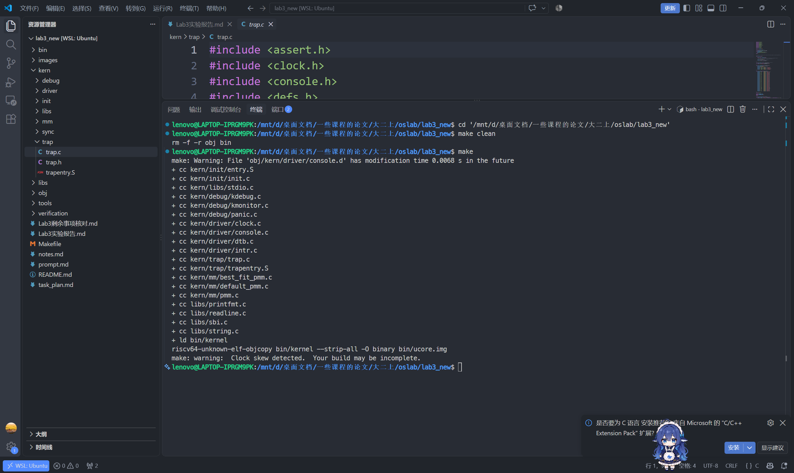

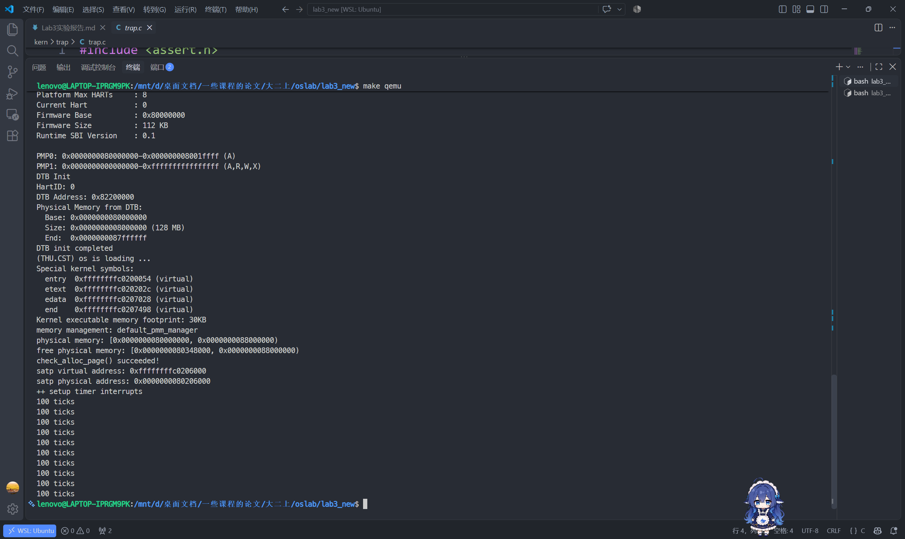

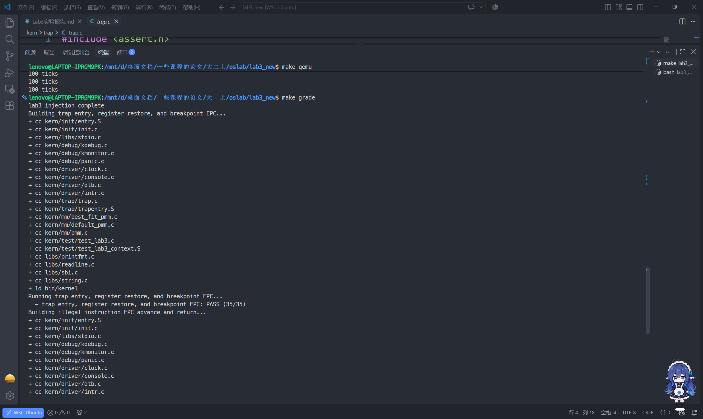

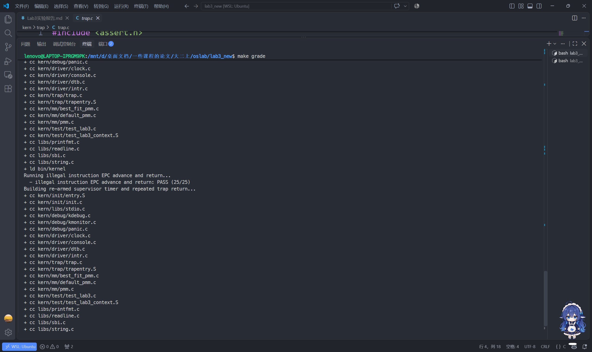

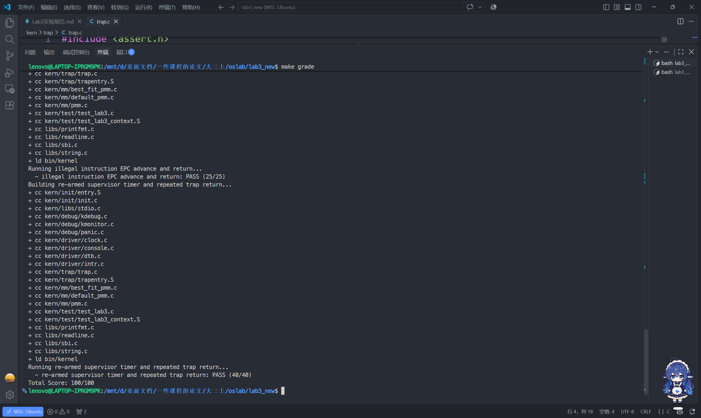

### 5.4 严宗贺的模块一自查记录

严宗贺在自己的新版工具链环境中进行模块一自查，其报告记录GCC 14.2.0、QEMU 10.2.1和OpenSBI v1.8。下列原图分别展示启动、持续计数和 `make grade-local` 的100/100。本地适配评分用于其个人自查；小组最终成绩以5.3节课程环境的 `make grade` 为准。其新环境启动适配没有作为额外改动合入本次提交版。

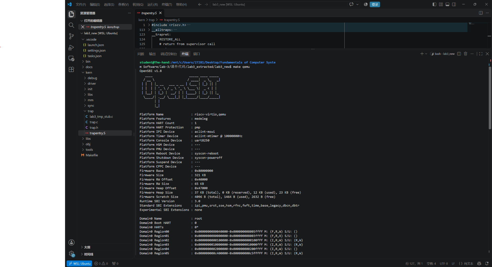

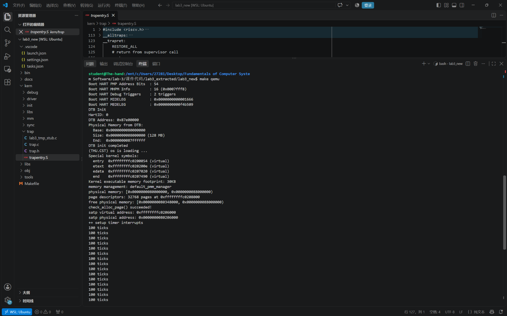

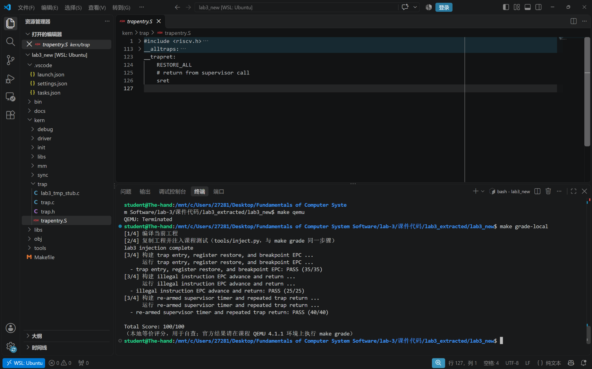

### 5.5 李文浩的异常处理与集成验证

李文浩在自己的合并工程中，于第二次 `idt_init()` 后、`clock_init()` 前临时触发4字节非法指令、4字节 `ebreak` 和2字节 `c.ebreak`，三项均执行到异常之后的 `returned` 日志。测试插桩用于个人验证，没有保留在最终日常启动流程中。以下记录来自其原始报告和截图：

```text
[Exception test] illegal instruction: begin
Illegal instruction at 0xffffffffc02000a0
[Exception test] illegal instruction: returned
[Exception test] ebreak: begin
Breakpoint at 0xffffffffc02000bc
[Exception test] ebreak: returned
[Exception test] c.ebreak: begin
Breakpoint at 0xffffffffc02000d8
[Exception test] c.ebreak: returned
```

其工程的 `make grade` 三项得分为35/35、25/25、40/40，合计100/100；小组最终合并版本另在5.3节重新验证。

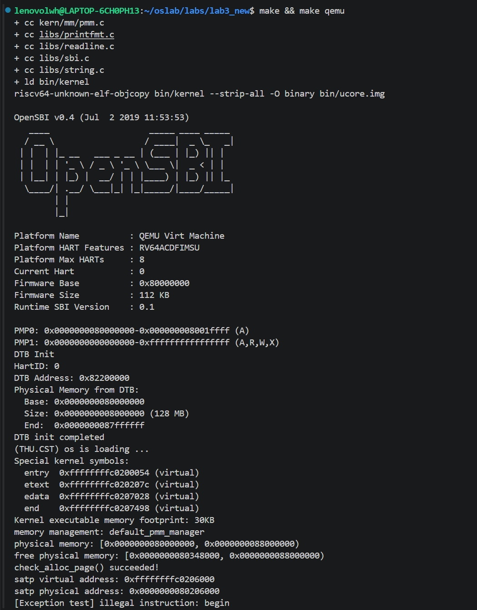

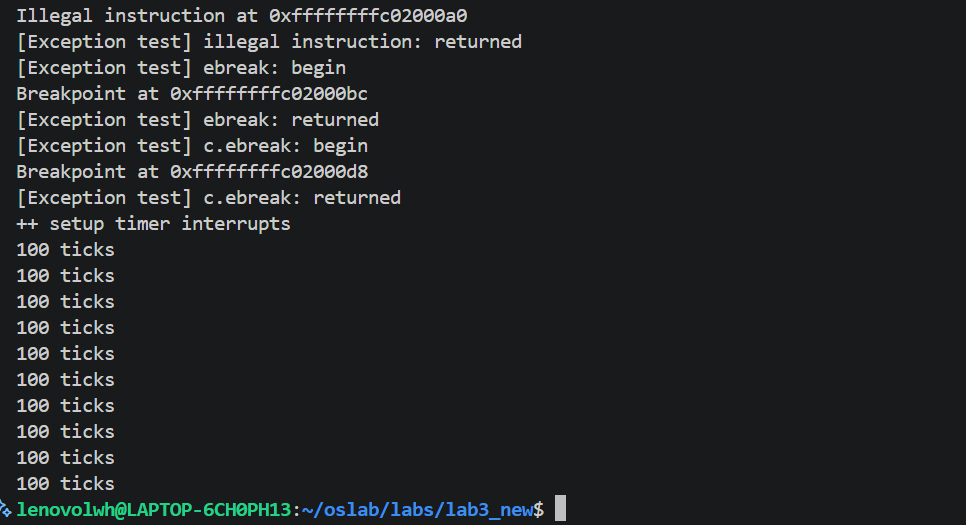

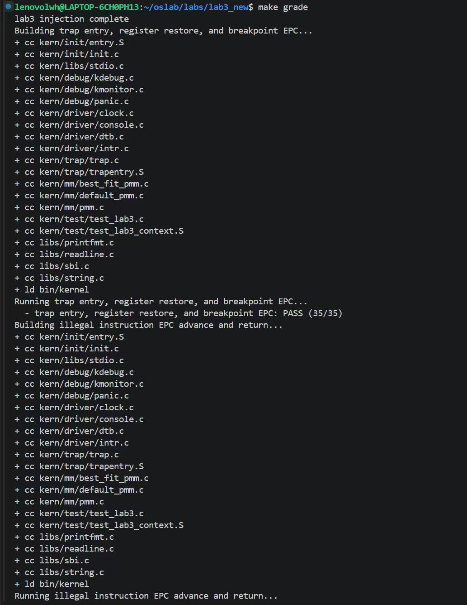

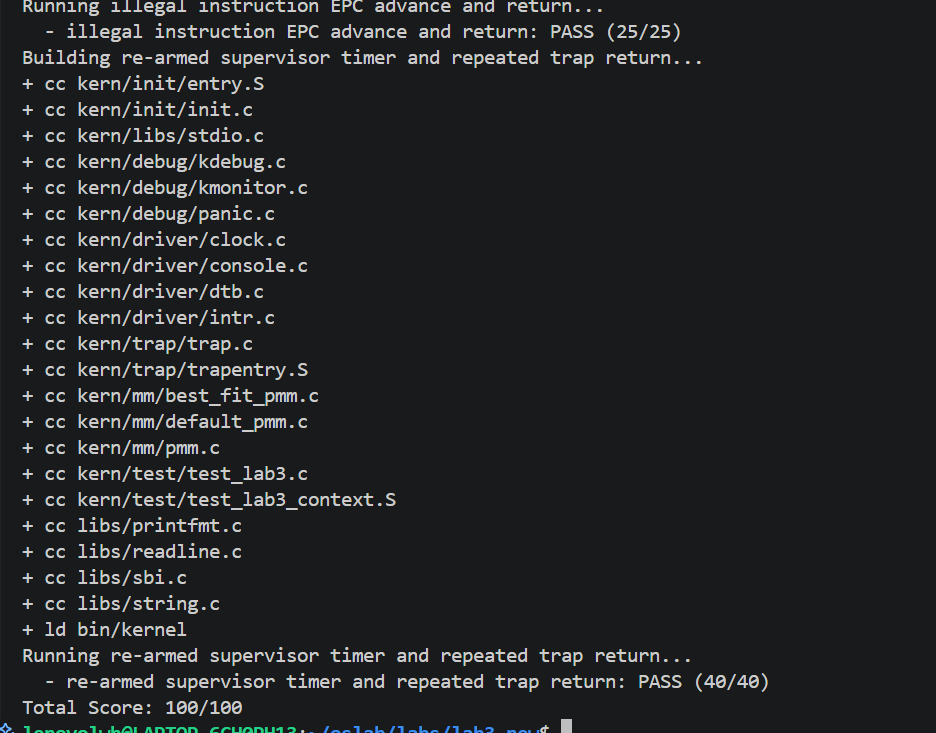

### 5.6 田城昊合并前的中断模块验证

中断函数先进行了主机侧独立边界测试，再在含辅助依赖的副本中整机验证。独立测试覆盖第1、99、100、101、200、999、1000次时钟事件，其他已定义中断、未知编号15及Trap frame保持不变。硬件接口使用适配器，因此这项测试只验证函数行为；随后实际QEMU运行检查了持续事件与关机。

早期辅助副本评分曾因时钟测试打印 `ticks=201` 而未匹配脚本固定要求的 `ticks=200`，得到60/100；未修改业务函数和评分脚本的复跑得到100/100。这是合并前的排错记录，最终正式版本的本轮评分为100/100。

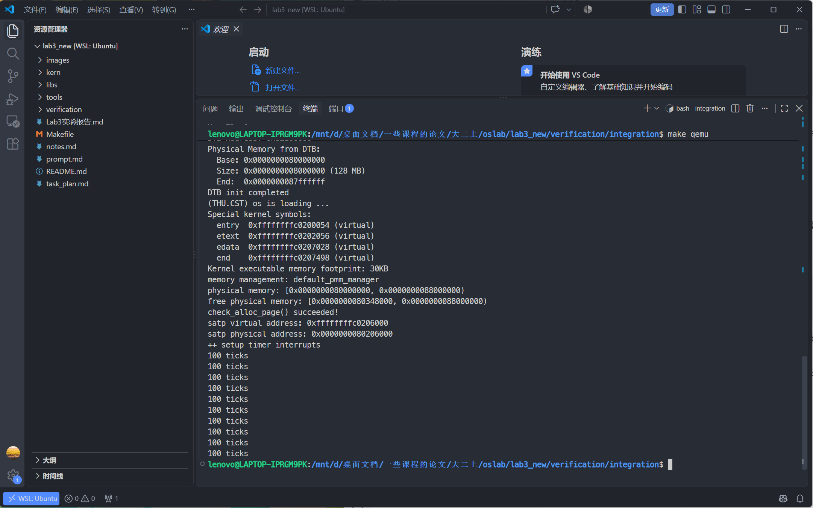

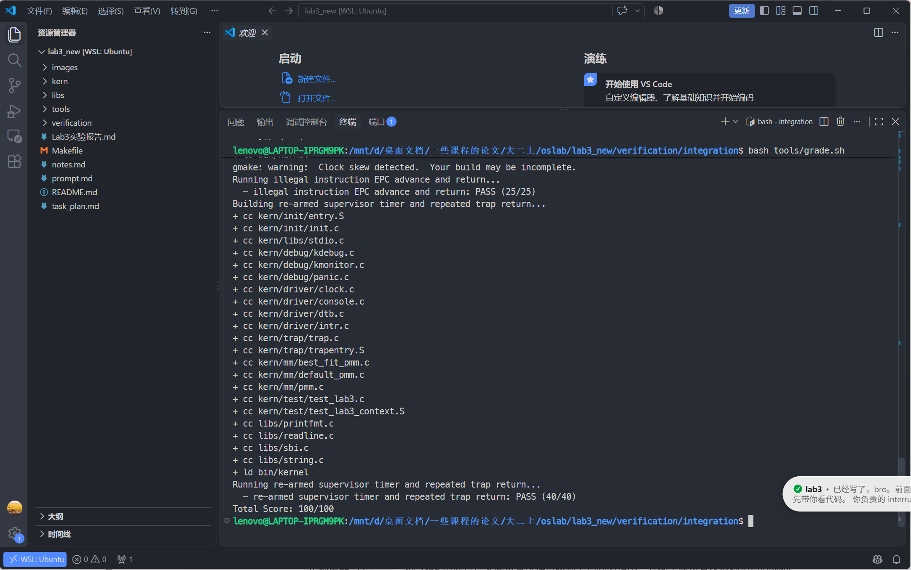

---

## 六、实验总结与收获

### 对操作系统的理解

| 本实验知识点 | 对应OS原理及本实验的具体体现 |
| --- | --- |
| Trap现场保存与恢复 | 对应中断处理中的执行环境保护。本实验用288字节的Trap frame保存现场；恢复时需要同时遵守字段布局、临时寄存器和栈指针依赖。 |
| 中断与异常分发 | 中断是异步事件，异常由当前指令同步触发。本实验用cause最高位分流，再按编号进入处理分支。 |
| 异常返回地址 | 对本实验需要跳过的指令，软件修改tf->epc，汇编恢复sepc。并非所有异常都应跳过，当前实现只处理题目指定的断点和非法指令。 |
| 时钟节拍 | ticks记录事件次数。周期性行为由软件重复预约下一次事件形成，为以后调度计时提供基础，本实验尚未实现调度器。 |
| 临界区与中断屏蔽 | Lab3已有的内存分配/释放包装保存中断状态、临时关闭中断并恢复，避免同一hart上中断处理打断关键修改；这不等价于完整的多核互斥。 |

尚未覆盖的原理内容包括：真实用户进程的用户栈与内核栈切换、系统调用服务、缺页异常恢复、抢占式调度、多核同步和外部设备中断控制。其他中断分支只输出提示，不能据此认为相应设备驱动已实现；当前Trap frame也没有保存浮点或向量寄存器。

### AI 协作开发的经验

严宗贺在模块一中先核对字段偏移，再借助模拟推演和现场打印排查问题。断点测试说明，寄存器比较失败也可能由返回地址落在指令中间引起，需要结合反汇编判断，不能只凭失败名称定位。

田城昊在提示词中明确了接口、输出周期、关机阈值和禁止改动的现场字段。测试结果需要与串口记录一起分析：早期评分的ticks精确匹配问题应保留真实记录，而不是为了得分改变正常计数逻辑。

李文浩给出Trap frame字段、输出要求及三种具体测试指令，使异常实现的验证目标明确。联调先根据编译报错补齐缺失模块，再用异常前后的日志分别确认进入处理函数和成功返回。

合并时保留各自模块边界，最后用同一份正式源码重新构建、运行和评分。个人自查结果、辅助依赖副本与正式提交版本的证据分别记录，避免把不同工程的结果混用。
