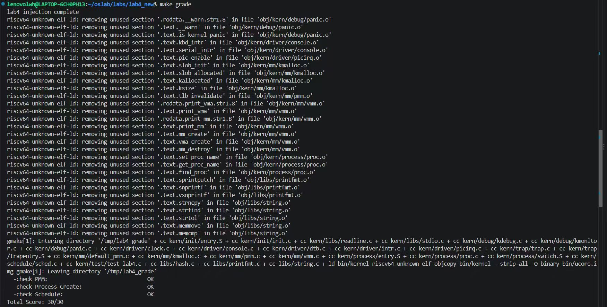
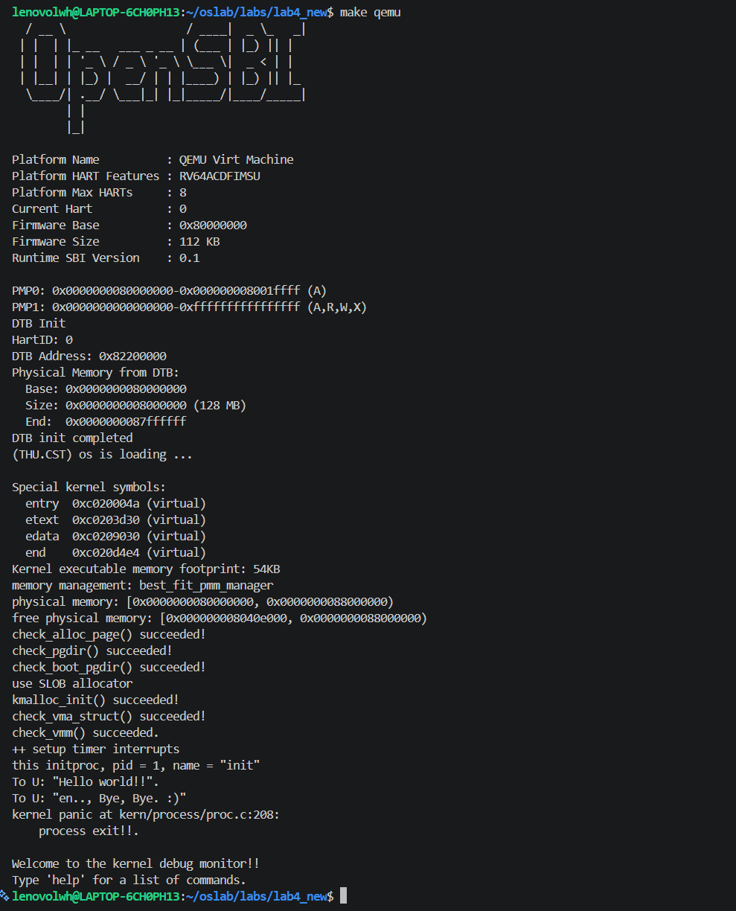

# Lab 4 进程管理实验报告

## 实验基本信息

| 项目 | 内容 |
|------|------|
| **实验名称** | Lab 4 进程管理 |
| **小组成员** | 2511203 严宗贺、2510582 田城昊、2514231 李文浩 |
| **完成日期** | 2026-11-21 |

### 小组分工

| 成员 | 负责的练习/模块 |
|------|----------------|
| 2511203 严宗贺 | 模块一，虚拟内存页操作及 Lab 2、Lab 3 依赖移植 |
| 2510582 田城昊 | 模块二，进程创建与初始化 |
| 2514231 李文浩 | 模块三，进程调度和上下文切换，负责小组联调 |

本报告汇总三个模块的实现、提示词设计、扩展练习与小组联调结果。合并后，课程评分三项均通过，总分为 30/30；普通启动中，`initproc` 成功执行并打印线程信息。

---

## 一、实验目的

1. 理解 Sv39 多级页表，完成虚拟页映射的建立、替换与撤销，维护物理页引用计数和 TLB 一致性。
2. 理解进程控制块、内核栈、`context` 和 `trapframe` 的作用，实现 `idleproc` 与 `initproc` 的创建。
3. 完成可运行线程的选择、页表切换和寄存器上下文切换，使新线程第一次获得 CPU 并执行入口函数。
4. 通过接口约定、spec 和 prompt 约束 AI 生成代码，使用课程用例及实际启动输出检查三人实现的衔接。

## 二、实验环境

小组最终在 Windows 的 WSL Ubuntu 中使用 VS Code 编辑，在 Linux 终端中通过 `riscv64-unknown-elf-` 工具链和 QEMU 编译、运行。模块二记录使用 RISC-V GCC 10.2.0、QEMU 4.1.1 和 OpenSBI v0.4；模块一曾在 GCC 14.2.0 下单独验证。

| 成员 | AI 编程工具 | 底层模型 | 备注 |
|------|------------|---------|------|
| 2511203 严宗贺 | Codex 桌面应用 | GPT-6.2 Sol |  |
| 2510582 田城昊 | Codex 桌面应用 | GPT-6.2 Sol |  |
| 2514231 李文浩 | Codex 桌面应用 | GPT-6.2 Sol |  |

最终测试目录为 `~/oslab/labs/lab4_new`。在工程根目录运行 `make -j2`、`make grade` 和 `make qemu`。

## 三、实验整体逻辑分析

### 3.1 本章节的逻辑主线

本实验按“准备内存映射—创建并登记线程—调度并切换执行”的顺序展开。只有物理页、页表和内存分配接口可用，才能分配 PCB 和线程内核栈；只有线程状态、链表和初始现场准备好，调度器才能把 CPU 安全交给新线程。

```text
kern_init
  → pmm_init：物理页、页表、kmalloc
  → 中断入口及虚拟内存管理初始化
  → proc_init：登记 idleproc，创建 initproc
  → cpu_idle → schedule → proc_run → switch_to
  → forkret → forkrets → __trapret
  → kernel_thread_entry → init_main
```

### 3.2 三个模块的接口关系

| 模块 | 提供的能力 | 下一模块依赖的条件 |
|------|------------|--------------------|
| 虚拟内存页操作 | 分配物理页，维护映射和页表 | PCB、内核栈和线程代码可以被正确访问 |
| 进程创建与初始化 | 初始化 PCB，设置内核栈、PID、链表和首次执行现场 | `initproc` 为 `PROC_RUNNABLE`，`context` 与 `trapframe` 布局正确 |
| 调度与上下文切换 | 选择线程，切换 `current`、页表及寄存器 | 新线程沿预先设置的返回链到达线程函数 |

内核线程共用启动页表，`proc->pgdir` 保存根页表的物理地址 `boot_pgdir_pa`。页表操作函数接收的 `pgdir` 参数则是页表根的内核虚拟地址，两者用途不同。

## 四、实验内容与实现

### 功能模块一：虚拟内存页操作

**负责人：2511203 严宗贺**

#### 接口和状态变化

```c
int page_insert(pde_t *pgdir, struct Page *page, uintptr_t la, uint32_t perm);
void page_remove(pde_t *pgdir, uintptr_t la);
```

`pgdir` 是页表根的内核虚拟地址。`get_pte()` 按 `PDX1(la)`、`PDX0(la)` 和 `PTX(la)` 定位叶槽，`pte_create()` 则按物理页号和权限构造带 `PTE_V` 的叶项。`PTE_U` 控制用户态访问，`PTE_R/W/X` 描述读、写、执行权限。在本模块中，零访问权限按只读叶处理，可写叶带上读权限，执行专用叶保持其原有权限。

| 场景 | 页表项与引用计数 |
| --- | --- |
| 建立映射 | 新的物理页增加一次引用，叶槽保存它的页号和权限。 |
| 重映射同一物理页 | 写入新权限时先持有新引用，再释放旧引用，净引用数保持原值，物理页也一直保留。 |
| 替换为另一页 | 先记住旧叶项，持有新页引用并更新叶项，失效旧翻译后再减少旧页引用，计数归零时归还物理页。 |
| 删除映射 | 只查找已有页表。有效叶项被清零并失效旧翻译，再减少对应页的引用。空槽或缺失的页表分支直接返回，因此重复删除无副作用。 |
| 页表分配失败 | `page_insert()` 返回 `-E_NO_MEM`。如果同时需要两级页表且第二次分配失败，释放尚未挂接的第一级新页表。失败路径不消耗数据页引用，也不挂接半成品分支。 |

新挂接非叶页表项后，用 `sfence.vma` 同步当前 hart 的地址翻译。叶项写入或清零后，按该虚拟地址同步翻译，再释放旧页引用。`release_mapping()` 将减引用和归还物理页保持在同一处。非叶项使用 `ptd_create()` 并清除保留的 `U/A/D` 位，启动自检也检查根目录项的 `U` 位为零。叶项仍按调用者请求设置 `PTE_U`。[RISC-V 特权规范 Supervisor-Level ISA](https://docs.riscv.org/reference/isa/v20240411/priv/supervisor.html)

#### 最终提示词

```text
[PROMPT]
在课程的 Lab 4 起始工程中补齐模块一。修改 kern/mm/pmm.c 中虚拟内存页操作及其直接依赖。核对 Lab 2／3 标记块，使用小组上轮的已验证源码作为移植依据。完成实际文件修改，保留课程标记并把模块一的 YOUR CODE 替换为 2511203。保持进程创建、调度和评分文件的课程接口。

[RELY]
系统使用 RV64 Sv39。PDX1、PDX0、PTX 定位三级页表，PGSIZE 是 4096。
get_pte(pde_t *pgdir, uintptr_t la, bool create) 返回叶槽的内核虚拟地址，create 决定是否允许分配下级页表。
struct Page 的 ref 由 page_ref_inc、page_ref_dec 管理。使用 page2ppn、pte2page、pte_create、free_page、tlb_invalidate 操作现有页表及物理页。
依赖来源为小组 Lab 2／3 源码中的物理页初始化、页分配器、中断与异常处理和 Trap 汇编。Trap 布局由 Lab 4 trap.h 约定，首次进入新线程由 Lab 4 的 forkrets 接到 __trapret。

[GUARANTEE]
int page_insert(pde_t *pgdir, struct Page *page, uintptr_t la, uint32_t perm);
void page_remove(pde_t *pgdir, uintptr_t la);
同时补齐课程标记处的 Lab 2／3 依赖，保持现有头文件和调用 ABI。

[SPECIFICATION]
输入为有效页表根及受物理页管理器管理的物理页。映射以 4 KiB 叶页为单位。
插入成功返回 0，目标虚拟页指向指定物理页，叶权限随 perm 更新并采用合法的 Sv39 叶编码。同页换权限保证最终引用数和空闲页数保持原值，换页保证旧页少一个引用而新页多一个引用。
分配失败返回 -E_NO_MEM，原映射和数据页引用保持原状态，临时分配且尚未挂接的页表应归还。
删除已有映射时清空叶槽并撤销一条引用，最后一次引用消失时归还物理页。删除缺失映射及重复删除均无副作用。
新挂接非叶项以后同步当前 hart 上的地址翻译，非叶项的 U/A/D 位保持为零。写入或清除叶项后针对对应虚拟地址同步，再释放旧页引用。
验证时查看 check_alloc_page、check_pgdir、check_boot_pgdir 和评分中的 Test PMM。结果只记录实际运行输出。
```

#### 实现过程与 Lab 2／3 衔接

对照课程自测和评分用例，把“同页重映射”和“第二级页表分配失败”写成独立条件。前者要求空闲页数保持不变，后者要求下级页表尚未接入根页表时即可回收。复核权限编码后，将 `perm = 0`、可写和执行专用三类情形分别落实在 `page_insert()`。

Lab 2 的 `page_init()` 从设备树获取物理内存，按内核直接映射范围裁剪上界，为 `struct Page` 数组及内核镜像保留空间，并把剩余的完整物理页交给 `init_memmap()`。Lab 4 在 `default_pmm.c` 的统一框架里使用 Best Fit，分配时选取满足大小的最小空闲块，回收时合并相邻块。既有的 `basic_check()` 与 `best_fit_check()` 检查分割、合并和空闲页统计。[物理页初始化](../code/kern/mm/pmm.c) · [页分配器](../code/kern/mm/default_pmm.c)

Lab 3 的 `__alltraps` 把当前栈上的 `trapframe` 地址放入 `a0` 传给 `trap()`。`RESTORE_ALL` 在 `sp` 仍指向中断帧时恢复 CSR 和通用寄存器，最后恢复 `sp`，再由 `sret` 回到 `sepc`。保存和恢复 `stval` 使用同一 CSR 编号 `0x143`，兼容工具链对新旧名称的差异。Lab 4 的 `forkrets` 构造同样的栈入口，让常规 Trap 返回和新线程首次进入共用恢复路径。[Trap 入口及返回](../code/kern/trap/trapentry.S)

`trap.c` 补齐 Lab 3 的中断与异常处理函数。时钟中断设置下一次事件并计数，断点与非法指令沿用 Lab 3 的现场处理约定。课程的 `trap()` 入口仍按 `scause` 的最高位分发。[Trap 分发](../code/kern/trap/trap.c)

#### 编译与启动排错记录

1. GCC 14 编译 `kmalloc.c` 时报告 `-Wint-conversion`。SLOB 页回收函数把 `unsigned long` 类型的内核虚拟地址交给要求指针的 `kva2page()`，在调用处按接口转换成 `void *` 后完成编译。[SLOB 页回收](../code/kern/mm/kmalloc.c)
2. 初次用 QEMU 10.2.1 的 `-kernel` 排查启动时，只显示 OpenSBI，15 秒后超时。启用 Sv39 后，CPU 短暂在原低地址继续取指。启动页表为该过渡保留临时恒等映射，跳转至高地址后撤销低地址别名并刷新 TLB。之后在课程要求的 QEMU 4.1.1 上使用 `make qemu`，也顺利启动并执行到 PMM 测试。[启动汇编](../code/kern/init/entry.S) · [QEMU 运行目标](../code/Makefile)
3. GCC 14 检查课程测试时，报告调度测试的回调返回类型与 `kernel_thread()` 的函数参数不匹配。回调会一直参与调度，因此将其声明为返回 `int` 且带 `noreturn` 属性，保持测试流程及断言。[课程测试](../code/tools/test_lab4.c)

### 功能模块二：进程创建及初始化

**负责人：2510582 田城昊**

#### 模块功能描述

```c
static struct proc_struct *alloc_proc(void);
static int copy_mm(uint32_t clone_flags, struct proc_struct *proc);
static void copy_thread(struct proc_struct *proc, uintptr_t stack,
                        struct trapframe *tf);
int do_fork(uint32_t clone_flags, uintptr_t stack, struct trapframe *tf);
int kernel_thread(int (*fn)(void *), void *arg, uint32_t clone_flags);
void proc_init(void);
```

`alloc_proc()` 分配并清零 PCB，设置初始状态 `PROC_UNINIT` 和尚未分配的 PID `-1`。`pgdir` 记录启动页表的物理地址，两个链表节点先初始化为独立节点。本次创建的是内核线程，`copy_mm()` 会检查父、子线程的 `mm` 都为空，继续共用启动页表。

`proc_init()` 先初始化进程链表和 PID 哈希桶。此时 CPU 已经在启动栈上运行，因此 `idleproc` 直接使用 `bootstack`，PID 为 0，设为 `current` 并置上重调度标志。接着调用 `kernel_thread(init_main, "Hello world!!", 0)` 创建 PID 为 1 的 `initproc`。

`do_fork()` 先分配 PCB 和内核栈，再准备地址空间和寄存器现场。都准备好之后，才在关本地中断的区间里分配 PID、挂入哈希表和进程链表、增加进程计数并调用 `wakeup_proc()`。栈分配失败时回收 PCB。地址空间准备接口如果返回错误，先回收栈，再回收 PCB。

`kernel_thread()` 把入口函数和参数分别放到临时 `trapframe` 的 `s0`、`s1`，将 `epc` 指向 `kernel_thread_entry`。它设置 `SPP` 和 `SPIE`，使 `sret` 返回到 S 态并恢复中断使能。随后 `copy_thread()` 把这份现场复制到新线程内核栈的高地址端。

| 字段 | 第一次切换时的用途 |
|------|------------------|
| `context.ra` | 指向 `forkret`，供 `switch_to()` 恢复后返回 |
| `context.sp` | 指向新内核栈上的 `trapframe` |
| `tf->gpr.a0` | 子线程的 fork 返回值，初始化为 0 |
| `tf->epc` | `sret` 的目标地址，即 `kernel_thread_entry` |

`forkret` 把 `current->tf` 交给 `forkrets`。后者设置栈指针，再跳到 `__trapret` 恢复寄存器。`sret` 到达 `kernel_thread_entry` 后，入口汇编把 `s1` 放到 `a0`，再调用 `s0` 里的线程函数。这里沿用了 Lab 3 的 Trap 恢复代码。

#### 最终提示词

```text
[PROMPT]
在 lab4_new/kern/process/proc.c 中完成 2510582 负责的进程创建与初始化。
保留已有的 alloc_proc()，接着实现 copy_mm()、copy_thread()、
do_fork()、kernel_thread() 和 proc_init()。

[RELY]
proc.h 给出 PCB 和 context 的字段；trap.h 和 trapentry.S 约定 trapframe
的布局。forkrets 把 sp 指向 trapframe 后走 __trapret。process/entry.S
用 s0 里的函数地址和 s1 里的参数调用线程函数，再进入 do_exit()。
复用 get_pid()、hash_proc()、setup_kstack()、put_kstack() 和 wakeup_proc()。
当前阶段只有内核线程，它们共用启动页表，mm 保持 NULL。

[GUARANTEE]
保持 proc.h 中的接口，以及 proc.c 内部辅助函数的作用域。
保留 LAB4 function2 标记并填入学号 2510582。
调度、页表切换和寄存器切换由模块三实现。

[SPECIFICATION]
alloc_proc() 分配 PCB，初始 PID 为 -1，状态为 PROC_UNINIT。
proc_init() 初始化进程链表及 PID 哈希桶，把 bootstack 交给 PID 0 的
idleproc，设为 current 并请求调度，再创建 PID 1 的 initproc。
kernel_thread() 将函数和参数写入 s0、s1，将 epc 指向 kernel_thread_entry，
设置 SPP、SPIE 并清除 SIE。copy_thread() 把现场复制到新内核栈，
将子线程的 a0 置零，把 context.ra、context.sp 分别设为 forkret 和现场地址。
do_fork() 先分配 PCB 和内核栈，再准备地址空间与现场。关中断期间分配 PID、
登记并唤醒线程。失败按逆序释放已分配资源，返回负错误码。
先用课程 PMM 和 Process Create 用例验证。完整调度测试等待模块三合入，
报告中只写实际观察到的输出。
```

#### 实现迭代过程

##### 第一次迭代

先单独写 `alloc_proc()`。这一阶段只需要骨架里的 `kmalloc()`、`boot_pgdir_pa` 和链表接口。完成后，用 RISC-V 交叉编译器检查了 `proc.c` 的语法。

##### 第二次迭代

接入模块一的交接代码后，再补齐创建流程。先对照 `trapentry.S` 和 `process/entry.S` 核对栈指针、返回入口、函数地址和参数放在哪个寄存器，再把这些条件写进提示词。调用 `set_proc_name()` 时还发现原函数固定读 15 个字节，短名字可能被越界读取，因此改成先计算限长长度再复制。

第一次用 `riscv64-linux-gnu-gcc` 编译临时测试内核成功，QEMU 运行超过 20 秒。后来在装有课程 QEMU 的 WSL Ubuntu 中找到 GCC 10.2.0，重新编译运行，两个用例均通过。

### 功能模块三：进程调度与上下文切换

**负责人：2514231 李文浩**

#### 模块功能描述

```c
void cpu_idle(void);
void schedule(void);
void proc_run(struct proc_struct *proc);
void switch_to(struct context *from, struct context *to);
```

`cpu_idle()` 是空闲线程的循环。`proc_init()` 已经把 `idleproc->need_resched` 设为 1，因此循环第一次检查时就会调用 `schedule()`。本实验的常规启动路径由这里主动调度；评分用例还会在测试线程中显式调用 `schedule()`，检查多个线程之间的切换。

`schedule()` 在保存中断状态并关闭本地中断后，清除当前线程的 `need_resched`。当前线程是 `idleproc` 时，从 `proc_list` 的表头之后开始查找；否则，从当前节点的下一个位置开始查找，跳过链表头，选择第一个 `PROC_RUNNABLE` 的线程。遍历一圈仍无可运行线程时选择 `idleproc`。如果只有当前线程可运行，查找也能回到当前节点并选中自身。选中后增加 `runs`，再调用 `proc_run()`。这种实现按链表顺序循环选择可运行线程，没有引入优先级或时间片抢占策略。

`proc_run()` 在目标与当前线程不同时执行真正切换。先用 `prev` 保存旧线程指针，再更新 `current`，根据新线程 `pgdir` 中的物理地址写入 Sv39 的 `satp`，执行 `flush_tlb()`，最后调用 `switch_to(&prev->context, &proc->context)`。使用的页表寄存器编码为：

```c
write_csr(satp,
          ((uintptr_t)SATP_MODE_SV39 << 60)
          | (proc->pgdir >> RISCV_PGSHIFT));
```

`SATP_MODE_SV39` 为 8，放入 RV64 `satp` 的最高四位。页表物理地址右移 12 位，得到根页表物理页号。本实验没有使用 `libs/riscv.h` 中面向 Sv32 的旧 `lsatp()` 接口，避免页表地址截断和模式错误。所有内核线程目前共享同一根页表，代码仍按线程字段完成切换，为后续独立地址空间保留接口。

`switch_to()` 位于 `kern/process/switch.S`。参数 `a0`、`a1` 分别指向旧、新线程的 `context`，不是整个 PCB。汇编把旧线程的 `ra`、`sp` 和 `s0～s11` 存入 `a0` 指向的结构，再从 `a1` 指向的结构恢复对应寄存器，最后执行 `ret`。RV64 下每个字段占 8 字节，偏移依次为 0、8、16，直到 104，与 `proc.h` 的字段顺序一致。

#### 为什么只保存 14 个寄存器

这里的切换发生在函数调用边界。编译器会按调用约定保护调用后仍需要的 caller-saved 值，例如存入栈或放入 callee-saved 寄存器，因此切换汇编保存 `s0～s11`，并保存恢复调用栈和执行位置所需的 `sp`、`ra`。这不等于编译器无条件把全部 caller-saved 寄存器压栈。中断和异常可以发生在任意指令处，所以 Trap 汇编还需要保存完整的通用寄存器现场。

#### 新线程第一次如何运行

模块二已把 `context.ra` 设为 `forkret`，`context.sp` 设为中断帧地址，因此首次恢复 `context` 后，`ret` 进入 `forkret()`。它把 `current->tf` 交给 `forkrets`，后者让 `sp` 指向这份中断帧，再跳到 `__trapret`。恢复 CSR 和通用寄存器后，`sret` 到达中断帧中预设的 `kernel_thread_entry`。

在线程入口中，`s1` 的参数被移动到 `a0`，再用 `jalr s0` 调用线程函数。这次调用的是 `init_main("Hello world!!")`。函数返回后进入 `do_exit()`。因此 `context.ra`、中断帧的 `epc`、中断帧的 `s0` 分别指向恢复入口、线程包装入口、实际线程函数，不能混为一个地址。

#### Spec 与提示词设计

设计时先规定四个函数各自的职责，再约束地址单位、寄存器布局和失败边界。重点是保持模块二生成的首次现场不变、禁止使用 Sv32 的页表切换接口，并要求调度器正确处理空链表、阻塞线程和当前线程自身。下面是根据本次对话需求和最终实现整理的可复现提示词。

```text
[PROMPT]
完成 Lab 4 模块三，学号 2514231。实现 proc.c 中的 cpu_idle、proc_run，
sched.c 中的 schedule，以及 process/switch.S 中的 switch_to。
保留其他两位同学的页表和进程创建代码，保持 LAB4 function3 标记。

[RELY]
proc.h 的 context 按顺序包含 ra、sp、s0～s11，RV64 下每项 8 字节。
idleproc 不在普通进程链表内；current 指向当前线程。
模块二将 pgdir 初始化为 boot_pgdir_pa，将新线程 context.ra 设为 forkret，
context.sp 设为线程的 trapframe。复用现有中断保护、链表和 TLB 接口。

[GUARANTEE]
保持四个函数的现有接口。proc_run 接收 PCB 指针，switch_to 接收两份
context 的指针。页表切换使用物理页号和 Sv39 模式，不使用 Sv32 的 lsatp。

[SPECIFICATION]
cpu_idle 持续检查 need_resched，非零时调用 schedule。
schedule 关本地中断后清除调度请求，从当前节点之后循环查找 RUNNABLE
线程，跳过表头；idleproc 从表头开始查找。无可运行线程时回退 idleproc。
正确处理只有当前线程可运行的情况，更新 runs 后调用 proc_run。
proc_run 在目标不同于当前线程时保存 prev，更新 current，写 satp 并刷新
TLB，再切换 context；关键区使用 local_intr_save/restore 保护。
switch_to 按结构体偏移用 sd/ld 保存恢复 14 个寄存器，以 ret 继续执行。
验证完整编译、课程 PMM/Process Create/Schedule 用例，以及 initproc 输出。
```

#### 实现与联调过程

先对照模块二核对 `pgdir` 的物理地址含义，以及 `context.ra/sp` 的初始化。再完成空闲循环、链表遍历和页表切换，最后按照 `context` 的字段顺序填写汇编偏移。合并后出现的问题主要来自运行环境和同名文件混用，具体修复见测试章节。修复后课程评分为 30/30，普通启动到达 `init_main`。

### 扩展练习

#### 保存和恢复中断状态的实现

**负责人：2514231 李文浩**

`local_intr_save(intr_flag)` 调用 `__intr_save()`，先读取 `sstatus` 的 `SIE` 位。如果中断原本开启，就调用 `intr_disable()` 关闭并返回 1；如果原本关闭，则返回 0。返回值保存在调用者的 `intr_flag` 中。

`local_intr_restore(intr_flag)` 调用 `__intr_restore()`。只有记录值为 1 时才重新开启中断，记录为 0 时保持关闭。因此它恢复的是进入临界区前的状态，而不是无条件开中断。

本实验的 `schedule()` 与 `proc_run()` 可以嵌套使用这套接口。外层先关闭中断，内层看到中断已关闭就记录 0，返回时不会提前开启；外层之后按自己的记录恢复。发生线程切换后，旧线程的局部标记随内核栈保留，在它以后恢复执行时继续完成返回过程。新线程首次启动则通过预先设置的 `trapframe.status` 恢复应有状态。

关闭本地中断是为了避免切换过程中 `current`、页表和寄存器现场被中断处理打断而不一致。它只约束当前 hart，不等于多核环境下的全局锁。

#### 不同分页模式与重复的查表逻辑

**负责人：2511203 严宗贺**

| 分页模式 | 页表层数 | 虚拟页号拆分 | 每级表项数 | 页内偏移 |
| --- | --- | --- | --- | --- |
| Sv32 | 2 | 10 + 10 位 | 1024 | 12 位 |
| Sv39 | 3 | 9 + 9 + 9 位 | 512 | 12 位 |
| Sv48 | 4 | 9 + 9 + 9 + 9 位 | 512 | 12 位 |

三级 Sv39 页表里，`PDX1` 和 `PDX0` 对应两次下降。每次用当前级的 VPN 字段索引槽位，有效的目录项给出下级页表的物理页号，经过 `PDE_ADDR()` 加 `KADDR()` 得到软件可访问的地址。槽位缺失时，`create = 0` 返回 `NULL`，`create = 1` 才允许分配并清零一页。最后一级用 `PTX` 找到叶槽。两段的共同点来自目录层级的相同布局，区别是索引使用的 VPN 位段和所处深度。对于 4 KiB 页，Sv32 需要一次下降，Sv48 需要三次下降。硬件还允许更高层的叶项表达大页，模块一讨论的是本实验的 4 KiB 页操作路径。[RISC-V 特权规范 Sv32、Sv39、Sv48](https://docs.riscv.org/reference/isa/v20240411/priv/supervisor.html)

#### `get_pte()` 的查找和分配是否需要拆开

**负责人**　2510582 田城昊

这次实验可以保留同一个底层函数。无论查找还是建立映射，前面都要按虚拟地址逐级走页表。现在 `page_remove()` 传 `create = 0`，遇到缺失的目录就返回，删除操作不会为一个原本不存在的地址分配页表。建立映射时，`page_insert()` 传 `create = 1`，允许补齐目录。

如果后面调用点变多，我会给外部留两个名字清楚的接口，比如 `lookup_pte()` 和 `ensure_pte()`，内部仍共用遍历代码。这样从调用处能直接看出是否会分配。若还要区分“没有映射”和“内存不足”，可以让带分配的接口返回明确错误码。分配有副作用，两级都缺失时要保留现有的回收逻辑。第二次分配失败，先归还尚未挂到根页表的那一页。

## 五、测试与验证

### 5.1 各模块单独验证

模块一交接记录表明，在 QEMU 4.1.1 上通过了物理页、页表及 VMM 自检，并输出 `[Test PMM] PASS`。其中还对同页重映射、重复删除和页表分配失败回滚进行了检查。分配回滚检查通过将可用物理页限制为一页，触发第二级分配失败，核对错误码、根目录项、引用计数及空闲页数是否恢复。

模块二在临时副本中先调用 `test_lab4_pmm_basic()`，再执行 `proc_init()` 和 `test_lab4_process_create()`。其报告记录两个用例通过。创建测试检查 `current == idleproc`、PID、父子关系、内核栈，以及 `initproc` 的初始 `context`。

### 5.2 小组合并中的问题与修复

| 实际问题 | 原因与修复 |
|----------|------------|
| PowerShell 提示找不到 `make` | 在 Windows 终端执行了 Linux 构建命令。进入已配置工具链的 WSL Ubuntu 后编译。 |
| `No targets specified and no makefile found` | 位于汇总文件夹外层。进入同时包含 `Makefile`、`kern`、`libs`、`tools` 的工程根目录。 |
| 缺少 `best_fit_pmm.h`，Trap 处理函数出现隐式声明警告 | 构建目录混入旧版本文件。恢复模块一交接文件，其中 `default_pmm.c` 使用 `default_pmm.h`，`trap.c` 包含中断和异常处理实现。 |
| 短名称的潜在越界读取 | 模块二把 `set_proc_name()` 的固定长度复制改为 `strnlen(name, PROC_NAME_LEN)`，目标数组先清零以保留字符串结束符。 |
| `boot_hartid`、`boot_dtb`、`bootstack` 等重复定义，同时缺少 `kernel_thread_entry` | 两个不同目录中的 `entry.S` 被混用。保留 `kern/init/entry.S` 的启动代码，把 `kern/process/entry.S` 恢复为 `kernel_thread_entry`，依次执行 `mv a0, s1`、`jalr s0`、`jal do_exit`。 |
| 链接输出大量 `removing unused section` | 这是链接器清理未引用段的信息。根据真正的错误和退出结果判断，不把这些提示当成编译失败。 |

模块一单独实现时还处理了 GCC 14 下地址整数到指针的显式转换，并修正启动页表切换时的过渡映射。课程调度测试回调的返回类型也与 `kernel_thread()` 要求对齐；保留了测试的断言和调度逻辑。

这些问题说明提示词约束正确并不能替代文件合并检查。同名文件必须按完整路径区分，三个模块也必须在同一套依赖版本上构建。

### 5.3 完整编译与课程评分

在 WSL 的 `~/oslab/labs/lab4_new` 中执行：

```bash
make clean
make -j2
make grade
```

编译完成后生成 `bin/kernel` 和 `bin/ucore.img`。课程评分在临时副本中注入测试，终端实际结果为：

```text
-check PMM:             OK
-check Process Create:  OK
-check Schedule:        OK
Total Score: 30/30
```

PMM 检查页映射与引用计数；Process Create 检查线程初始化；Schedule 用例创建两个测试线程，让它们反复主动调度，并检查两者确实运行。三项通过说明本次实现通过了课程提供的测试范围，不代表已经具备用户进程、抢占调度或完整退出回收能力。



*图 1：最终合并代码的课程评分结果。*

### 5.4 普通启动与线程执行

随后运行：

```bash
make qemu
```

启动输出显示 `best_fit_pmm_manager` 被使用，物理页、页表、kmalloc 和 VMM 自检依次通过。与线程执行直接相关的输出摘录如下：

```text
this initproc, pid = 1, name = "init"
To U: "Hello world!!".
To U: "en.., Bye, Bye. :)"
kernel panic at kern/process/proc.c:208:
    process exit!!.
```

前三行说明 `initproc` 不只是创建出 PCB，而是已经通过调度和现场恢复执行到了 `init_main()`，且参数传递正确。之后线程函数返回，入口汇编调用 `do_exit()`。本实验当前骨架的 `do_exit()` 直接执行 `panic("process exit!!.\n")`，因此出现这条停止信息；它是现有退出占位实现的行为，不是上下文切换失败。



*图 2：内核初始化、线程首次执行及线程函数返回后的实际输出。*

两张图来自小组联调。汇总到本机时保留了模块一的启动页表过渡映射与 QEMU 构建配置，并在 WSL Ubuntu 临时副本中用 RISC-V GCC 10.2.0 和 QEMU 4.1.1 复跑。三项课程评分仍为 30/30，普通启动也打印了 `initproc` 的 PID、名称和传入参数。

## 六、实验总结与收获

### 对操作系统的理解

模块一让我们认识到，映射建立不只是写入物理页号，还要同步维护权限、引用计数和 TLB。模块二把普通函数包装成可调度的内核线程，需要把 PCB、内核栈和两份现场一起准备好。模块三再把这些静态结构真正恢复到 CPU 上，才使线程获得执行机会。

`context` 与 `trapframe` 的分工是贯穿本次实验的重点。前者用于从函数调用边界恢复线程，后者用于恢复 Trap 现场。新线程虽然没有真正被中断过，仍能通过预先构造两份现场，从 `forkret` 一路进入 `kernel_thread_entry` 和实际线程函数。

### AI 协作开发的经验

三个模块先约定接口，再分别实现。写 spec 时要把具体条件列清楚，例如 `pgdir` 是物理地址还是虚拟地址、`context` 各字段的偏移、同页重映射的引用计数，以及页表分配失败如何回滚。prompt 在此基础上限定允许修改的文件和职责，避免跨模块重复实现。

最后的验证必须分层：编译成功只能说明代码能够生成内核；创建测试通过说明 PCB 和首次现场建立；普通启动的三行输出证明线程真正执行；调度评分则进一步检查多个测试线程的切换。本次合并中的同名文件覆盖问题，也说明需要核对完整路径和最终工程，而不能只检查各自的单文件代码。
